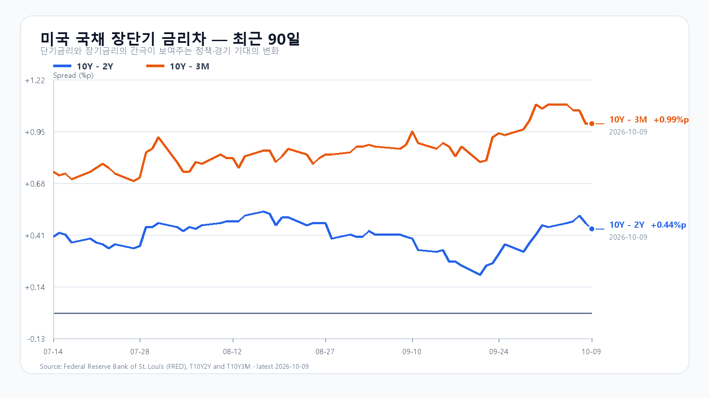

# 2026-10-12 KOSPI·KODEX 일일 리서치

작성 2026-10-12T08:13:40+09:00 / 데이터 최종 확인 2026-10-12T08:13:40+09:00 / 한국 장전.

확정 사실은 출처 시각 기준이며, 시나리오와 확률은 조건부 전망이다.

## 핵심 결론

10월 9일 미국 시장은 지수는 반등했지만 반도체는 크게 밀렸다. QQQ는 0.23%, TQQQ는 0.33% 올랐으나 SOXX는 5.01%, SMH는 4.32% 하락했다. AI 인프라 투자 자금조달 부담이 다시 부각되며 Nvidia·AMD·Micron이 동반 약세를 보였다. 직전 KRX 거래일인 10월 8일 KOSPI가 6,625.93으로 2.61%, KODEX 레버리지가 5.44% 하락한 뒤라서, 오늘은 미국 반도체 약세의 크기와 국내 수급이 실제로 얼마나 겹치는지를 분리해 봐야 한다.

대응 점수는 공격 10, 관망 50, 방어 40이다. 기본 시나리오는 6,530~6,700(45%)이다. 6,700을 회복하고 외국인 현물·프로그램이 함께 순매수로 돌아서면 6,700 초과~6,830의 강세 범위(20%)를 본다. 반대로 6,530 아래에서 두 수급이 동반 매도로 확대되면 6,360~6,530 미만의 약세 범위(35%)가 열린다. 장중 90% 포락은 6,310~6,850이다.

KODEX 레버리지는 99,350원을 1차 지지, 101,400원을 반등 기준, 103,250원을 저항으로 둔다.

## 밤사이 시장을 지배한 이슈

미국 대형 지수는 10월 9일 반등했지만 반도체의 낙폭은 훨씬 컸다. SOXX는 559.40으로 5.01%, SMH는 603.33으로 4.32% 내렸다. Nvidia는 2.00%, AMD는 4.07%, Micron은 4.27% 하락했고 Broadcom은 1.80% 올랐다. AI 투자 확대 자체보다 그 투자에 필요한 자금조달과 수익화 속도를 시장이 다시 가격에 반영한 흐름이다.

메모리의 중기 수급은 별도로 남아 있다. TrendForce는 서버 DRAM 다년 계약과 HBM 중심의 생산능력 배분이 현물 거래를 조용하게 만들고 있다고 설명한다. 10월 9일 기준 DDR5 16Gb 현물 평균은 58.900달러, DDR4 8Gb 평균은 5.960달러다. 이 가격은 실물 수급의 기준이고, 하루 동안의 Micron 주가와 같은 신호로 읽을 수는 없다.

원유도 다시 변수다. WTI 최근 거래는 배럴당 92.42달러로 직전 종가보다 3.33% 높다. 반면 원/달러는 1,341.14원으로 직전 값 1,343.75원보다 낮다. 유가 상승이 장기화하면 수입물가와 금리 경계가 커질 수 있지만, 장전 환율만으로 오늘 외국인 수급 방향을 단정할 수는 없다.

## 전일 대비 바뀐 변수와 유지 변수

직전 KRX 거래일에는 KOSPI가 6,625.93, KODEX 레버리지가 101,400원으로 마감했다. 삼성전자는 262,000원, SK하이닉스는 1,681,000원이었다. 장전 NXT에서는 삼성전자 259,500원(-0.95%), SK하이닉스 1,653,000원(-1.67%)으로 각각 낮게 거래됐다. NXT는 유동성이 제한된 참고값이므로 정규장 지수와 수급이 확인되기 전에는 종가 전망을 고정하지 않는다.

미국의 10년-2년 금리차는 10월 9일 +0.44%p, 10년-3개월 금리차는 +0.99%p다. 개별 3개월·2년·10년 금리는 10월 8일 기준 4.23%, 4.75%, 5.22%다. 금리차의 방향보다 5%대 장기금리와 유가의 동반 압력이 반도체 밸류에이션에 더 직접적이다.

## 한국시장·KODEX 대시보드

|항목|직전 확정값|기준 시각|
|---|---:|---|
|KOSPI|6,625.93 · -2.61%|10월 8일 정규장 종가|
|KODEX 레버리지|101,400원 · -5.44%|10월 8일 정규장 종가|
|삼성전자|262,000원|10월 8일 정규장 종가|
|SK하이닉스|1,681,000원|10월 8일 정규장 종가|
|원/달러|1,341.31원 · -0.18%|10월 12일 08:12 KST|
|삼성전자 NXT|259,000원 · -1.15%|10월 12일 08:13 KST|
|SK하이닉스 NXT|1,646,000원 · -2.08%|10월 12일 08:13 KST|

## 메모리 반도체 수급

서버 DRAM과 HBM의 공급 제약은 다년 계약과 생산능력 전환에서 나오는 중기 변수다. TrendForce의 10월 7일 설명처럼 현물 거래량이 조용하다고 수요가 약해졌다고 단정하기 어렵다. 다만 오늘의 한국 메모리주는 이 중기 수요보다 미국 반도체 ETF 낙폭, 유가, 장전 호가와 정규장 외국인 수급의 영향을 먼저 받을 가능성이 크다.

## 미국 반도체·AI

|종목·ETF|10월 9일 미국 정규장|
|---|---:|
|QQQ|+0.23%|
|TQQQ|+0.33%|
|SOXX|-5.01%|
|SMH|-4.32%|
|Nvidia|-2.00%|
|AMD|-4.07%|
|Micron|-4.27%|
|Broadcom|+1.80%|

## 달러/원·국내 수급·시장 구조

장전 원/달러가 1,341원대로 내려왔지만, 반도체의 미국 낙폭과 국내 NXT 약세가 동시에 보인다. 오늘 수급은 장전 단계에서 확정할 수 없다. 6,700 회복은 외국인 현물과 프로그램의 동반 전환이 필요한 구간이고, 6,530 이탈은 두 수급이 다시 매도로 기울 때 유효하다.

## 경제 캘린더

미국 9월 CPI는 10월 14일 21:30 KST에 발표된다. 이번 주에는 미국 은행권 실적과 반도체 공급망 기업들의 실적 전망도 AI 투자 수익화 논쟁의 다음 확인 지점이다. 연준의 다음 정례회의는 10월 27~28일이다.

## 미 국채와 장단기 금리차

FRED 최신 관측에서 10년-2년 금리차는 10월 9일 +0.44%p, 10년-3개월 금리차는 +0.99%p다. 10월 8일의 3개월·2년·10년 금리는 각각 4.23%, 4.75%, 5.22%다.

## 오늘 KOSPI·KODEX 시나리오

|시나리오|종가 범위·확률|성립 조건|무효화 기준|
|---|---:|---|---|
|강세|6,700 초과~6,830 · 20%|6,700 상회, 외국인 현물 순매수, 프로그램 전체 순매수|6,700 아래 재진입|
|기본|6,530~6,700 · 45%|6,530 이상, 6,700 이하, 외국인 순매도 8천억원 미만|범위 이탈|
|약세|6,360~6,530 미만 · 35%|6,530 미만, 외국인 현물 순매도, 프로그램 전체 순매도|6,530 회복|

## 장중 체크리스트

- KOSPI 6,530 방어와 6,700 회복 여부
- 외국인 현물·프로그램 수급의 동반 전환 또는 매도 확대
- 삼성전자·SK하이닉스 정규장 가격이 NXT 참고값보다 회복되는지
- 유가와 미국 지수선물이 동시에 안정되는지

## 출처와 확인 시각

- [Naver Finance KOSPI](https://m.stock.naver.com/domestic/index/KOSPI/total) 및 KODEX·삼성전자·SK하이닉스 원시 응답 · 10월 12일 08:02 KST.
- [Yahoo Finance QQQ](https://finance.yahoo.com/quote/QQQ/), [SOXX](https://finance.yahoo.com/quote/SOXX/) · 10월 9일 미국 정규장 종가.
- [TrendForce DRAM 현물가격](https://www.trendforce.com/price/dram/dram_spot) · 10월 9일 18:10 GMT+8 갱신.
- [FRED T10Y2Y](https://fred.stlouisfed.org/series/T10Y2Y)·[T10Y3M](https://fred.stlouisfed.org/series/T10Y3M) · 10월 9일 최신 금리차 관측.
