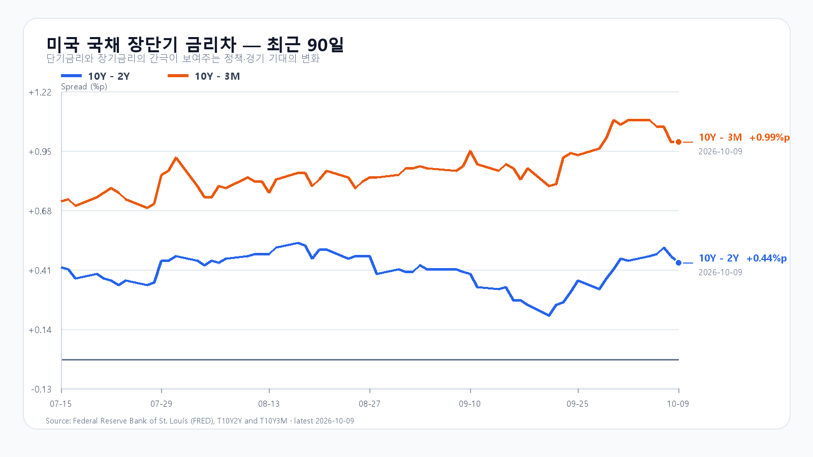
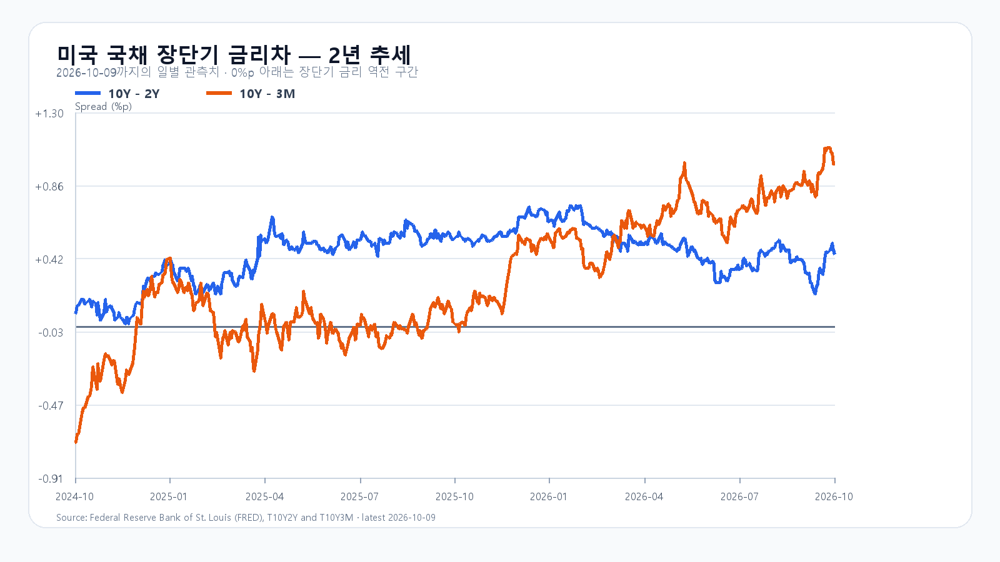

# 2026-10-13 KOSPI·KODEX 일일 리서치

작성 2026-10-13T08:09:54+09:00 / 데이터 최종 확인 2026-10-13T08:09:54+09:00 / 한국 장전.

확정 사실은 출처 시각 기준이며, 시나리오와 확률은 조건부 전망이다.

## 핵심 결론

미국 반도체 매도가 이어진 뒤 국내 시장은 6,384선에서 새 장을 맞는다. 전일 KOSPI는 3.65%, KODEX 레버리지는 7.67% 하락했고, 10월 12일 미국 정규장에서 SOXX는 2.60%, SMH는 2.05% 더 내렸다. 다만 장전 NXT의 삼성전자와 SK하이닉스는 전일 종가 부근이다. 오늘은 미국 하락폭을 한 번 더 더하기보다 6,250선의 지지와 외국인·프로그램 수급을 먼저 봐야 한다.

대응 점수는 공격 10, 관망 45, 방어 45다. 기본 시나리오는 6,250~6,450(45%)이다. 6,450을 회복하고 외국인 현물·프로그램이 함께 순매수로 바뀌면 6,450 초과~6,600의 강세 범위(15%)가 열리고, 6,250 아래에서 두 수급이 동반 매도로 기울면 6,100~6,250 미만의 약세 범위(40%)를 본다. 장중 90% 포락은 6,050~6,660이다.

KODEX 레버리지는 92,965원을 1차 지지, 93,620원을 반등 기준, 100,130원을 저항으로 둔다.

## 밤사이 시장을 지배한 이슈

10월 12일 미국 정규장에서 QQQ는 0.70%, TQQQ는 2.06%, SOXX는 2.60%, SMH는 2.05% 하락했다. Nvidia는 1.29%, AMD는 2.28%, Micron은 3.88%, Broadcom은 1.88% 내렸다. AP는 대형 기술주의 하락이 지수의 약세를 이끌었고 Micron·AMD·Broadcom·Nvidia가 모두 하락했다고 전했다. AI 투자 확대 자체보다 투자금 회수와 밸류에이션을 둘러싼 경계가 단기 가격을 누르는 국면이다.

메모리 현물은 다른 속도로 움직였다. TrendForce의 10월 12일 DDR5 16Gb 현물 평균은 59.433달러로 직전 세션보다 0.90%, DDR4 16Gb는 83.886달러로 0.29% 올랐다. 서버 DRAM과 HBM의 공급 제약은 중기 수요를 뒷받침하지만, 현물 상승만으로 당일 메모리주 반등을 단정할 수는 없다.

## 전일 대비 바뀐 변수와 유지 변수

10월 12일 KOSPI는 6,384.24로 3.65%, KODEX 레버리지는 93,620원으로 7.67% 하락했다. 삼성전자는 251,000원(-4.20%), SK하이닉스는 1,605,000원(-4.52%)으로 마감했다. 장전 NXT는 삼성전자 243,000원(-3.0%), SK하이닉스 1,552,000원(-3.3%)으로 전일 종가보다 낮다.

원/달러 최근 값은 1,334.15원으로 전일 대비 0.44% 낮다. WTI 최근 거래는 93.36달러다. 미국 10년물은 10월 8일 5.22%, 2년물은 4.73%였고 10년-2년 금리차는 +0.44%p다. 고유가와 5%대 장기금리는 성장주 할인율의 부담으로 남아 있다.

## 한국시장·KODEX 대시보드

|항목|직전 확정값|기준 시각|
|---|---:|---|
|KOSPI|6,384.24 · -3.65%|10월 12일 정규장 종가|
|KODEX 레버리지|93,620원 · -7.67%|10월 12일 정규장 종가|
|삼성전자|251,000원 · -4.20%|10월 12일 정규장 종가|
|SK하이닉스|1,605,000원 · -4.52%|10월 12일 정규장 종가|
|원/달러|1,334.05원 · -0.01%|10월 13일 08:09 KST|
|삼성전자 NXT|243,000원 · -3.0%|10월 13일 08:09 KST|
|SK하이닉스 NXT|1,552,000원 · -3.3%|10월 13일 08:09 KST|

## 메모리 반도체 수급

서버 DRAM·HBM 공급 제약과 현물 가격은 중기 펀더멘털이고, 오늘의 주가 방향은 미국 반도체 매도 후 국내 수급이 결정한다. DDR5와 DDR4 현물 상승은 메모리 공급이 당장 풀렸다는 신호가 아니지만, 반도체 주가 하락을 곧바로 실물 수요 약화로 해석할 근거도 아니다.

## 미국 반도체·AI

|종목·ETF|10월 12일 미국 정규장|
|---|---:|
|QQQ|-0.70%|
|TQQQ|-2.06%|
|SOXX|-2.60%|
|SMH|-2.05%|
|Nvidia|-1.29%|
|AMD|-2.28%|
|Micron|-3.88%|
|Broadcom|-1.88%|

## 경제 캘린더

미국 9월 CPI는 10월 14일 21:30 KST에 발표된다. BLS 일정상 바로 다음 날 21:30 KST에는 9월 PPI가 예정돼 있다. 10월 27~28일 FOMC도 장기금리와 성장주 할인율을 다시 확인할 일정이다.

## 미 국채와 장단기 금리차

FRED의 최신 확정 관측에서 10년-2년 금리차는 10월 9일 +0.44%p, 10년-3개월 금리차는 +0.99%p다. 개별 3개월·2년·10년 금리는 10월 8일 각각 4.23%, 4.73%, 5.22%다.

## 오늘 KOSPI·KODEX 시나리오

|시나리오|종가 범위·확률|성립 조건|무효화 기준|
|---|---:|---|---|
|강세|6,450 초과~6,600 · 15%|6,450 상회, 외국인 현물 순매수, 프로그램 전체 순매수|6,450 아래 재진입|
|기본|6,250~6,450 · 45%|6,250 이상, 6,450 이하, 외국인 순매도 8천억원 미만|범위 이탈|
|약세|6,100~6,250 미만 · 40%|6,250 미만, 외국인 현물·프로그램 전체 순매도|6,250 회복|

## 장중 체크리스트

- KOSPI 6,250 방어와 6,450 회복 여부
- 외국인 현물·프로그램 수급의 동반 전환 또는 매도 확대
- 삼성전자·SK하이닉스가 장전 NXT 참고값을 벗어나는 방향
- 유가와 미국 지수선물의 동반 안정 여부

## 출처와 확인 시각

- [Naver Finance KOSPI](https://m.stock.naver.com/domestic/index/KOSPI/total) 및 KODEX·삼성전자·SK하이닉스 원시 응답 · 10월 13일 08:09 KST.
- [Yahoo Finance QQQ](https://finance.yahoo.com/quote/QQQ/), [SOXX](https://finance.yahoo.com/quote/SOXX/) · 10월 12일 미국 정규장 종가.
- [TrendForce DRAM 현물가격](https://www.dramexchange.com/) · 10월 12일 14:40 GMT+8 갱신.
- [BLS 10월 발표 일정](https://www.bls.gov/schedule/2026/10_sched_list.htm), [FRED T10Y2Y](https://fred.stlouisfed.org/series/T10Y2Y)·[T10Y3M](https://fred.stlouisfed.org/series/T10Y3M) · 최신 확정 관측.
