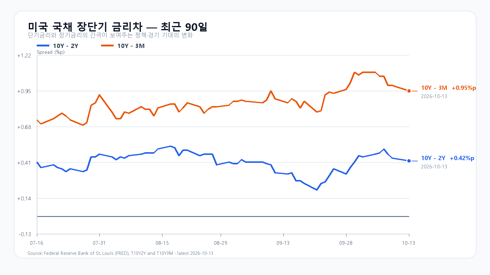
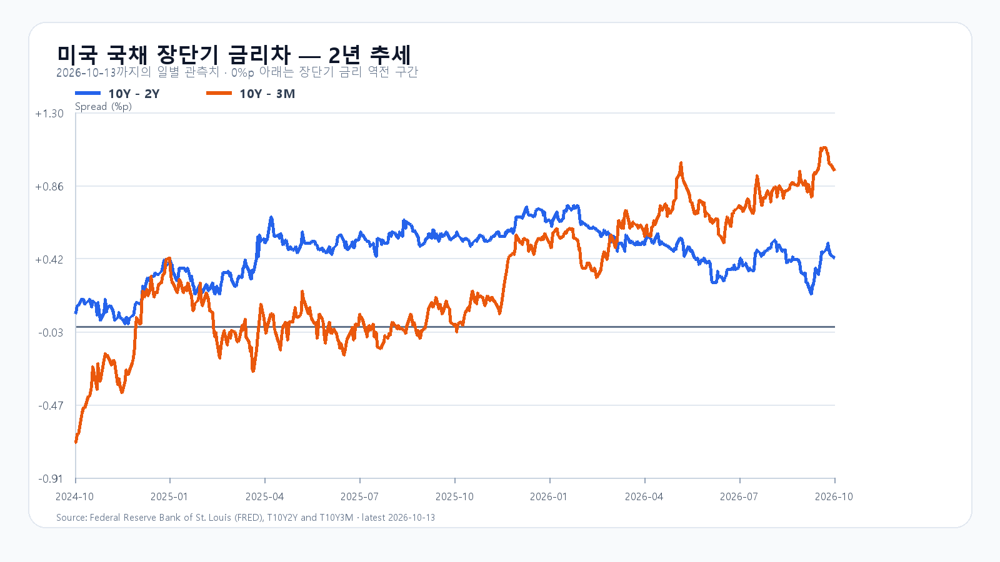

# 2026-10-14 KOSPI·KODEX 일일 리서치

작성 2026-10-14T08:13:01+09:00 / 데이터 최종 확인 2026-10-14T08:13:01+09:00 / 한국 장전. 시장별 원천 시각은 아래 표에 따름.

## 핵심 결론

국내 급락 뒤 미국 메모리주는 더 밀렸지만 Nvidia·AMD는 반등했습니다. KOSPI 6,000선 방어와 국내 메모리주 반등의 지속성을 봐야 합니다. 대응 점수 공격 10·관망 50·방어 40. 기본 5,900~6,200(45%), 강세 6,200 초과~6,350(20%), 약세 5,750~5,900 미만(35%). 장중 90% 포락 5,650~6,450. 조건부 추론이며 확정 시세와 구분한다.

## 밤사이 시장을 지배한 이슈

Reuters는 CXMT 기술 진전 보도와 AI 투자 수익성 경계를 반도체 매도 배경으로 전했다. 10월 13일 국내 급락에 이미 반영된 재료다. 미국에서 MU -3.62%와 NVDA +0.97%·AMD +1.90%의 차별화가 새 관측이다. CXMT 4F² 양산·수율·고객 검증은 미확인이고 새 공급량으로 환산하지 않는다. CXMT 공식 G5 양산 발표는 9월 20일로 당일 신규 발표가 아니다.

## 전일 대비 바뀐 변수와 유지 변수

KOSPI는 6,384.24에서 6,035.35(-5.46%)로 하락했다. 전일 전망 하단 6,100도 이탈해 낙폭을 과소평가했다. 메모리 현물 강세를 당일 수급 회복으로 연결하지 않아야 한다. 미국 비메모리 반등은 새 변수이나 국내 정규장 반전은 아직 조건부다.

## 한국시장·KODEX 대시보드

|항목|10월 13일 종가|등락|
|---|---:|---:|
|KOSPI|6,035.35|-5.46%|
|122630|81,965|-12.45%|
|005930|234,000|-6.59%|
|000660|1,456,000|-9.28%|

## 메모리 반도체 수급

TrendForce 10월 13일 18:10 GMT+8: DDR5 16Gb 59.90달러(+0.79%), DDR4 16Gb 83.858달러(+0.06%). 미래 공급 경쟁과 현재 현물 수급은 분리한다. HBM·eSSD·NAND 최신 계약 세부값과 고객별 공급량은 미확인으로 남긴다. 오래된 CAPEX 수치를 오늘 발표처럼 쓰지 않는다.

## 미국 반도체·AI

|ETF·종목|10월 13일 정규장 종가|전일 대비|
|---|---:|---:|
|QQQ|743.57|-0.33%|
|TQQQ|78.81|-1.00%|
|SOXX|543.90|-0.17%|
|SMH|588.12|-0.49%|
|NVDA|228.52|+0.97%|
|AMD|605.53|+1.90%|
|MU|953.19|-3.62%|
|AVGO|357.31|+0.73%|

Yahoo 직접 차트의 마지막 두 정규장 일봉 기준. 시간외 별도 확정 시세는 미확인. Reuters 장중 등락률을 종가로 혼용하지 않는다. Broadcom의 OCP 네트워크 제품 발표는 10월 8일 원문이고, 새로운 매출·공급 계약으로 해석하지 않는다. Citi 3분기 순이익 52억달러는 SEC 원문 확인. 빅테크 신규 실적·대규모 강제청산·새 규제·확정 증자는 핵심 원문 미확보이며 시장 원인으로 채택하지 않는다.

## 달러/원·국내 수급·시장 구조

|항목|최근값|원천 시각|
|---|---:|---|
|삼성전자 NXT|237,000원 · 2.16%|2026-10-14T08:13:01.237085+09:00|
|SK하이닉스 NXT|1,475,000원 · 2.22%|2026-10-14T08:13:01.237095+09:00|
|하나은행 USD/KRW|1,343.00원|2026-10-14T06:24:20+09:00|
|NQF 최근 거래|30,796.00|2026-10-14T08:02:59+09:00|
|ESF 최근 거래|7,857.75|2026-10-14T08:02:56+09:00|
|CLF 최근 거래|94.60|2026-10-14T08:02:32+09:00|
|BZF 최근 거래|106.16|2026-10-14T08:01:26+09:00|

NXT 등락은 NXT 원천의 비교 기준이며 KRX 종가 대비와 다를 수 있다. 전일 KRX 삼성전자 234,000원, SK하이닉스 1,456,000원과 별도 비교한다. 하나은행 값은 고시환율이며 역외 현물과 구분한다. 장전 0 수급·시장 폭은 미개시 값으로 제외. 전일 확정 현물·선물·프로그램·시장 폭 원문은 미확보, 0으로 추정하지 않는다.

## 경제 캘린더

10월 14일 21:30 KST(08:30 ET) 미국 9월 CPI, 15일 21:30 KST PPI. 발표 결과는 오늘 한국 정규장 뒤에 반영된다.

## 미 국채와 장단기 금리차

FRED 최신 스프레드 10월 13일: 10년-2년 +0.42%p, 10년-3개월 +0.95%p. 개별 금리 최신 관측 10월 9일: 3개월 4.25%, 2년 4.80%, 10년 5.24%. 서로 다른 날짜의 절대금리와 스프레드를 같은 날짜 차감값처럼 쓰지 않는다.

## 오늘 KOSPI·KODEX 시나리오

강세 20%: 6,200 초과~6,350. 15:20 기준 KOSPI 6,200 초과 AND 외국인 현물 순매수 AND 프로그램 순매수. 6,200 재이탈 시 무효.
기본 45%: 5,900~6,200. 15:20 기준 하단 이상 AND 상단 이하 AND 외국인 순매도 8천억원 이하. 범위 이탈 시 무효.
약세 35%: 5,750~5,900 미만. 15:20 기준 5,900 미만 AND 외국인 순매도 AND 프로그램 순매도. 5,900 회복 시 무효.
KODEX 78,780/81,965/88,340원. 공격·관망·방어 10/50/40.

## 장중 체크리스트

09:30·10:00에 메모리 반등과 수급 동행, 14:00·15:20에 5,900 방어와 6,200 회복을 확인한다. 전일 저가 5,911.11 이탈 여부도 확인한다.

## 출처와 확인 시각

- [KOSPI·국내 종가](https://m.stock.naver.com/domestic/index/KOSPI/total) — 2026-10-14T08:13:01+09:00 확인, 표별 원천 시각 우선.
- [미국 ETF·종목 정규장](https://finance.yahoo.com/quote/SOXX/) — 2026-10-14T08:13:01+09:00 확인, 표별 원천 시각 우선.
- [중국 메모리 경쟁과 AI 투자 경계](https://www.marketscreener.com/news/us-chip-stocks-extend-slide-as-china-memory-report-ai-spending-jitters-hit-sector-ce785dddd18ff02c) — 2026-10-14T08:13:01+09:00 확인, 표별 원천 시각 우선.
- [메모리 현물](https://www.trendforce.com/price/dram/dram_spot) — 2026-10-14T08:13:01+09:00 확인, 표별 원천 시각 우선.
- [CPI·PPI 일정](https://www.bls.gov/schedule/2026/10_sched.htm) — 2026-10-14T08:13:01+09:00 확인, 표별 원천 시각 우선.
- [미국 금리](https://fred.stlouisfed.org/series/T10Y2Y) — 2026-10-14T08:13:01+09:00 확인, 표별 원천 시각 우선.
