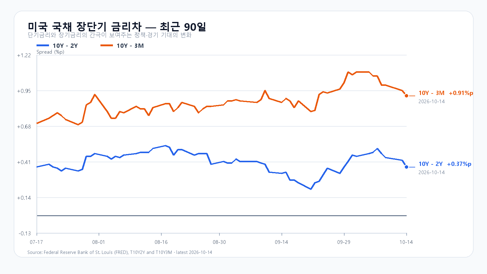
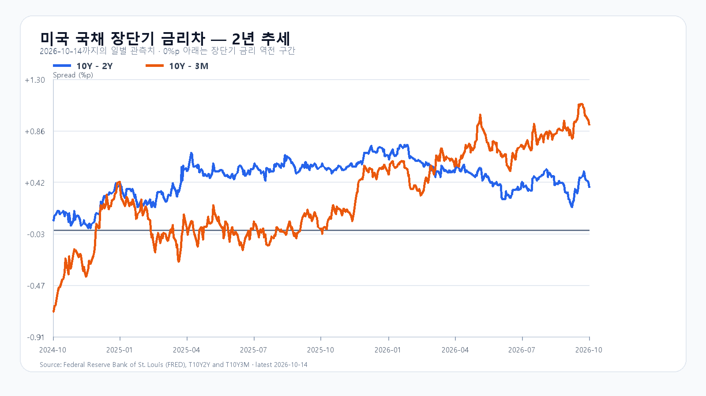

# 2026-10-15 KOSPI·KODEX 일일 리서치

작성 2026-10-15T08:07:53+09:00 / 데이터 최종 확인 2026-10-15T08:07:53+09:00 / 한국 장전. 시세별 원천 거래 시각을 분리한다.

## 핵심 결론

미국 CPI가 3.7%로 높아지고 반도체주가 동반 하락했습니다. 전일 외국인 매도가 이어진 KOSPI는 6,000선 방어와 오늘 TSMC 실적이 관건입니다. 조건부 기본 종가 5,800~6,050(45%), 강세 6,050 초과~6,200(15%), 약세 5,600~5,800 미만(40%). 대응 점수 공격 5·관망 45·방어 50. 장중 90% 포락 5,450~6,300. 확률은 분석 판단이며 보장하지 않는다.

## 밤사이 시장을 지배한 이슈

BLS 9월 CPI 전년 3.7%, 전월 0.6%, 근원 2.6%/0.3%, 에너지 전월 5.2%. 10/14 21:30 KST 발표로 전일 KRX 마감 뒤 신규 정보. 미국 반도체 전반 하락이 할인율·AI 자금조달 부담을 보여준다. 물가가 모든 매도의 단일 원인이라는 주장은 하지 않는다. 전일 반영된 CXMT 경쟁 우려와 ADR 후행 하락은 별도 충격으로 중복 가산하지 않는다.

ASML 3분기 매출 117억·순익 50억유로, 연간 매출 440~450억유로는 반대 근거. NVIDIA cuPotential은 제품 생태계 발표로 계약금액·신규 실적으로 바꾸지 않는다. BAC 제재는 Treasury 10/13 발표, 한국 반도체 직접성 낮음. Anthropic 매출 Reuters 보도는 회사 원문 미확보. 새 강제청산·증자·규제·확정 공급계약은 미확인. 후보 점수·제외 근거는 research/notes/2026-10-15.md에 보존.

## 전일 대비 바뀐 변수와 유지 변수

KOSPI 종가 6,008.81은 직전 기본 5,900~6,200 안이고 고저 경로 5,944.65~6,190.65도 포락 안. 외국인 -11,614억원은 기본 조건 -8,000억원을 이탈했다. 범위 적중을 수급 지속성 적중으로 바꾸지 않는다. 15:20 앵커 미확보로 구조화 조건은 미검증. 새 CPI 발표와 비메모리 동반 매도가 오늘의 변화.

## 한국시장·KODEX 대시보드

|항목|10월 14일 종가|등락|
|---|---:|---:|
|KOSPI|6,008.81|-0.44%|
|122630|81,100|-1.06%|
|005930|234,500|1.08%|
|000660|1,425,000|-1.25%|

## 메모리 반도체 수급

TrendForce 10/14 18:10 GMT+8: DDR5 16Gb 60.10달러(+0.33%), DDR4 16Gb 83.611달러(-0.30%). 현물 품목 혼조와 주식 매도 압력은 분리한다. HBM·NAND·eSSD 신규 계약가격, 고객별 실제 공급량·양산 수율은 미확인. ASML 설비 실적을 메모리 가격 전반의 상승으로 치환하지 않는다.

## 미국 반도체·AI

|ETF·종목|10월 14일 정규장 종가 USD|전일 대비|
|---|---:|---:|
|QQQ|728.95|-1.97%|
|TQQQ|74.12|-5.95%|
|SOXX|519.42|-4.50%|
|SMH|564.74|-3.98%|
|NVDA|221.30|-3.16%|
|AMD|570.82|-5.73%|
|MU|914.13|-4.10%|
|AVGO|346.25|-3.10%|

Yahoo 마지막 두 정규장 일봉, AP 종목 등락 대조. 정규장 종료 10/15 05:00 KST.

|종목|시간외 최근 USD|정규장 종가 대비|원천 거래 시각 KST|
|---|---:|---:|---|
|NVDA|218.50|-1.27%|2026-10-15T07:59:32+09:00|
|AMD|561.00|-1.72%|2026-10-15T07:59:25+09:00|
|MU|893.85|-2.22%|2026-10-15T07:59:47+09:00|
|AVGO|342.62|-1.05%|2026-10-15T07:59:36+09:00|

시간외 최근 5분봉 관측이며 완료 종가가 아니다. 낮은 유동성과 종목별 거래 시각 차이를 고려한다.

## 달러/원·유가·선물·국내 수급

|항목|최근값|원천 시각|
|---|---:|---|
|삼성전자 NXT (OPEN)|216,000원 · -6.90%|2026-10-15T08:07:52.633662+09:00|
|SK하이닉스 NXT (OPEN)|1,317,000원 · -7.19%|2026-10-15T08:07:52.633673+09:00|
|하나은행 USD/KRW 고시|1,343.00원|2026-10-15T07:51:20+09:00|
|NQF 최근 거래|30,001.75|2026-10-15T07:57:50+09:00|
|ESF 최근 거래|7,750.75|2026-10-15T07:57:49+09:00|
|CLF 최근 거래|94.96|2026-10-15T07:56:57+09:00|
|BZF 최근 거래|105.86|2026-10-15T07:56:23+09:00|

하나은행 고시환율과 역외 현물환을 구분한다. 선물 값은 최근 거래이며 정규장 지수 종가가 아니다. NXT 등락 기준과 KRX 전일 종가가 다를 수 있다. PREOPEN/거래량 없음은 당일 체결로 읽지 않는다.

전일 확정 원문(10/14 CLOSE·bizdate 20261014): 외국인 -11,614·기관 +7,876·개인 -3,203억원. 프로그램 차익 +634·비차익 -631·합계 +3억원. 상승 503·하락 371·보합 44종목, 상한 4 별도. 수급 앵커 09:30·10:00·14:00은 미확보. 장전 당일 0은 미개시로 제외. 선물 투자자 수급은 미확인.

## 경제 캘린더

TSMC 10/15 14:00 대만(02:00 ET)=15:00 KST, 당일 오후. 미국 9월 PPI 10/15 08:30 ET=21:30 KST. 미국 수출입물가 10/16 08:30 ET=21:30 KST. 빅테크 새 실적 원문은 미확보, 과거 분기 실적을 당일 발표로 쓰지 않음.

## 미 국채와 장단기 금리차

FRED 개별 최신 금리 10/13: 3개월 4.26%, 2년 4.79%, 10년 5.21%. 10/14 최신 금리차 10년-2년 +0.37%p, 10년-3개월 +0.91%p. 서로 다른 날짜의 자료이므로 동일 날짜 차감값으로 쓰지 않는다. CPI 직후 금리 상승 보도를 하루 종가 상승으로 일반화하지 않는다.

## 오늘 KOSPI·KODEX 시나리오

- 강세 15%: 6,050 초과~6,200. 15:20 KOSPI>6,050 AND 외국인>0 AND 프로그램>0. 6,050 재이탈 시 무효.
- 기본 45%: 5,800~6,050. 15:20 KOSPI>=5,800 AND <=6,050 AND 외국인>=-8,000억원. 범위 이탈 또는 외국인 매도 확대 시 무효.
- 약세 40%: 5,600~5,800 미만. 15:20 KOSPI<5,800 AND 외국인<0 AND 프로그램<0. 5,800 회복 시 무효.
- KODEX 1차 지지 79,070원·반등 기준 81,100원·저항 86,295원. 전일 OHLC 기준, 이탈 시 보장 지지로 해석하지 않음.

## 장중 체크리스트

09:30·10:00 실제 외국인·프로그램 방향, 삼성전자·SK하이닉스 전일 종가 회복. 14:00 수급 변화, 15:00 TSMC 발표, 15:20 5,800 방어/6,050 회복. 원천 시각이 다르면 같은 시점의 동행으로 단정하지 않는다.

## 출처와 확인 시각

- [미국 9월 CPI](https://www.bls.gov/news.release/cpi.nr0.htm) — 확인 2026-10-15T08:03:38+09:00, 표별 원천 시각 우선.
- [미국 정규장 가격](https://finance.yahoo.com/quote/SOXX/) — 확인 2026-10-15T08:03:38+09:00, 표별 원천 시각 우선.
- [KOSPI·국내 종가](https://m.stock.naver.com/domestic/index/KOSPI/total) — 확인 2026-10-15T08:03:38+09:00, 표별 원천 시각 우선.
- [ASML 3분기 실적](https://investor.asml.com/news-releases/news-release-details/asml-reports-eu11.7-billion-total-net-sales-and-eu5.0-billion-net-income-q3-2026) — 확인 2026-10-15T08:03:38+09:00, 표별 원천 시각 우선.
- [TSMC 실적 일정](https://investor.tsmc.com/english/quarterly-results/2026/q3) — 확인 2026-10-15T08:03:38+09:00, 표별 원천 시각 우선.
- [메모리 현물](https://www.trendforce.com/price/dram/dram_spot) — 확인 2026-10-15T08:03:38+09:00, 표별 원천 시각 우선.
- [PPI 일정](https://www.bls.gov/schedule/2026/10_sched.htm) — 확인 2026-10-15T08:03:38+09:00, 표별 원천 시각 우선.
- [미국 금리차](https://fred.stlouisfed.org/series/T10Y2Y) — 확인 2026-10-15T08:03:38+09:00, 표별 원천 시각 우선.
