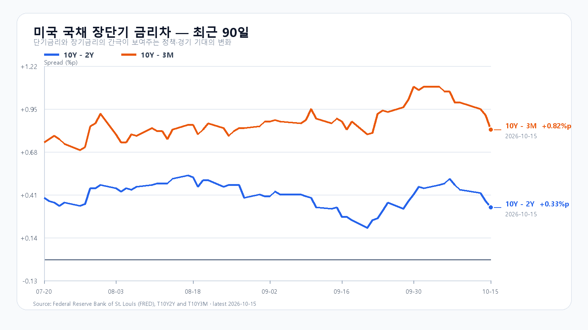
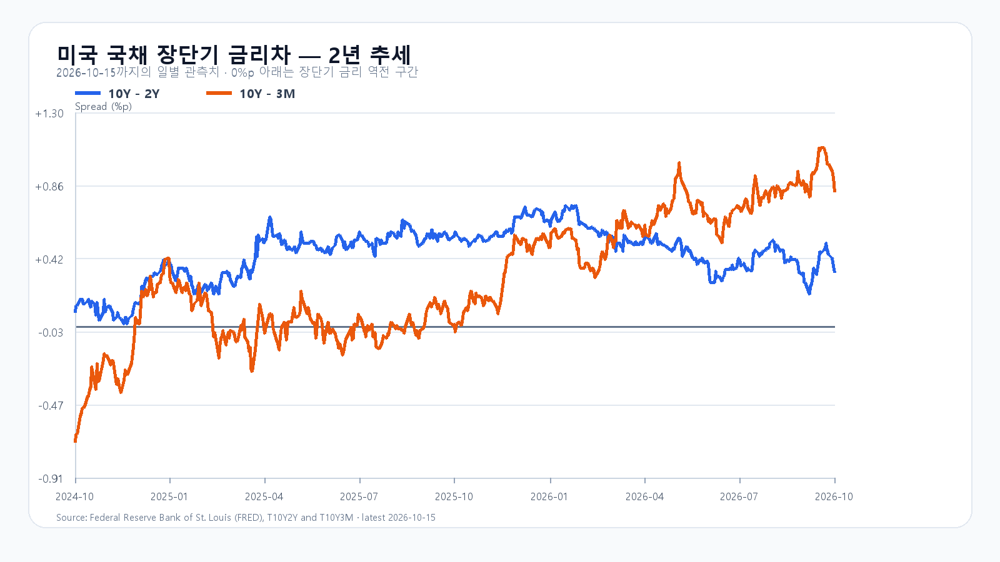

# 2026-10-16 KOSPI·KODEX 장전 리서치

작성 2026-10-16T08:10:34+09:00 / 데이터 최종 확인 2026-10-16T08:10:34+09:00 / 한국 장전. 미국 10/15 정규장 종료, 시간외 최근 거래 별도 표기.

## 핵심 결론

TSMC의 주문 전망은 강했지만 미국 생산자물가와 AI 자금조달 부담이 남았습니다. Micron 반등 속에서 KOSPI 5,450선 방어와 5,650선 회복을 봅니다. 기본 종가 5,450~5,650(45%), 강세 5,650 초과~5,800(25%), 약세 5,200~5,450 미만(30%). 대응 공격 10·관망 50·방어 40. 장중 90% 포락 5,050~5,950. 확률과 대응 점수는 별개이며 판단 범위 밖 결과도 가능.

## 밤사이 시장을 지배한 이슈

BLS PPI 전월 1.3%·전년 6.3%, 식품·에너지·무역서비스 제외 0.5%·5.0%. 10/15 21:30 KST로 한국 마감 뒤 새 정보. TSMC 3분기 매출 467.2억달러와 4분기 523~543억달러 전망은 전일 15:00 KST 발표로 한국 막판 반영 가능. 두 재료의 시간차를 구분한다. TSMC 실적 수치는 공식 IR 기준. 물가→금리·자금조달→AI 투자속도 경로는 해석이다.

Reuters 10/15 16:00 ET 갱신: CoreWeave 주식은 장중 반등했으나 채권 금리는 약 15%. Axios 별도 보도와 대조. 실제 파산·청산 확정이 아니다. 기존 AI 금융비용과 CPI·CXMT 우려는 한국장 반영분을 다시 가산하지 않는다. 신규 확정 공급계약·대규모 증자·수출규제·빅테크 실적 원문은 미확인. 후보 순위·반론은 research/notes/2026-10-16.md.

## 직전 전망 회고와 국내 시장

전일 KOSPI 5,554.22(-7.57%)는 약세 하단 5,600도 이탈했다. 기본 범위 실패, 전체 종가 포락 실패. 저가 5,450.81은 장중 포락 5,450 바로 위였다. 방어적 대응과 종가 예측 정확성은 별개. 15:20 수급 앵커 누락으로 조건 정산은 미검증.

|항목|10/15 시가|고가|저가|종가|
|---|---:|---:|---:|---:|
|KOSPI|5,673.01|5,751.45|5,450.81|5,554.22|
|KODEX|72,505|73,800|64,920|67,785|

KODEX 거래량 35,584,318주. fchart와 price OHLCV 일치. 삼성·하이닉스의 API 중복 일봉은 NXT/통합시세와 KRX 정규장 범위 차이가 있어 정규장값으로 단정하지 않는다. 전일 서킷브레이커는 뉴스핌·뉴스웨이 대조, 오늘 신규 사건으로 가산하지 않는다.

## 메모리 반도체 수급

TrendForce 10/15 18:10 GMT+8 DDR5 16Gb 60.433달러(+0.55%), DDR4 16Gb 83.66달러(+0.06%). 현물 수요와 주가 수급은 분리. HBM·서버 DRAM·RDIMM·NAND·eSSD·TLC·SLC/MLC 신규 계약가격, 실제 수율·생산량·고객 주문은 미확인. 빅테크 투자 계획을 확정 메모리 매출로 치환하지 않는다. TSMC 가이던스와 MU 반등은 수요 붕괴 주장에 반대 근거다.

## 미국 정규장·시간외

|종목|10/15 정규장 종가 USD|등락|
|---|---:|---:|
|QQQ|728.00|-0.13%|
|TQQQ|73.82|-0.40%|
|SOXX|514.71|-0.91%|
|SMH|558.84|-1.04%|
|NVDA|217.23|-1.84%|
|AMD|562.23|-1.50%|
|MU|931.24|+1.87%|
|AVGO|344.33|-0.55%|

정규장 종료 10/16 05:00 KST. Yahoo 시세 원천, Reuters 업종 하락 대조. SOXX·SMH 하락과 Micron 상승이 공존한다.

|종목|시간외 USD|정규장 대비|원천 시각 KST|
|---|---:|---:|---|
|NVDA|217.34|+0.05%|2026-10-16T08:00:50+09:00|
|AMD|557.00|-0.93%|2026-10-16T08:01:43+09:00|
|MU|925.27|-0.64%|2026-10-16T08:02:09+09:00|
|AVGO|343.30|-0.30%|2026-10-16T07:59:27+09:00|

시간외는 마지막 관측 5분봉이며 확정 종가와 다르다. 거래량·종목별 시차 주의.

## 발행 직전 환율·미국 선물·국내 NXT

|항목|최근값|원천 시각|
|---|---:|---|
|삼성전자 NXT (OPEN)|218,500원 · 4.05%|2026-10-16T08:10:34.820407+09:00|
|SK하이닉스 NXT (OPEN)|1,312,000원 · 3.96%|2026-10-16T08:10:34.82042+09:00|
|하나은행 USD/KRW 고시|1,342.50원|2026-10-16T07:35:02+09:00|
|NQF 최근 거래|30,062.25|2026-10-16T08:00:33+09:00|
|ESF 최근 거래|7,786.50|2026-10-16T08:00:32+09:00|
|CLF 최근 거래|96.18|2026-10-16T08:00:20+09:00|
|BZF 최근 거래|105.70|2026-10-16T07:55:51+09:00|

하나은행 고시는 역외 현물환과 다르다. 선물은 최근 거래, NXT는 실제 거래일·OPEN·거래량을 확인한다. KRX 종가와 기준이 다를 수 있다.

## 국내 수급·시장 구조

오늘 integration이 초기화되어 전일 최종 현물·프로그램·시장 폭 묶음을 복구하지 못했다. 당일 0은 장전 미개시이므로 전일 확정값으로 쓰지 않는다. 언론 외국인 순매도 금액도 3.6253조/4.8196조로 충돌해 정확값 미확인. 금융투자·연기금·사모·보험·투신 및 선물 수급 미확인. 현재 환율과 전일 수급을 같은 시점으로 연결하지 않는다. 삼성·하이닉스 비중이 큰 지수와 방어업종의 차이를 개장 후 시장 폭과 함께 점검.

## 금리·경제 캘린더

FRED 개별금리 10/14: 3개월 4.28%, 2년 4.82%, 10년 5.19%. 10/15 금리차 10년-2년 +0.33%p, 10년-3개월 +0.82%p. 서로 다른 기준일이므로 동일 날짜 차감·금리방향으로 일반화하지 않는다. PPI를 근거로 국채 종가 상승을 단정하지 않음.

오늘 10/16 미국 수출입물가 08:30 ET=21:30 KST(BLS). 산업생산은 연준 일정 후속 확인, Warsh 발언 시각은 공식 원문 미확보로 확정 일정에서 제외. 다음 KRX 거래일 월요일 10/19, 주말 신규 정책·신용 뉴스 점검.

## 조건부 시나리오·무효화

- 강세 25%: 5,650 초과~5,800. 15:20 지수>5,650 AND 외국인>0 AND 프로그램>0. 5,650 재이탈 시 무효.
- 기본 45%: 5,450~5,650. 15:20 지수>=5,450 AND <=5,650 AND 외국인>=-8,000억원. 범위 이탈·매도 확대 시 무효.
- 약세 30%: 5,200~5,450 미만. 15:20 지수<5,450 AND 외국인<0 AND 프로그램<0. 5,450 회복 시 무효.
- KODEX 64,920/67,785/73,800원: 1차 지지/반등 기준/저항. 64,920 이탈 후 미회복 시 지지 판단 무효.

## 장중 확인

09:30·10:00 외국인·프로그램의 동행과 NXT 반등의 KRX 지속 여부. 14:00 수급 반전, 15:20 지수 구간과 수급 조건. 장중 예상 고저와 종가 범위는 별도 평가.

## 출처

- [TSMC 공식 실적](https://investor.tsmc.com/english/quarterly-results/2026/q3) — 수집 08:01~08:04 KST, 각 원천 시각 우선.
- [미국 PPI](https://www.bls.gov/news.release/ppi.nr0.htm) — 수집 08:01~08:04 KST, 각 원천 시각 우선.
- [AI 금융비용 Reuters](https://www.investing.com/news/stock-market-news/coreweave-shares-bonds-slide-further-as-ai-debt-fears-mount-4951350) — 수집 08:01~08:04 KST, 각 원천 시각 우선.
- [미국 가격](https://finance.yahoo.com/quote/SOXX/) — 수집 08:01~08:04 KST, 각 원천 시각 우선.
- [국내 일봉](https://fchart.stock.naver.com/sise.nhn?symbol=KOSPI&timeframe=day&count=5&requestType=0) — 수집 08:01~08:04 KST, 각 원천 시각 우선.
- [메모리 현물](https://www.trendforce.com/price/dram/dram_spot) — 수집 08:01~08:04 KST, 각 원천 시각 우선.
- [경제 일정](https://www.bls.gov/schedule/2026/10_sched.htm) — 수집 08:01~08:04 KST, 각 원천 시각 우선.
- [FRED 금리차](https://fred.stlouisfed.org/series/T10Y2Y) — 수집 08:01~08:04 KST, 각 원천 시각 우선.
