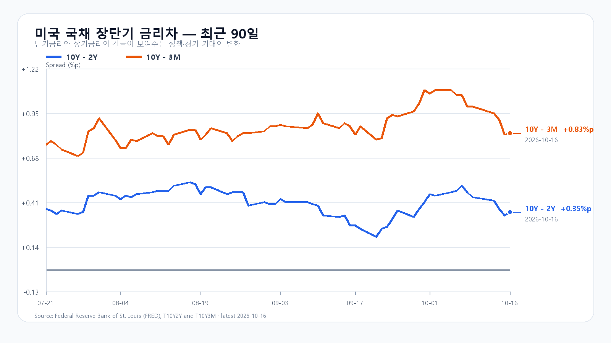
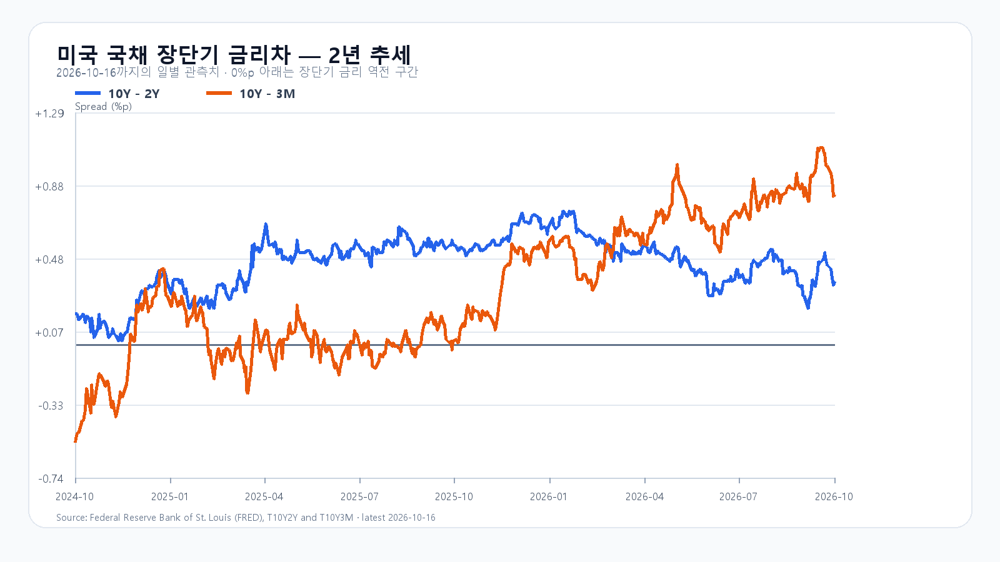

# 2026-10-19 KOSPI·KODEX 장전 리서치

작성 2026-10-19T08:03:26+09:00 / 데이터 최종 확인 2026-10-19T08:03:26+09:00 / 한국 장전. 미국 10/16 정규장 및 시간외 종료. 월요일 선물·NXT 별도 시각.

## 핵심 결론

미국 반도체 매도와 수입물가 상승이 금요일 국내 반등을 압박합니다. DRAM 현물 가격은 견조한 가운데 KOSPI 5,590선 방어와 5,700선 회복을 봅니다. 기본 종가 5,500~5,700(45%), 강세 5,700 초과~5,850(20%), 약세 5,250~5,500 미만(35%). 공격10·관망45·방어45. 90% 장중 포락5,100~6,000. 수동 조건부 전망이며 확률과 대응점수는 별개.

## 밤사이 시장을 지배한 이슈

금요일 미국 SOXX -4.14%, SMH -3.41%, MU -5.63%. 한국 10/16 마감 이후 거래이므로 국내 반등 뒤 추가 부담이다. CoreWeave 신용 우려는 기존 사건 연장으로 분리하고 파산·강제청산으로 확대하지 않는다. BLS 수입물가 +1.1%/+8.1%, 수출물가 +2.2%(10/16 08:30 ET=21:30 KST)는 한국 마감 뒤 새 물가 정보다. 금리·AI 금융비용·반도체 할인율 경로는 해석. 후보 8건·반론·제외 사유는 research/notes/2026-10-19.md.

## 국내 확정값·직전 전망 회고

|항목|10/16 시가|고가|저가|종가|
|---|---:|---:|---:|---:|
|KOSPI|5,653.99|5,809.94|5,590.33|5,668.05|
|KODEX|70,405|73,980|68,460|70,415|

KOSPI +2.05%, KODEX +3.88%, 거래량27,605,409주. KRX 기반 price·fchart 교차. 직전 기본5450~5650 실패, 강세 종가범위 적중. 고가5809.94는 강세 종가상단 초과하나 장중포락5050~5950 안. 정확15:20 앵커 부재로 수급조건 미검증. 누적 평가기는 기존9/21 보고서 해시 불일치로 중단, 활성 가설 없음.

현물 수급 API의 개인·기관·외국인 합계가 불일치해 금액 검증 보류. 프로그램 합계는 +4278억원이나 최종 전체묶음·기타 주체 대조 미완료로 공개 전략에 사용하지 않음. 금융투자·연기금·사모·보험·투신·선물 확정값 미확인. 장전 0을 최종값으로 채우지 않음.

## 메모리 펀더멘털과 주가 수급

TrendForce 10/16 18:10 GMT+8 DDR5 16Gb 60.60달러(+0.28%), DDR4 16Gb83.66달러(보합). 현물 가격 견조와 주식 매도 공존. SK하이닉스10/16 OCP 메모리 중심 서버 비전은 제품 로드맵이며 확정 수주와 다름. HBM·서버 DRAM·RDIMM·NAND·eSSD 신규 계약단가·수율·물량 미확인. NAND 공개현물10/5·계약8/31을 최신가격으로 쓰지 않음. Solidigm 협상 보도는 확정 미국 신규공장 계약으로 쓰지 않음.

## 미국 정규장

|종목|10/16 종가 USD|등락|
|---|---:|---:|
|QQQ|709.80|-2.50%|
|TQQQ|68.21|-7.60%|
|SOXX|493.39|-4.14%|
|SMH|539.79|-3.41%|
|NVDA|214.13|-1.43%|
|AMD|528.75|-5.95%|
|MU|878.84|-5.63%|
|AVGO|328.75|-4.52%|

미국10/16 16:00 ET=10/17 05:00 KST 종료. 연속 정규장 종가로 등락 계산, 시간외와 분리.

|종목|시간외 USD|종가 대비|최근 5분봉 KST|
|---|---:|---:|---|
|NVDA|213.75|-0.18%|2026-10-17T08:59:57+09:00|
|AMD|527.09|-0.31%|2026-10-17T08:59:11+09:00|
|MU|875.98|-0.33%|2026-10-17T08:59:52+09:00|
|AVGO|330.30|+0.47%|2026-10-17T08:59:54+09:00|

시간외 마지막 유효5분봉이며 확정종가·현재거래와 다름. 월요일 미국 정규장 아직 개장 전.

## 최종 환율·선물·NXT

|항목|최근값|원천 시각|
|---|---:|---|
|삼성전자 NXT (OPEN)|202,500원 · -6.03%|2026-10-19T08:03:26.764849+09:00|
|SK하이닉스 NXT (OPEN)|1,185,000원 · -6.84%|2026-10-19T08:03:26.764858+09:00|
|하나은행 USD/KRW 고시|1,338.00원|2026-10-19T07:23:55+09:00|
|NQF 최근 거래|29,612.00|2026-10-19T07:53:24+09:00|
|ESF 최근 거래|7,731.50|2026-10-19T07:53:24+09:00|
|CLF 최근 거래|98.21|2026-10-19T07:53:22+09:00|
|BZF 최근 거래|108.83|2026-10-19T07:52:00+09:00|

하나은행 고시는 역외 현물환과 다르다. 선물은 최근 거래값과 원천시각을 구분, 유가는 최근선물 가격이며 현물·결제값이 아님. NXT와 KRX 가격 기준 차이 주의. 기존 CXMT·CPI·급락 반영분 및 후행ADR·EWY를 새 충격으로 이중 계산하지 않음.

## 금리와 경제 일정

FRED 10/16 10Y-2Y +0.35%p, 10Y-3M +0.83%p. 개별금리 최신10/15 3M4.28%, 2Y4.77%, 10Y5.10%. 기준일 혼합 차감·금리방향 추정 금지. 금리차 양수만으로 경기·주가 강세 단정 불가.

BLS 공식달력10/19 주요발표 없음. Netflix10/20 13:01 PT=10/21 05:01 KST, Tesla10/21 미국마감후=10/22 KST, FOMC10/27~28 ET. 확정되지 않은 빅테크 날짜는 추가하지 않음.

## 조건부 전망과 무효화

- 강세20%: 5700초과~5850. 15:20 지수>5700 AND 외국인>0 AND 프로그램>0. 5700 재이탈 시 무효.
- 기본45%: 5500~5700. 15:20 지수>=5500 AND <=5700 AND 외국인>=-8000억원. 범위이탈·매도확대 시 무효.
- 약세35%: 5250~5500미만. 15:20 지수<5500 AND 외국인<0 AND 프로그램<0. 5500회복 시 무효.
- KOSPI 단기 기술지지5590, 반등기준5700, 저항5810. 종가 시나리오 경계5500과 구별.
- KODEX 지지68460·반등기준70415·저항73980원. 68460이탈 후 미회복시 방어 실패.
- 09:30·10:00 외국인·프로그램 동행, 14:00 반전,15:20 종가조건 점검. 한 시점 매수를 지속수급으로 간주하지 않음.

## 출처

- [미국 시세](https://finance.yahoo.com/quote/SOXX/)
- [국내 일봉](https://fchart.stock.naver.com/sise.nhn?symbol=KOSPI&timeframe=day&count=5&requestType=0)
- [미국 수출입물가](https://www.bls.gov/news.release/ximpim.nr0.htm)
- [DRAM 현물](https://www.trendforce.com/price/dram/dram_spot)
- [SK하이닉스](https://news.skhynix.com/en/all/)
- [BLS 일정](https://www.bls.gov/schedule/2026/10_sched.htm)
- [FOMC](https://www.federalreserve.gov/monetarypolicy/fomccalendars.htm)
- [FRED](https://fred.stlouisfed.org/series/T10Y2Y)
