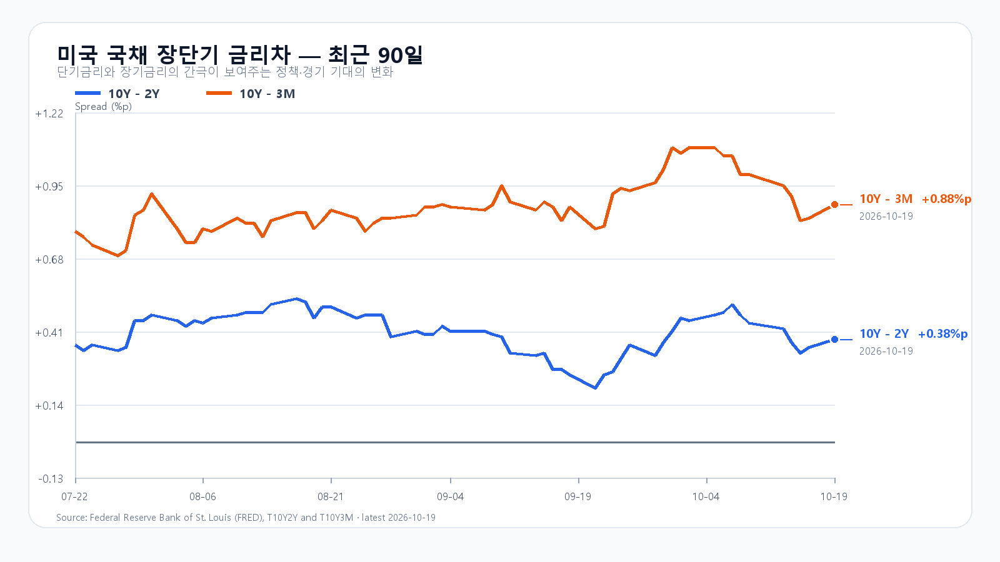
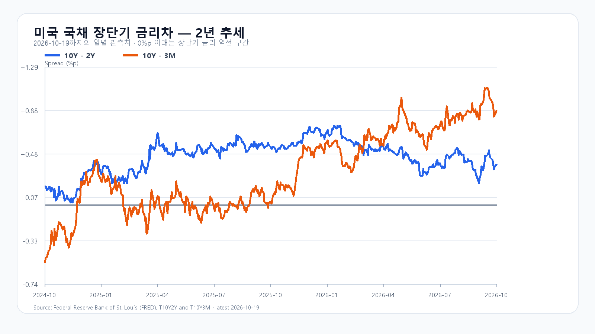

# 2026-10-20 KOSPI·KODEX 장전 리서치

작성 2026-10-20T08:01:07+09:00 / 데이터 최종 확인 2026-10-20T08:01:07+09:00 / 한국 장전. 미국10/19 정규장 종가와 진행 중 시간외 구분.

## 핵심 결론
미국 반도체주가 반등하고 국내 지수는 전일 고점에서 마쳤습니다. KOSPI 5,768선 유지와 외국인·프로그램 매수 동행이 상승 연장의 조건입니다. 기본 종가5700~5900(50%), 강세5900초과~6050(25%), 약세5450~5700미만(25%). 공격25·관망50·방어25. 90% 장중 포락5300~6200. 수동 조건부 전망이며 확률과 대응점수는 별개다.

## 밤사이 지배 이슈
미국 SOXX +1.73%, SMH +1.61%, MU +2.97%. 기술주 반등은 신규 확정 수주와 구분한다. 전일 한국 오후장과 겹치는 미국 프리마켓 기대와 밤사이 정규장 반등 전체를 독립 충격으로 중복 합산하지 않는다. 신규계약·청산·증자·규제 탐색과 제외 사유는 research/notes/2026-10-20.md.

## 국내 확정값과 직전 전망
|항목|10/19 시가|고가|저가|종가|
|---|---:|---:|---:|---:|
|KOSPI|5488.41|5768.01|5488.41|5768.01|
|KODEX|65920|72255|65750|72255|
KOSPI+1.76%, KODEX+2.61%, 거래량25923397주. Naver KRX 기반 price·fchart 교차. 직전 기본범위 실패·강세종가 적중, 장중 기본하단 이탈·포락 안. 정확15:20 앵커 부재로 수급 원인 미검증. integration 수급 합계 및 보도와 불일치로 확정 묶음 보류. 세부 기관·선물 수급 미확인, 0으로 채우지 않음.

## 메모리 펀더멘털
TrendForce10/19 18:10 GMT+8 DDR5 16Gb60.633달러(+0.05%), DDR4 16Gb83.414달러(-0.29%). 현물 차별화와 주식 반등은 다른 층위다. HBM·서버DRAM·RDIMM·NAND·eSSD 신규 계약단가·수율·물량 미확인. 미국 빅테크 신규 AI CAPEX 확정치 없이 반등을 신규 수요 확정으로 쓰지 않는다.

## 미국 정규장
|종목|10/19 종가 USD|등락|
|---|---:|---:|
|QQQ|718.36|+1.21%|
|TQQQ|70.64|+3.56%|
|SOXX|501.93|+1.73%|
|SMH|548.46|+1.61%|
|NVDA|217.09|+1.38%|
|AMD|538.05|+1.76%|
|MU|904.90|+2.97%|
|AVGO|334.59|+1.78%|
미국10/19 16:00 ET=10/20 05:00 KST 종료. 등락은 연속 일봉 종가 계산.

## 미국 시간외
|종목|USD|종가 대비|유효 5분봉 시각 KST|
|---|---:|---:|---|
|NVDA|217.52|+0.20%|2026-10-20T07:56:42+09:00|
|AMD|540.44|+0.44%|2026-10-20T07:55:30+09:00|
|MU|908.10|+0.35%|2026-10-20T07:57:22+09:00|
|AVGO|335.81|+0.37%|2026-10-20T07:56:26+09:00|
시간외 진행 중의 최근 유효봉이며 확정 종가가 아니다.

## 최종 환율·선물·NXT
|항목|최근값|원천 시각|
|---|---:|---|
|삼성전자 NXT (OPEN)|222,500원 · 2.06%|2026-10-20T08:01:07.566817+09:00|
|SK하이닉스 NXT (OPEN)|1,293,000원 · 1.25%|2026-10-20T08:01:07.566833+09:00|
|하나은행 USD/KRW 고시|1,333.50원|2026-10-20T06:56:40+09:00|
|NQF 최근 거래|29,774.50|2026-10-20T07:51:04+09:00|
|ESF 최근 거래|7,743.75|2026-10-20T07:51:03+09:00|
|CLF 최근 거래|98.26|2026-10-20T07:51:04+09:00|
|BZF 최근 거래|109.28|2026-10-20T07:51:04+09:00|
하나은행 고시·역외 현물·NXT·KRX의 시장 기준을 구분한다. 선물은 최근 거래이며 현물·결제값과 다르다.

## 금리와 일정
FRED10/19 10Y-2Y+0.38%p·10Y-3M+0.88%p. 개별금리 최신10/16 3M4.26%·2Y4.74%·10Y5.09%. 혼합 날짜 차감 금지. 금리차 확대만으로 금융여건 완화 단정 불가.
BLS10/20 10:00 ET=23:00 KST 주별 고용, Netflix10/21 05:01 KST(10/20 13:01 PT), Tesla10/22 새벽(10/21 미국마감후), FOMC10/27~28 ET.

## 조건과 무효화
- 강세25%: 5900초과~6050. 15:20 지수>5900 AND 외국인>0 AND 프로그램>0. 5900 재이탈 시 무효.
- 기본50%: 5700~5900. 15:20 지수>=5700 AND <=5900 AND 외국인>=-8000억원. 범위이탈·매도확대 시 무효.
- 약세25%: 5450~5700미만. 15:20 지수<5700 AND 외국인<0 AND 프로그램<0. 5700회복 시 무효.
- KOSPI지지5700·반등기준5768·저항5900. KODEX지지70000·반등기준72255·저항73980원. 70000 이탈 후 미회복 시 방어 실패.
- 09:30·10:00 외국인·프로그램 동행,14:00 반전,15:20 종가조건 점검. 한 시점 매수는 지속수급과 다르다.

## 출처
- [미국 시세](https://finance.yahoo.com/quote/SOXX/)
- [국내 일봉](https://m.stock.naver.com/api/index/KOSPI/price?pageSize=50&page=1)
- [DRAM 현물](https://www.trendforce.com/price/dram/dram_spot)
- [BLS 일정](https://www.bls.gov/schedule/2026/10_sched.htm)
- [Netflix 실적](https://ir.netflix.net/investor-news-and-events/financial-releases/press-release-details/2026/Netflix-to-Announce-Third-Quarter-2026-Financial-Results/default.aspx)
- [Tesla 실적](https://ir.tesla.com/press-release/tesla-third-quarter-2026-production-deliveries-and-deployments)
- [FOMC](https://www.federalreserve.gov/monetarypolicy/fomccalendars.htm)
- [FRED](https://fred.stlouisfed.org/series/T10Y2Y)
