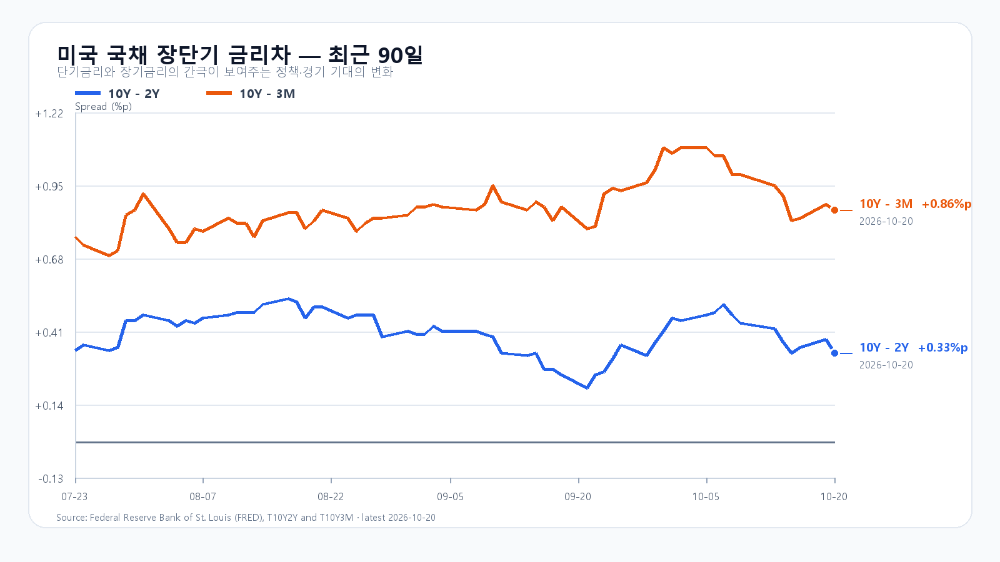
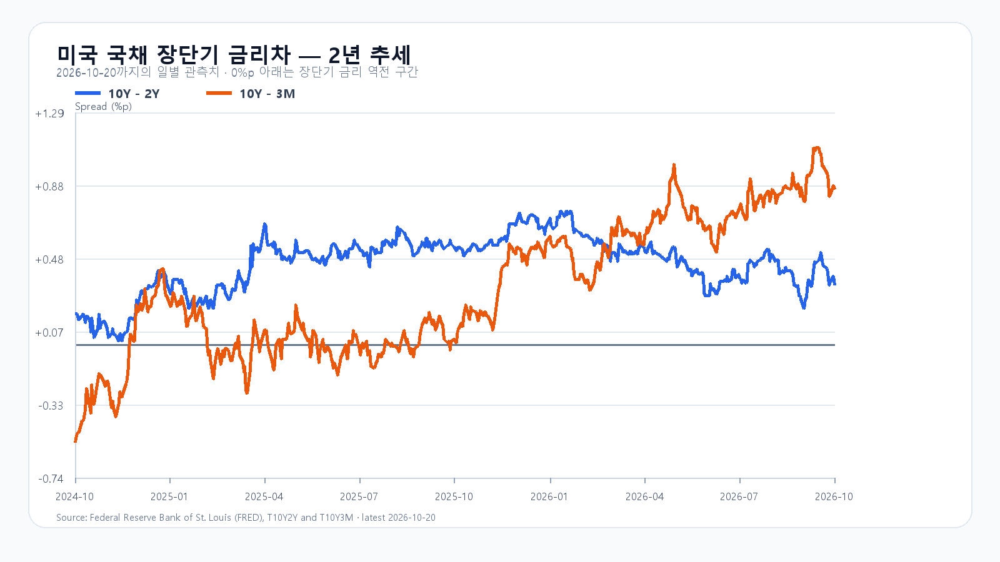

# 2026-10-21 KOSPI·KODEX 장전 리서치

작성 2026-10-21T08:04:40+09:00 / 데이터 최종 확인 2026-10-21T08:04:40+09:00 / 한국 장전. 미국10/20 정규장 종료·시간외 구분.

## 핵심 결론
미국 반도체주는 정규장 약세 뒤 시간외에서 반등했습니다. AI 서버 잠정실적과 중국 GPU 주문 수요가 부각된 가운데 KOSPI는 5,550선 회복과 국내 매도 완화가 관건입니다. 기본5450~5650(45%), 강세5650초과~5800(20%), 약세5200~5450미만(35%). 공격10·관망45·방어45. 90% 장중 포락5100~5950. 수동 조건부 전망이며 확률과 대응 점수는 별개다.

## 밤사이 지배 이슈
중국향 GPU 주문 Reuters 보도는350억달러 표시가격·익명취재·납품불확실. HBM 확정 계약과 구분. Supermicro 잠정 매출185억~195억달러(기존145억~155억달러)과 Amazon2027 독일투자160억유로 중 AWS48억유로. Netflix 광고전망30억→27억달러. 후보9개와 제외근거는 research/notes/2026-10-21.md. 전일 한국 급락과 미국 후행 약세를 중복 충격으로 계산하지 않음.

## 국내 확정값·직전 전망
|항목|10/20 시가|고가|저가|종가|
|---|---:|---:|---:|---:|
|KOSPI|5733.57|5733.57|5493.24|5552.74|
|KODEX|71265|71300|65335|67170|
KOSPI-3.73%, KODEX-7.04%, 거래량23418195주. fchart·price 교차. 직전 기본 실패·약세 종가범위 적중, 장중 고저 모두90%포락 안. 정확15:20 앵커 누락으로 조건·원인 미검증. integration 수급 보도값 충돌·기타법인 누락으로 정본묶음 보류. 개별주 일봉 종가·대비 기준 혼재로 공개 정규장 종가 제외. 기관·선물·프로그램 최종 묶음 미확인, 0 채우지 않음.

## 메모리 펀더멘털
TrendForce10/20 18:10 GMT+8 DDR5 16Gb60.70달러(+0.11%), DDR4 16Gb83.364달러(-0.06%). HBM·서버DRAM·RDIMM·NAND·eSSD 신규 단가·물량 미확인. 공개 RDIMM·NAND 표의10/12 및8월 값은 최신값 아님. 빅테크 CAPEX 계획과 공급사 확정매출을 구분한다.

## 미국 정규장
|종목|10/20 종가 USD|등락|
|---|---:|---:|
|QQQ|717.63|-0.10%|
|TQQQ|70.41|-0.33%|
|SOXX|500.01|-0.38%|
|SMH|546.36|-0.38%|
|NVDA|216.47|-0.29%|
|AMD|534.74|-0.62%|
|MU|896.07|-0.98%|
|AVGO|334.37|-0.07%|
미국10/20 16:00 ET=10/21 05:00 KST 종료. 연속 일봉 종가 계산.

## 미국 시간외
|종목|USD|종가 대비|유효 5분봉 시각 KST|
|---|---:|---:|---|
|NVDA|220.88|+2.04%|2026-10-21T07:58:42+09:00|
|AMD|548.24|+2.52%|2026-10-21T07:57:42+09:00|
|MU|918.50|+2.50%|2026-10-21T07:58:30+09:00|
|AVGO|338.69|+1.29%|2026-10-21T07:58:11+09:00|
진행 중 최근 유효봉이며 확정 종가 아님.

## 최종 환율·선물·NXT
|항목|최근값|원천 시각|
|---|---:|---|
|삼성전자 NXT (OPEN)|217,000원 · 2.60%|2026-10-21T08:04:40.021326+09:00|
|SK하이닉스 NXT (OPEN)|1,252,000원 · 2.37%|2026-10-21T08:04:40.021336+09:00|
|하나은행 USD/KRW 고시|1,327.00원|2026-10-21T07:02:35+09:00|
|NQF 최근 거래|29,911.75|2026-10-21T07:54:35+09:00|
|ESF 최근 거래|7,776.50|2026-10-21T07:54:36+09:00|
|CLF 최근 거래|98.16|2026-10-21T07:53:57+09:00|
|BZF 최근 거래|109.12|2026-10-21T07:50:41+09:00|
하나은행 고시·역외현물·NXT·KRX 및 선물 최근거래·결제값을 구분한다.

## 금리와 일정
FRED10/20 10Y-2Y+0.33%p·10Y-3M+0.86%p. 개별금리10/19 3M4.27%·2Y4.77%·10Y5.15%, 날짜 혼합 차감 금지.
BLS10/21 10:00 ET=23:00 KST 분기 통상주급, Tesla10/21 마감후·설명회10/22 06:30 KST(10/21 17:30 ET), FOMC10/27~28 ET. BLS10/20 발표는 주별 고용이 아닌 주별(State) 고용·실업 월간통계였음. 과거 보고서 원문은 보존.

## 조건·무효화
- 강세20%:5650초과~5800.15:20 지수>5650 AND 외국인>0 AND 프로그램>0.5650재이탈 무효.
- 기본45%:5450~5650.15:20 지수>=5450 AND <=5650 AND 외국인>=-8000억원.범위이탈·매도확대 무효.
- 약세35%:5200~5450미만.15:20 지수<5450 AND 외국인<0 AND 프로그램<0.5450회복 무효.
- KOSPI지지5450·반등5550·저항5650.KODEX65335/67170/71300원.지지이탈 후 미회복 무효.
- 09:30·10:00 수급 동행,14:00반전,15:20종가조건. 단일 시점 매수는 지속수급과 다름.

## 출처
- [미국 시세](https://finance.yahoo.com/quote/SOXX/)
- [국내 일봉](https://m.stock.naver.com/api/index/KOSPI/price?pageSize=50&page=1)
- [DRAM 현물](https://www.trendforce.com/price/dram/dram_spot)
- [중국 GPU 주문 Reuters](https://www.investing.com/news/stock-market-news/exclusivebytedance-alibaba-tencent-place-over-35-billion-worth-of-nvidia-chip-orders-4959231)
- [Netflix 주주서한](https://ir.netflix.net/files/doc_financials/2026/q3/FINAL-Q3-26-Shareholder-Letter.pdf)
- [Supermicro 잠정실적](https://ir.supermicro.com/news/news-details/2026/Supermicro-Provides-First-Quarter-of-Fiscal-Year-2027-Preliminary-Business-Update/default.aspx)
- [Amazon 독일 투자](https://press.aboutamazon.com/de/2026/10/invest-in-germany-summit-amazon-kuendigt-16-milliarden-euro-investitionen-fuer-2027-in-deutschland-an)
- [BLS 일정](https://www.bls.gov/schedule/2026/10_sched.htm)
- [Tesla 일정](https://ir.tesla.com/press-release/tesla-third-quarter-2026-production-deliveries-and-deployments)
- [FOMC](https://www.federalreserve.gov/monetarypolicy/fomccalendars.htm)
- [FRED](https://fred.stlouisfed.org/series/T10Y2Y)

- 시간외 반등: 07:58 KST 무렵 NVDA+2.04%, AMD+2.52%, MU+2.50%, AVGO+1.29%. 정규장 하락과 분리. Supermicro 잠정실적은 미국 정규장 마감 후 신규 정보이므로 오늘 한국장에 새로 전달되는 긍정 재료. 기사 제목·요약에 반영.
