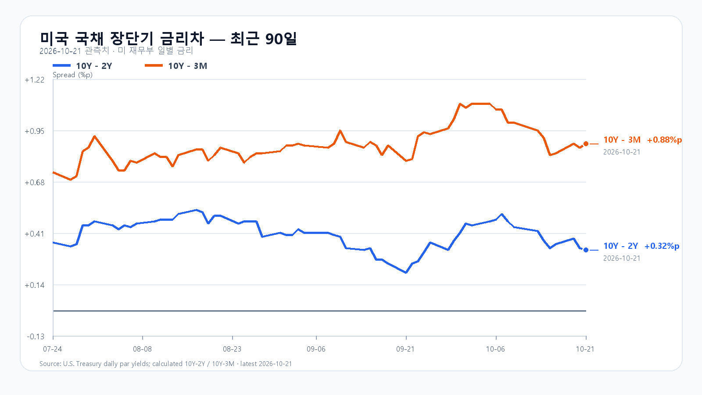
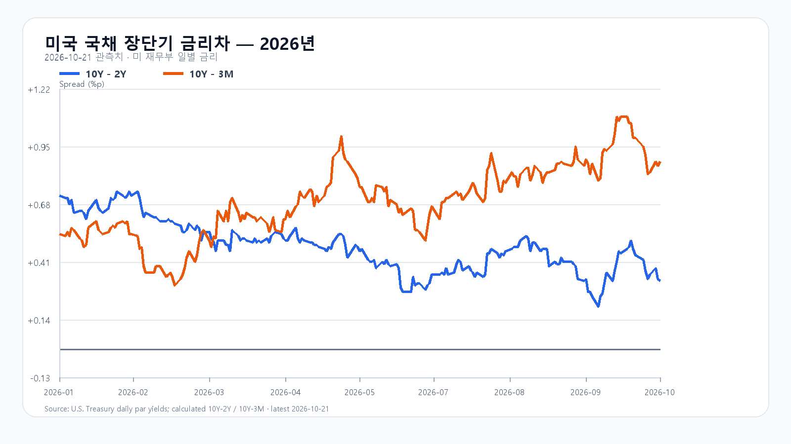

# 2026-10-22 KOSPI·KODEX 장전 리서치

작성 2026-10-22T08:08:32+09:00 / 데이터 최종 확인 2026-10-22T08:08:32+09:00 / 한국 장전. 미국10/21 정규장 종료·시간외 진행, 원천 지연 가능.

## 핵심 결론
미국 반도체 ETF는 올랐지만 주요 종목은 시간외에서 밀렸습니다. Nvidia의 국내 기판·패키징 투자와 금통위 결과가 KOSPI 반등의 지속성을 가를 변수입니다. 기본5600~5800(50%), 강세5800초과~5950(20%), 약세5350~5600미만(30%). 공격15·관망50·방어35. 90% 장중포락5250~6100. 조건부 수동판단으로 대응점수와 확률은 별개.

## 밤사이 지배 이슈
Nvidia 공식10/21 공급망 증설·삼성전기 기판 합류·Amkor한국 패키징 확대. 생산계획과 확정 매출 구분. 미국 정규장 반등 뒤 시간외 약세. 금통위10/22 공식일정. 후보8건·제외사유는 research/notes/2026-10-22.md. 전일 한국 반영된 Supermicro·SpaceX 호재를 중복 충격으로 가산하지 않음.

## 국내 확정값·전망 회고
|항목|10/21 시가|고가|저가|종가|
|---|---:|---:|---:|---:|
|KOSPI|5666.34|5816.43|5630.14|5735.66|
|KODEX|69940|74365|69220|71740|
KOSPI+3.29%, KODEX+6.80%, 거래량27461872주. fchart·basic·price 교차. KOSPI price10/20 지연 제외. 전일 기본실패·강세종가적중, 경로포락내. 정확15:20 앵커 미확보로 원인조건 미검증. 수급·프로그램·시장폭 정본묶음 미확인, 0 채우지 않음.

## 메모리 펀더멘털
10/21 18:10 GMT+8 DDR5 16Gb60.867달러+0.28%, DDR4 16Gb83.117달러-0.30%. HBM·서버DRAM·eSSD 신규계약 물량/단가 미확인. NAND10/12·계약8월 공개표는 최신아님. 부품 증설을 메모리 확정수주로 치환하지 않음.

## 미국 정규장
|종목|10/21 종가 USD|등락|
|---|---:|---:|
|QQQ|725.20|+1.05%|
|TQQQ|72.61|+3.12%|
|SOXX|510.36|+2.07%|
|SMH|556.70|+1.89%|
|NVDA|221.97|+2.54%|
|AMD|552.72|+3.36%|
|MU|913.67|+1.96%|
|AVGO|337.80|+1.03%|
10/21 16:00 ET=10/22 05:00 KST 종료. 연속 일봉 계산.

## 미국 시간외
|종목|USD|종가 대비|원천시각 KST|
|---|---:|---:|---|
|NVDA|220.51|-0.66%|2026-10-22T08:02:54+09:00|
|AMD|545.50|-1.31%|2026-10-22T08:02:29+09:00|
|MU|903.79|-1.08%|2026-10-22T08:02:10+09:00|
|AVGO|335.35|-0.73%|2026-10-22T07:58:55+09:00|
|META|713.18|+2.25%|2026-10-22T08:02:58+09:00|
|TSLA|374.83|-3.01%|2026-10-22T08:02:58+09:00|
진행중 유효봉, 확정 종가 아님.

## 최종 환율·선물·NXT
|항목|최근값|원천 시각|
|---|---:|---|
|삼성전자 NXT (OPEN)|222,000원 · -0.67%|2026-10-22T08:08:33.216521+09:00|
|SK하이닉스 NXT (OPEN)|1,273,000원 · -1.62%|2026-10-22T08:08:33.216534+09:00|
|하나은행 USD/KRW 고시|1,327.50원|2026-10-22T07:34:04+09:00|
|NQF 최근 거래|29,856.00|2026-10-22T07:58:26+09:00|
|ESF 최근 거래|7,775.50|2026-10-22T07:58:11+09:00|
|CLF 최근 거래|98.04|2026-10-22T07:58:14+09:00|
|BZF 최근 거래|110.05|2026-10-22T07:49:38+09:00|
하나은행 고시·선물최근거래·NXT·KRX 구분. 계약월연속선물 종가 차이를 현물당일수익률로 사용하지 않음.

## 금리와 일정
재무부10/21 3M4.25%,2Y4.81%,10Y5.13%. 차이+0.32/+0.88%p. FRED점검중으로 공식재무부2026시계열 대체, 2년차트 아님.
한국은행10/22 금통위(정확 발표시각 공식일정 미기재), FOMC10/27~28 ET. 미국주간실업수당 통상목요일08:30 ET=21:30KST이나 오늘 개별공식일정 원문 미확인으로 확정시각 단정안함.

## 조건과 무효화
강세20% 5800초과~5950:15:20 지수>5800 AND 외국인>0 AND 프로그램>0,5800재이탈무효.
기본50% 5600~5800:지수>=5600 AND <=5800 AND 외국인>=-8000억원,범위이탈·매도확대무효.
약세30% 5350~5600미만:지수<5600 AND 외국인<0 AND 프로그램<0,5600회복무효.
KOSPI5600/5700/5800, KODEX69220/71740/74365. 09:30·10:00 수급동행,14:00반전,15:20종가조건. 방어35·관망50·공격15.

## 출처
- [Nvidia 공급망 발표](https://nvidianews.nvidia.com/news/nvidia-and-supply-chain-partners-expand-capacity-to-accelerate-ai-infrastructure-buildout/)
- [Tesla 공시](https://ir.tesla.com/_flysystem/s3/sec/000162828026066738/tsla-20261021-gen.pdf)
- [Meta 실적 AP](https://apnews.com/article/13ecd6c459e39a3602f302bcc2412fe9)
- [DRAM 현물](https://www.trendforce.com/price/dram/dram_spot)
- [한국은행 금통위 일정](https://www.bok.or.kr/eng/main/contents.do?menuNo=400020)
- [미 재무부 금리](https://home.treasury.gov/resource-center/data-chart-center/interest-rates/TextView?type=daily_treasury_yield_curve&field_tdr_date_value=2026)
- [미국 시세](https://finance.yahoo.com/quote/SOXX/)
- [국내 일봉](https://fchart.stock.naver.com/sise.nhn?symbol=KOSPI&timeframe=day&count=5&requestType=0)
- [FOMC](https://www.federalreserve.gov/monetarypolicy/fomccalendars.htm)
