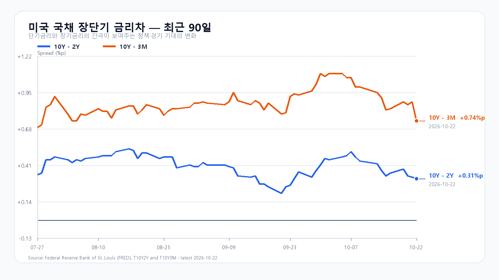
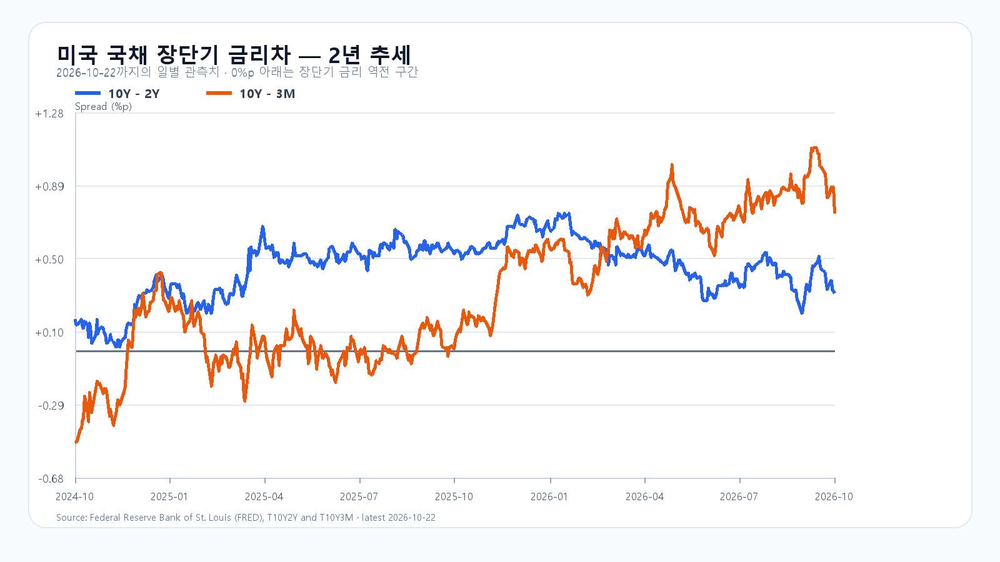

# 2026-10-23 KOSPI·KODEX 장전 리서치

작성 2026-10-23T08:03:37+09:00 / 데이터 최종 확인 2026-10-23T08:03:37+09:00 / 한국 장전. 미국10/22 정규장 종료·시간외. 원천 지연 가능.

## 핵심 결론
미국 반도체주가 급락한 뒤 시간외에서는 종목별 흐름이 갈렸습니다. 전일 하락을 거친 KOSPI는 5,486선 방어와 국내 매수의 지속성을 시험합니다. 기본5350~5550(45%),강세5550초과~5700(15%),약세5100~5350미만(40%). 공격5·관망40·방어55. 90% 장중포락4950~5850. 수동 조건부 판단이며 점수는 확률과 별개.

## 밤사이 시장을 지배한 이슈
Meta FCF-21.2억달러·연CAPEX1350~1450억달러, C주신설은 자금조달수단 확보로 현금증자 완료 아님. 미국 반도체 급락·원유 부담. 후보9건·제외근거는 취재노트. Meta실적·Nvidia공급망·금통위10/22한국 반영분과 후행미국매도 중복합산 제외. 신규 판단은 미국매도강도·시간외차이·NXT/선물/환율 반응.

## 한국시장·KODEX 대시보드와 회고
|항목|10/22 시가|고가|저가|종가|
|---|---:|---:|---:|---:|
|KOSPI|5670.11|5740.28|5485.98|5533.77|
|KODEX|70280|72300|65385|66770|
KOSPI-3.52%,KODEX-6.93%,KODEX거래량23246556주. fchart/basic/stock price교차. 전일 기본실패·약세종가적중·경로포락내. 수급exact앵커없어 원인조건 미검증. 투자주체합계-427억원 정합미확인, 프로그램·시장폭 최종묶음 보류. 미확인수급 0채우지 않음.

## 메모리 반도체 수급
10/22 18:10 GMT+8 DDR5 16Gb61.10달러+0.38%,DDR4 16Gb83.117보합. 현물지지와 주식투자비부담 분리. HBM·서버DRAM·eSSD 신규계약 물량/단가미확인. NAND10/12·공개계약8월을 최신으로 쓰지 않음.

## 미국 반도체·AI 정규장
|종목|10/22종가 USD|등락|
|---|---:|---:|
|QQQ|704.47|-2.86%|
|TQQQ|66.42|-8.52%|
|SOXX|475.69|-6.79%|
|SMH|523.35|-5.99%|
|NVDA|212.21|-4.40%|
|AMD|507.93|-8.10%|
|MU|856.49|-6.26%|
|AVGO|323.24|-4.31%|
10/22 16:00 ET=10/23 05:00KST. 일봉연속값 계산.

## 미국 시간외
|종목|USD|종가대비|원천시각 KST|
|---|---:|---:|---|
|NVDA|213.02|+0.38%|2026-10-23T07:57:54+09:00|
|AMD|508.08|+0.03%|2026-10-23T07:57:16+09:00|
|MU|845.60|-1.27%|2026-10-23T07:57:51+09:00|
|AVGO|324.10|+0.27%|2026-10-23T07:56:48+09:00|
|META|647.02|-0.28%|2026-10-23T07:57:15+09:00|
|TSLA|373.47|-0.30%|2026-10-23T07:57:15+09:00|
진행중 유효봉으로 확정종가 아님.

## 달러/원·선물·NXT
|항목|최근값|원천 시각|
|---|---:|---|
|삼성전자 NXT (OPEN)|205,000원 · -4.43%|2026-10-23T08:03:37.681226+09:00|
|SK하이닉스 NXT (OPEN)|1,186,000원 · -3.03%|2026-10-23T08:03:37.681236+09:00|
|하나은행 USD/KRW 고시|1,326.50원|2026-10-23T07:53:40+09:00|
|NQF 최근 거래|29,110.75|2026-10-23T07:53:32+09:00|
|ESF 최근 거래|7,709.00|2026-10-23T07:53:22+09:00|
|CLF 최근 거래|99.01|2026-10-23T07:53:22+09:00|
|BZF 최근 거래|112.80|2026-10-23T07:44:01+09:00|
하나은행고시·연속선물최근거래·NXT와KRX 구분. 선물계약월롤을 현물당일등락으로 계산하지 않음.

## 경제 캘린더
한국은행10/22 3.00%만장일치동결, 향후인상시기/속도판단. DOL10/22 신규실업수당194000(전주수정200000), 계속수급1728000. 미시간대공식10/23 10ET=23KST확정치. PMI10/23 22:45KST보조출처일치·공식403으로 잠정일정. FOMC10/27~28ET.

## 미 국채와 장단기 금리차
Treasury10/22 3M4.22·2Y4.65·10Y4.96%, 전일4.25/4.81/5.13대비 -3/-16/-17bp. FRED10/22 10Y-2Y0.31·10Y-3M0.74%p. 장기금리급락으로 금리차축소. FRED개별금리10/21과 최신스프레드 혼합차감 금지. FRED복구로2년·90일차트 생성.

## 오늘 시나리오·무효화
강세15%5550초과~5700:15:20지수>5550 AND 외국인>0 AND 프로그램>0,5550재이탈무효.
기본45%5350~5550:지수>=5350 AND <=5550 AND 외국인>=-8000억원,범위이탈·매도확대무효.
약세40%5100~5350미만:지수<5350 AND 외국인<0 AND 프로그램<0,5350회복무효.
KOSPI5350/5486/5550,KODEX65385/66770/72300. KODEX65385이탈미회복 지지무효. 09:30·10:00수급동행,14:00반전,15:20조건. 한시점매수의 지속성 단정금지.

## 출처와 확인 시각
취재원문 fetchedAt/rawHash는 research/evidence/2026-10-23/. Meta·DOL은 웹원문별도열람, 직접403구분. 최종가격 각행원천시각.
- [Meta 3분기 실적](https://investor.atmeta.com/investor-news/press-release-details/2026/Meta-Reports-Third-Quarter-2026-Results/default.aspx)
- [한국은행 10월22일 결정](https://www.bok.or.kr/eng/bbs/E0000634/view.do?nttId=11065825&menuNo=400069)
- [DRAM 현물](https://www.trendforce.com/price/dram/dram_spot)
- [미 재무부](https://home.treasury.gov/resource-center/data-chart-center/interest-rates/TextView?type=daily_treasury_yield_curve&field_tdr_date_value=2026)
- [미국 시세](https://finance.yahoo.com/quote/SOXX/)
- [국내 일봉](https://fchart.stock.naver.com/sise.nhn?symbol=KOSPI&timeframe=day&count=5&requestType=0)
- [미국 실업수당](https://www.dol.gov/ui/data.pdf)
- [미시간대 소비심리](https://www.sca.isr.umich.edu/)
- [FOMC](https://www.federalreserve.gov/monetarypolicy/fomccalendars.htm)
- [FRED 금리차](https://fred.stlouisfed.org/series/T10Y2Y)
