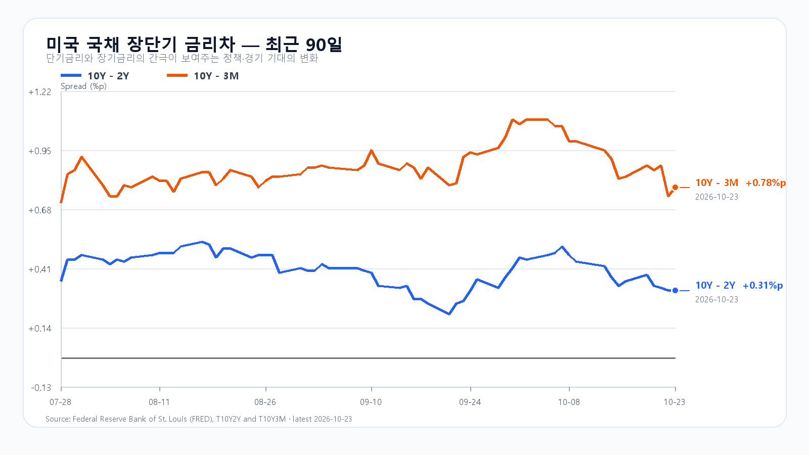
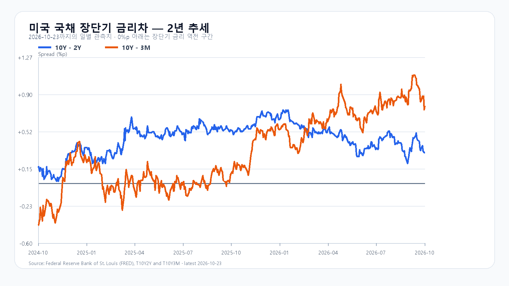

# 2026-10-26 KOSPI·KODEX 장전 리서치

작성 2026-10-26T08:05:24+09:00 / 데이터 최종 확인 2026-10-26T08:05:24+09:00 / 한국 장전. 미국10/23 정규장·10/24KST 시간외 종료. 원천 지연 가능.

## 핵심 결론
미국 반도체 ETF가 소폭 반등했지만 종목별 흐름은 갈렸습니다. 금요일 저점에서 회복한 KOSPI는 FOMC를 앞두고 5,550선 유지와 매수 지속성을 시험합니다. 기본5400~5600(50%),강세5600초과~5750(25%),약세5200~5400미만(25%). 공격20·관망55·방어25. 90% 장중포락5050~5900. 수동 조건부 판단.

## 밤사이 시장 지배 이슈
반도체 회복 차별화·유가/금리 부담·FOMC/빅테크실적. 솔리다임 IPO검토중단과투자유지는별개. 금요일한국에반영된Meta·솔리다임·미국목요일매도 중복합산금지. 후보8건과제외경계는취재노트.

## 한국 시장·회고
10/23 KOSPI OHLC5403.17/5550.30/5305.98/5550.30(+0.30%), KODEX64005/67415/61145/67415(+0.97%),24520732주. KOSPI price API10/22지연제외, fchart/basic/ETF일봉교차. 이전기본5350~5550은0.30p상회·강세종가. 장중약세범위통과,수급조건미검증. 확정수급·프로그램·시장폭·선물정본묶음미확인.

## 메모리 수급
10/23 18:10GMT+8 DDR5 61.267달러+0.27%,DDR4 82.87달러-0.30%. HBM·서버DRAM·RDIMM·NAND·eSSD 신규계약단가/물량미확인. 현물과투자/주가분리. 공개계약8월·모듈10/12 최신값으로사용안함.

## 미국 정규장
|종목|10/23종가 USD|등락|
|---|---:|---:|
|QQQ|704.40|-0.01%|
|TQQQ|66.29|-0.20%|
|SOXX|478.20|+0.53%|
|SMH|527.20|+0.74%|
|NVDA|210.96|-0.59%|
|AMD|516.79|+1.74%|
|MU|877.55|+2.46%|
|AVGO|321.68|-0.48%|
10/23 16ET=10/24 05KST. 원문 OHLC·종가위치는각yahoo JSON보존.

## 미국 시간외
|종목|USD|종가대비|시각 KST|
|---|---:|---:|---|
|NVDA|211.11|+0.07%|2026-10-24T08:59:55+09:00|
|AMD|516.80|+0.00%|2026-10-24T08:59:20+09:00|
|MU|879.90|+0.27%|2026-10-24T08:59:59+09:00|
|AVGO|322.23|+0.17%|2026-10-24T08:59:51+09:00|
주말 이전 마지막 유효봉. 월요일시간외가격아님.

## 달러/원·선물·NXT
|항목|최근값|원천 시각|
|---|---:|---|
|삼성전자 NXT (OPEN)|217,000원 · 0.70%|2026-10-26T08:05:24.94281+09:00|
|SK하이닉스 NXT (OPEN)|1,293,000원 · 1.25%|2026-10-26T08:05:24.94282+09:00|
|하나은행 USD/KRW 고시|1,326.00원|2026-10-26T07:38:39+09:00|
|NQF 최근 거래|29,304.25|2026-10-26T07:55:23+09:00|
|ESF 최근 거래|7,689.75|2026-10-26T07:55:19+09:00|
|CLF 최근 거래|102.06|2026-10-26T07:55:18+09:00|
|BZF 최근 거래|110.62|2026-10-26T07:54:12+09:00|
연속선물 최근거래값, 계약월롤로 금요일결제대비수익률미계산. 하나고시·NXT/KRX구분.

## 국채·캘린더
Treasury10/23 3M4.22·2Y4.69·10Y5.00%. 2Y/10Y전일대비+4bp. FRED10/23금리차0.31/0.78%p. 개별금리10/22와혼합금지.
FOMC10/27~28ET(결정10/29 03KST), Microsoft10/28ET·Amazon10/29ET실적예정. BEA10/29 08:30ET=21:30KST GDP·소득소비/PCE동시. 중국PMI·한국기업실적 정확시각미확인,추정안함.

## 시나리오·무효화
강세25%5600초과~5750:15:20지수>5600 AND 외국인>0 AND 프로그램>0,5600재이탈무효.
기본50%5400~5600:지수>=5400 AND <=5600 AND 외국인>=-8000억원,범위이탈·매도확대무효.
약세25%5200~5400미만:지수<5400 AND 외국인<0 AND 프로그램<0,5400회복무효.
KOSPI5400/5550/5600,KODEX64005/67415/72300.64005이탈미회복반등무효.09:30·10시·14시·15:20각각관찰. 한시점순매수지속단정금지.

## 출처
원문수집시각·해시는 research/evidence/2026-10-26/. 누적평가기기존9/21해시불일치·활성가설없음.
- [SK하이닉스 솔리다임 발표](https://news.skhynix.com/en/fact-12/)
- [SEC 6-K](https://www.sec.gov/Archives/edgar/data/2120882/000119312526429184/d159239d6k.htm)
- [DRAM 현물](https://www.trendforce.com/price/dram/dram_spot)
- [미 재무부](https://home.treasury.gov/resource-center/data-chart-center/interest-rates/TextView?type=daily_treasury_yield_curve&field_tdr_date_value=2026)
- [미국 시세](https://finance.yahoo.com/quote/SOXX/)
- [국내 일봉](https://fchart.stock.naver.com/sise.nhn?symbol=KOSPI&timeframe=day&count=5&requestType=0)
- [FOMC](https://www.federalreserve.gov/monetarypolicy/fomccalendars.htm)
- [BEA 일정](https://www.bea.gov/news/schedule)
- [Microsoft IR](https://www.microsoft.com/en-us/investor/default)
- [Amazon 실적 일정](https://www.aboutamazon.com/news/company-news/amazon-earnings-q3-2026-report)
- [FRED 금리차](https://fred.stlouisfed.org/series/T10Y2Y)
