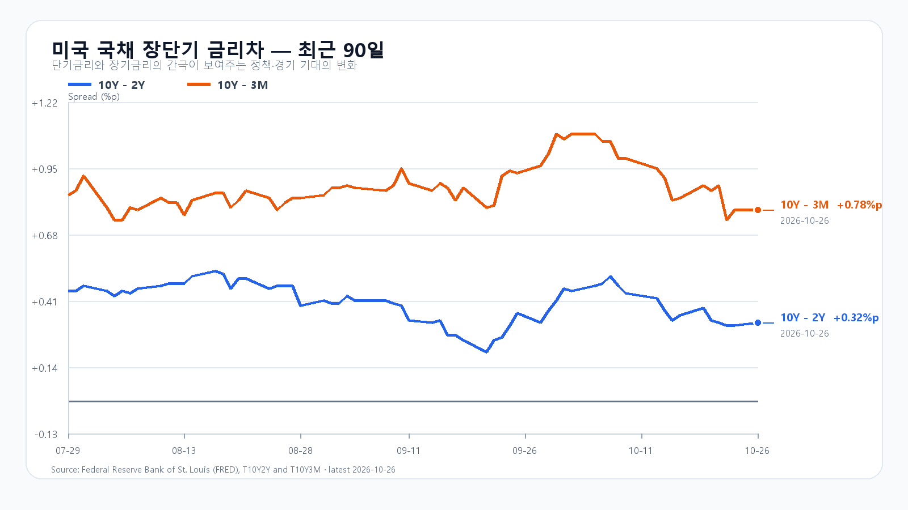
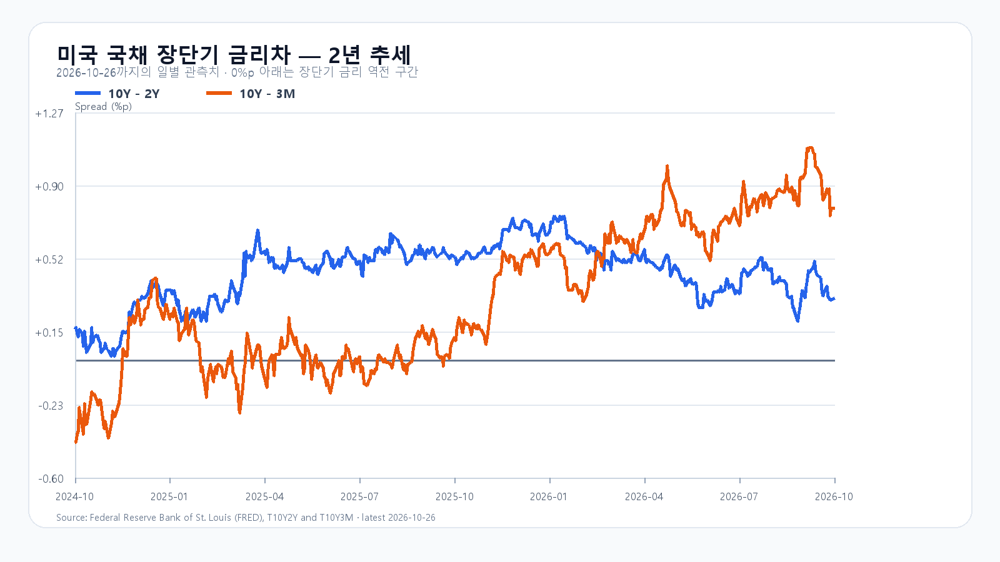

# 2026-10-27 KOSPI·KODEX 장전 리서치

작성 2026-10-27T08:03:44+09:00 / 데이터 최종 확인 2026-10-27T08:03:44+09:00 / 한국 장전. 미국10/26 정규장·10/27 KST 시간외 분리. 원천 지연 가능.

## 핵심 결론
Meta의 공모와 SpaceX의 GPU 금융 약정이 AI 투자 지속 기대를 높였습니다. 미국 반도체주가 동반 상승한 가운데 KOSPI는 5,500선 회복과 국내 매수 동행을 시험합니다. 기본5400~5600(50%),강세5600초과~5750(30%),약세5200~5400미만(20%). 공격30·관망50·방어20. 90% 장중포락5100~5900. 수동 조건부 판단.

## 밤사이 지배 이슈
Meta350억달러 공모개시·600억ATM계획(납입완료아님), SpaceX400억GPU리스 구속력약정(종결조건), Anthropic IPO등록공개(가격미정). 기업발표·SEC·보도 경계와 레이더8건 research/notes/2026-10-27.md. 전일한국반영 Meta기존CAPEX·솔리다임중복제외. 사건과미국반도체가격반응독립합산금지.

## 국내 확정·회고
10/26 KOSPI5499.05/5565.67/5455.11/5469.47(-1.46%), KODEX66075/67985/65115/65475(-2.88%),18823219주. fchart와basic/ETF교차. 직전기본5400~5600내·포락내. 정확수급앵커미확보로지속성·인과판정보류. 최종현물·프로그램·시장폭·선물정본묶음미확인.

## 메모리
10/26 18:10GMT+8 DDR5 61.333달러+0.11%,DDR4 82.623달러-0.30%. HBM·서버DRAM·RDIMM·NAND/eSSD 신규계약단가·물량미확인. NAND현물10/19·공개계약8월은최신값으로사용안함. 수요·자금조달·주식평가분리.

## 미국 정규장
|종목|10/26종가 USD|등락|
|---|---:|---:|
|QQQ|712.20|+1.11%|
|TQQQ|68.43|+3.23%|
|SOXX|491.83|+2.85%|
|SMH|541.62|+2.74%|
|NVDA|216.00|+2.39%|
|AMD|531.28|+2.80%|
|MU|903.70|+2.98%|
|AVGO|329.17|+2.33%|
10/26 16ET=10/27 05KST. OHLC·종가위치원문보존.

## 미국 시간외
|종목|USD|종가대비|시각 KST|
|---|---:|---:|---|
|NVDA|216.36|+0.17%|2026-10-27T07:58:36+09:00|
|AMD|532.50|+0.23%|2026-10-27T07:58:21+09:00|
|MU|906.92|+0.36%|2026-10-27T07:58:36+09:00|
|AVGO|332.93|+1.14%|2026-10-27T07:58:12+09:00|
시간외 최근 유효봉·정규종가와분리.

## 최종 환율·선물·NXT
|항목|최근값|원천 시각|
|---|---:|---|
|삼성전자 NXT (OPEN)|219,000원 · 2.82%|2026-10-27T08:03:45.459855+09:00|
|SK하이닉스 NXT (OPEN)|1,320,000원 · 3.53%|2026-10-27T08:03:45.459864+09:00|
|하나은행 USD/KRW 고시|1,327.00원|2026-10-27T07:51:22+09:00|
|NQF 최근 거래|29,473.50|2026-10-27T07:53:43+09:00|
|ESF 최근 거래|7,717.00|2026-10-27T07:53:35+09:00|
|CLF 최근 거래|101.32|2026-10-27T07:53:33+09:00|
|BZF 최근 거래|110.24|2026-10-27T07:26:51+09:00|
연속선물최근거래·롤수익률미계산. 하나고시·NXT/KRX구분.

## 국채·일정
Treasury10/26 3M4.22·2Y4.68·10Y5.00%. FRED동일10/26금리차0.32/0.78%p. 개별FRED10/23값혼합안함.
FOMC10/27~28ET·결정10/29 03KST, MS10/28ET·Amazon10/29ET실적. BEA10/29 08:30ET=21:30KST GDP·개인소득소비/PCE동시. 국내기업실적정확시각미확인.

## 조건·무효화
강세30%5600초과~5750:15:20지수>5600 AND 외국인>0 AND 프로그램>0,5600재이탈무효.
기본50%5400~5600:지수>=5400 AND <=5600 AND 외국인>=-8000억원,범위이탈·매도확대무효.
약세20%5200~5400미만:지수<5400 AND 외국인<0 AND 프로그램<0,5400회복무효.
KOSPI5400/5500/5600,KODEX65115/66075/67985.65115이탈미회복반등무효.09:30·10시·14시·15:20별도관찰.

## 출처
- [Meta 회사 발표](https://finance.yahoo.com/markets/stocks/articles/meta-announces-launch-offering-depositary-105800284.html)
- [SpaceX 금융 약정](https://ir.spacex.com/updates/releases-details/2026/SPACEX-SECURES-40-BILLION-IN-THE-LARGEST-GPU-FINANCING-EVER-2026-EnDqGhTAB3/default.aspx)
- [Anthropic S-1](https://www.sec.gov/Archives/edgar/data/2130357/000162828026067168/anthropicpbc-sx1.htm)
- [DRAM 현물](https://www.trendforce.com/price/dram/dram_spot)
- [미 재무부](https://home.treasury.gov/resource-center/data-chart-center/interest-rates/TextView?type=daily_treasury_yield_curve&field_tdr_date_value=2026)
- [미국 시세](https://finance.yahoo.com/quote/SOXX/)
- [국내 일봉](https://fchart.stock.naver.com/sise.nhn?symbol=KOSPI&timeframe=day&count=5&requestType=0)
- [FOMC](https://www.federalreserve.gov/monetarypolicy/fomccalendars.htm)
- [BEA 일정](https://www.bea.gov/news/schedule)
- [Microsoft IR](https://www.microsoft.com/en-us/investor/default)
- [Amazon 실적 일정](https://www.aboutamazon.com/news/company-news/amazon-earnings-q3-2026-report)
