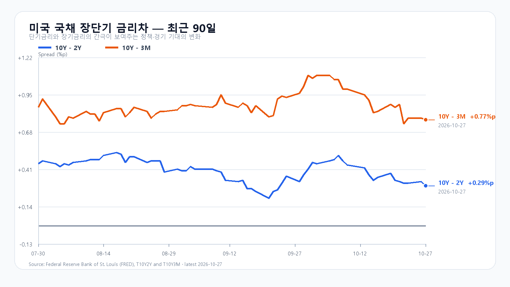
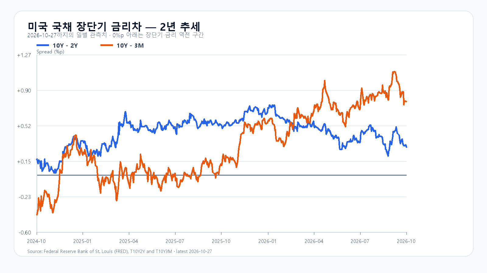

# 2026-10-28 KOSPI·KODEX 장전 리서치

작성 2026-10-28T08:33:51+09:00 / 데이터 최종 확인 2026-10-28T08:33:51+09:00 / 한국 장전. 미국10/27 정규장·10/28 KST 시간외 분리. 원천 지연 가능.

## 핵심 결론
미국 반도체주가 추가 상승했습니다. 전일 급등한 KOSPI는 오늘 SK하이닉스 실적과 매수 지속성을 시험하며, 밤사이에는 FOMC와 빅테크 실적이 이어집니다. 기본5600~5800(50%),강세5800초과~5950(25%),약세5400~5600미만(25%). 공격25·관망50·방어25. 90% 장중포락5250~6100. 수동 조건부 판단이며 대응점수는 확률과 별개.

## 밤사이 시장을 지배한 이슈
미국반도체추가상승·SK당일실적·Meta공모증액/가격결정·FOMC. 레이더9건과사실경계 research/notes/2026-10-28.md. 이미한국반영AI금융·IPO·주주환원보도중복가산제외. Meta 375억공모+600억계획은975억즉시납입아님.

## 전일 대비 바뀐 변수와 유지 변수
SOXX+3.91%,SMH+3.02% 추가상승 신규 관측. 미국가격상승과그원인독립합산금지. 국내급등후고점반납·고금리·FOMC예정 유지. 당일SK실적수치발표전미확인,컨센서스를실적으로쓰지않음.

## 한국시장·KODEX 대시보드와 직전 전망
10/27 KOSPI5658.65/5737.61/5612.92/5638.34(+3.09%), KODEX69965/72745/69465/69955(+6.84%),20694302주. fchart와basic교차. 전일기본5400~5600초과·강세5600초과~5750내·장중포락내. final수급·exact앵커미확보로조건인과판정보류.

## 메모리 반도체 수급
10/27 18:10GMT+8 DDR5 61.333·DDR4 82.623 각보합. DDR5 RDIMM32GB2165달러-0.92%. HBM·서버DRAM·NAND/eSSD 신규계약단가/물량미확인. NAND현물10/19·공개계약8월은최신대체사용안함. 생산/수율/주문은오늘SK발표후검증. AI투자지속과수익화·주가수급별도평가.

## 미국 반도체·AI 정규장
|종목|10/27종가 USD|등락|
|---|---:|---:|
|QQQ|721.25|+1.27%|
|TQQQ|71.04|+3.81%|
|SOXX|511.06|+3.91%|
|SMH|557.98|+3.02%|
|NVDA|217.94|+0.90%|
|AMD|560.26|+5.45%|
|MU|928.76|+2.77%|
|AVGO|342.33|+4.00%|
10/27 16ET=10/28 05KST. 원문 OHLC보존: SOXX500.245/513.160/498.410/511.060, SMH548.800/559.800/546.665/557.980. SOXX/SMH종가고점근처이나NVDA시가218.30→217.94로차별화.

## 미국 시간외
|종목|USD|종가대비|시각 KST|
|---|---:|---:|---|
|NVDA|217.63|-0.14%|2026-10-28T08:03:18+09:00|
|AMD|561.71|+0.26%|2026-10-28T08:03:07+09:00|
|MU|927.00|-0.19%|2026-10-28T08:01:39+09:00|
|AVGO|341.56|-0.23%|2026-10-28T08:02:12+09:00|
시간외 유효봉·정규종가와분리. SK ADR은전일한국장후행반영과분리해야하므로별도충격점수미사용.

## 달러/원·국내 수급·시장 구조
|항목|최근값|원천 시각|
|---|---:|---|
|삼성전자 NXT (OPEN)|229,000원 · 3.15%|2026-10-28T08:33:51.637236+09:00|
|SK하이닉스 NXT (OPEN)|1,377,000원 · 2.68%|2026-10-28T08:33:51.637245+09:00|
|하나은행 USD/KRW 고시|1,327.00원|2026-10-28T08:24:14+09:00|
|NQF 최근 거래|29,814.00|2026-10-28T08:23:47+09:00|
|ESF 최근 거래|7,758.75|2026-10-28T08:23:47+09:00|
|CLF 최근 거래|99.92|2026-10-28T08:22:20+09:00|
|BZF 최근 거래|109.49|2026-10-28T08:20:26+09:00|
하나은행고시·연속선물최근거래·NXT장전과KRX종가구분. 선물롤수익률미계산. PREOPEN수급/프로그램0은거래전초기값이며전일실제0이아님. 외국인현물/선물·기관세부·프로그램·시장폭최종묶음미확인. 오늘개장후재관찰,미확인은null.

## 경제 캘린더
SK하이닉스10/28 09시전발표·09시콜(공식초청장). FOMC10/27~28ET·결정10/29 03KST, MS10/28ET·Amazon10/29ET실적. BEA10/29 08:30ET=21:30KST GDP·개인소득소비/PCE동시. 삼성공식IR페이지수집·세부시간정본미확인. CB10월수치원문지연/전월수정충돌로보류.

## 미 국채와 장단기 금리차
Treasury10/27 3M4.22·2Y4.70·10Y4.99%. FRED동일10/27금리차0.29/0.77%p. 전일0.32/0.78에서축소:2Y+2bp·10Y-1bp. 개별FRED10/26값혼합차감안함. 성장주할인율에는10Y절대수준부담.

## 오늘 KOSPI·KODEX 시나리오
강세25%5800초과~5950:15:20지수>5800 AND 외국인>0 AND 프로그램>0,5800재이탈무효.
기본50%5600~5800:지수>=5600 AND <=5800 AND 외국인>=-8000억원,범위이탈·매도확대무효.
약세25%5400~5600미만:지수<5600 AND 외국인<0 AND 프로그램<0,5600회복무효.
KOSPI5600/5700/5800,KODEX69465/69955/72745. 69465이탈미회복반등무효. 90%장중포락5250~6100,종가범위와별도.

## 장중 체크리스트
09:00SK콜·09:30초기반응·10시외국인/프로그램동행·14시지속성·15:20조건관측. 반도체두종목외금융/자동차/조선확산·시장폭도확인. 사전수급가설승격없음.

## 출처와 확인 시각
원천별 fetchedAt·거래일·rawHash는 evidence/2026-10-28에보존. 최종조회시각상단표기.
- [SK하이닉스 실적 일정](https://news.skhynix.com/en/q3-2026-earnings-conference-call-invitation/)
- [Meta 공모 가격 확정](https://investor.atmeta.com/investor-news/press-release-details/2026/Meta-Announces-Pricing-of-Offering-of-Depositary-Shares-Representing-Series-A-Mandatory-Convertible-Preferred-Stock-and-Offering-of-Class-A-Common-Stock-in-Connection-with-Forward-Sale-Agreements/default.aspx)
- [DRAM 현물](https://www.trendforce.com/price/dram/dram_spot)
- [미 재무부](https://home.treasury.gov/resource-center/data-chart-center/interest-rates/TextView?type=daily_treasury_yield_curve&field_tdr_date_value=2026)
- [미국 시세](https://finance.yahoo.com/quote/SOXX/)
- [국내 일봉](https://fchart.stock.naver.com/sise.nhn?symbol=KOSPI&timeframe=day&count=5&requestType=0)
- [FOMC](https://www.federalreserve.gov/monetarypolicy/fomccalendars.htm)
- [BEA 일정](https://www.bea.gov/news/schedule)
- [Microsoft IR](https://www.microsoft.com/en-us/investor/default)
- [Amazon 실적 일정](https://www.aboutamazon.com/news/company-news/amazon-earnings-q3-2026-report)
