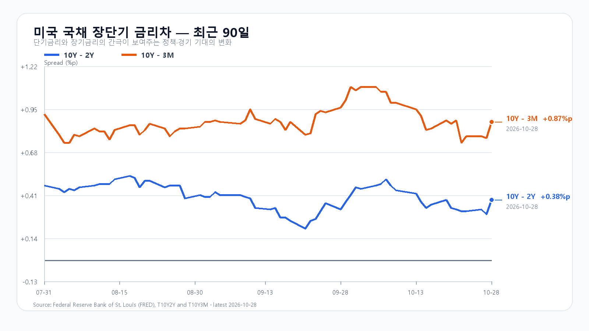
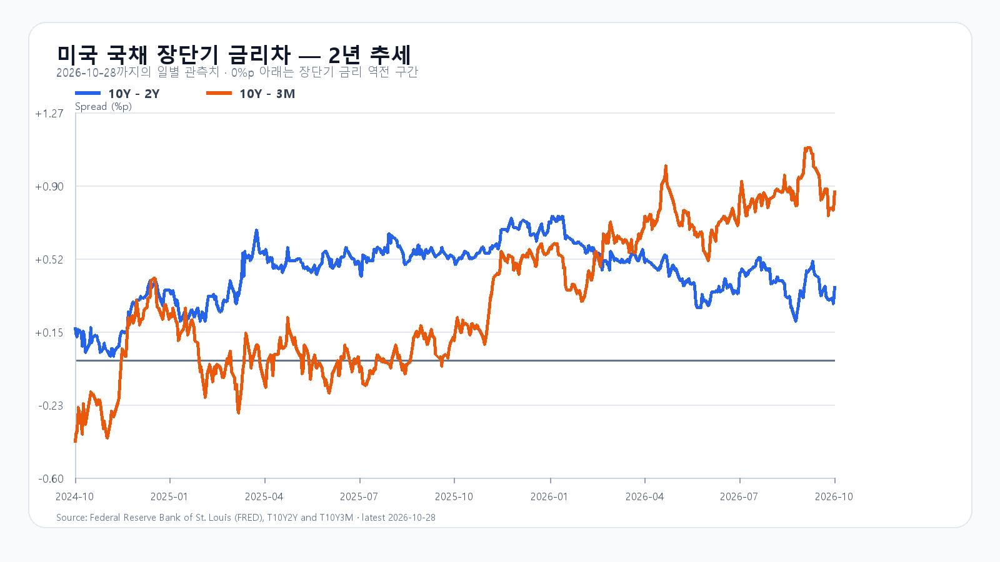

# 2026-10-29 KOSPI·KODEX 장전 리서치
작성 2026-10-29T08:52:27+09:00 / 데이터 최종 확인 2026-10-29T08:52:27+09:00 / 한국 장전, 미국10/28정규장·시간외 별도

## 핵심 결론
급등후6000안착확인. 공격15·관망50·방어35. MS수요성장과Alphabet현금부담충돌.
## 밤사이 시장을 지배한 이슈
연준3.75~4%동결10:2·소수2인인상선호. MS매출922.79억+19%·Azure+48%. Alphabet매출1275.77억·Cloud307억+103%·CAPEX513.55억/OCF422.90억/FCF-90.65억. 사실과해석분리: 수요성장은확정,국내매수지속은조건부.
## 전일 대비 바뀐 변수와 유지 변수
새변수연준결정/빅테크실적. SK실적전일반영·미국후행분중복합산제외.
## 한국시장·KODEX 대시보드
전일KOSPI{'open': 5763.85, 'high': 6032.28, 'low': 5745.51, 'close': 6012.44, 'volume': 237337.0}·+6.63%,KODEX{'open': 73425.0, 'high': 81010.0, 'low': 72860.0, 'close': 80280.0, 'volume': 23425006.0}·+14.76%. fchart/API교차.
|항목|최근값|원천 시각|
|---|---:|---|
|삼성전자 NXT (OPEN)|240,000원 · -0.83%|2026-10-29T08:50:00+09:00|
|SK하이닉스 NXT (OPEN)|1,489,000원 · 0.13%|2026-10-29T08:50:00+09:00|
|하나은행 USD/KRW 고시|1,341.00원|2026-10-29T08:50:52+09:00|
|NQF 최근 거래|29,632.25|2026-10-29T08:42:19+09:00|
|ESF 최근 거래|7,745.25|2026-10-29T08:42:24+09:00|
|CLF 최근 거래|101.79|2026-10-29T08:42:23+09:00|
|BZF 최근 거래|110.56|2026-10-29T08:38:42+09:00|
## 메모리 반도체 수급
10/28 DRAM표DDR5 16Gb61.333달러보합·DDR4 16Gb82.92달러+0.36%. 현물과HBM계약구분. HBM/서버DRAM/NAND/eSSD신규물량·계약단가미확인. 수요성장과할인율·포지션위험분리.
## 미국 반도체·AI
|종목|종가USD|등락|
|---|---:|---:|
|QQQ|725.61|+0.60%|
|TQQQ|72.36|+1.86%|
|SOXX|521.94|+2.13%|
|SMH|567.67|+1.74%|
|NVDA|215.38|-1.17%|
|AMD|578.44|+3.24%|
|MU|983.23|+5.86%|
|AVGO|351.81|+2.77%|
시간외는별도:
|NVDA|213.91|-0.68%|2026-10-29T08:46:40+09:00|
|AMD|566.15|-2.12%|2026-10-29T08:47:10+09:00|
|MU|959.02|-2.46%|2026-10-29T08:47:08+09:00|
|AVGO|343.00|-2.50%|2026-10-29T08:46:22+09:00|
## 달러/원·국내 수급·시장 구조
|항목|최근값|원천 시각|
|---|---:|---|
|삼성전자 NXT (OPEN)|240,000원 · -0.83%|2026-10-29T08:50:00+09:00|
|SK하이닉스 NXT (OPEN)|1,489,000원 · 0.13%|2026-10-29T08:50:00+09:00|
|하나은행 USD/KRW 고시|1,341.00원|2026-10-29T08:50:52+09:00|
|NQF 최근 거래|29,632.25|2026-10-29T08:42:19+09:00|
|ESF 최근 거래|7,745.25|2026-10-29T08:42:24+09:00|
|CLF 최근 거래|101.79|2026-10-29T08:42:23+09:00|
|BZF 최근 거래|110.56|2026-10-29T08:38:42+09:00|
최종현물/선물·기관세부·프로그램·시장폭미확인(null),PREOPEN0재사용금지.
## 경제 캘린더
10/29 21:30KST GDP/PCE,Amazon미국29일. 연준결정은이미발표됨.
## 미 국채와 장단기 금리차
FRED10/28 10Y-2Y0.38%p·10Y-3M0.87%p. 개별금리최신10/27 3M4.22·2Y4.70·10Y4.99%. 서로다른날혼합차감안함.

## 오늘 KOSPI·KODEX 시나리오
강세20%6100초과~6250:지수>6100 AND 외국인>0 AND 프로그램>0,6100재이탈무효.
기본50%5900~6100:지수>=5900 AND <=6100 AND 외국인>=-8000억원,범위이탈무효.
약세30%5700~5900미만:지수<5900 AND 외국인<0 AND 프로그램<0,5900회복무효.
관측15:20·다음확인09:30/10시/14시. 장중90%포락5500~6400. KODEX78000/80280/81010.
## 장중 체크리스트
6000안착·5900지지·반도체매수확산·환율/선물동행. 가설승격없음.
## 출처와 확인 시각
evidence/2026-10-29 원문rawHash/fetchedAt별도. 최초수집08:47,최종표시상단.
- [연준 10월 결정](https://www.federalreserve.gov/newsevents/pressreleases/monetary20261028a.htm)
- [Microsoft 실적](https://www.microsoft.com/en-us/Investor/earnings/FY-2027-Q1/press-release-webcast)
- [Alphabet SEC 실적](https://www.sec.gov/Archives/edgar/data/1652044/000165204426000080/googexhibit991q32026.htm)
- [DRAM 현물](https://www.trendforce.com/price/dram/dram_spot)
- [미국 시세](https://finance.yahoo.com/quote/SOXX/)
- [국내 일봉](https://fchart.stock.naver.com/sise.nhn?symbol=KOSPI&timeframe=day&count=5&requestType=0)
- [BEA 일정](https://www.bea.gov/news/schedule)
