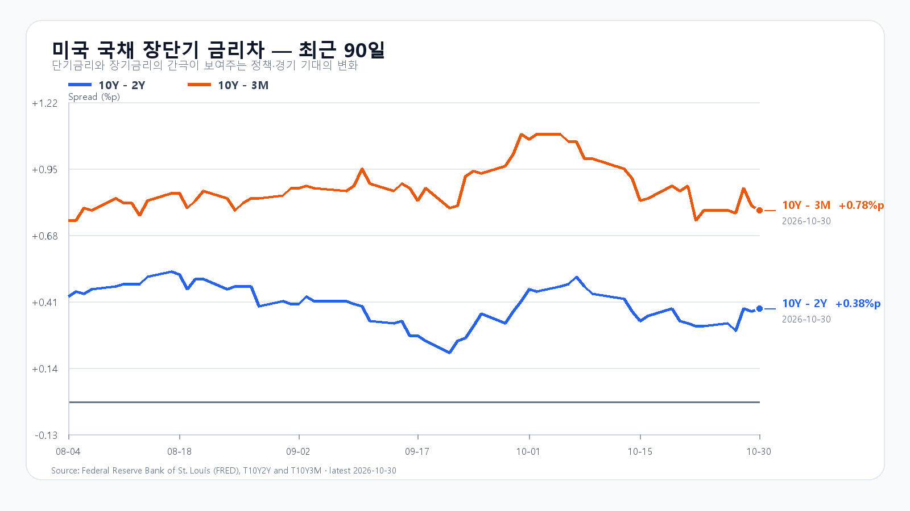
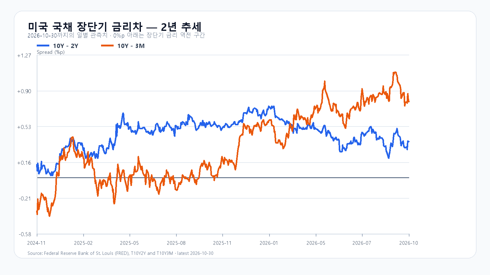

# 2026-11-02 KOSPI·KODEX 장중 리서치
작성 2026-11-02T09:17:05+09:00 / 데이터 최종 확인 2026-11-02T09:17:05+09:00

## 밤사이 시장을 지배한 이슈
Intel 전망 부진과 공장 사고, 미국 반도체 동반 하락, 소비자 DRAM 현물과 계약가격의 차별화가 중심이다. Intel 전망의 일부는 전일 한국장에 이미 반영됐다. 상세 취재 근거는 research/notes/2026-11-02.md에 보관한다.

## 미국 10월 30일 정규장
|종목|종가 USD|등락|
|---|---:|---:|
|QQQ|690.49|-3.47%|
|TQQQ|62.01|-10.47%|
|SOXX|471.51|-8.24%|
|SMH|522.49|-6.98%|
|NVDA|204.64|-4.22%|
|AMD|504.80|-10.88%|
|MU|884.74|-5.30%|
|AVGO|326.08|-5.48%|
## 발행 직전 조회
|항목|최근값|원천 시각|
|---|---:|---|
|KOSPI|5,663.42 · -1.17%|2026-11-02T09:17:00+09:00|
|KODEX 레버리지|71,135원 · -1.94%|조회 2026-11-02T09:17:04.633839+09:00|
|하나은행 USD/KRW 고시|1,335.10원|2026-11-02T09:15:43+09:00|
|NQF 최근 거래|28,700.75|2026-11-02T09:07:06+09:00|
|ESF 최근 거래|7,646.25|2026-11-02T09:07:04+09:00|
|CLF 최근 거래|102.48|2026-11-02T09:07:01+09:00|
|BZF 최근 거래|111.85|2026-11-02T09:06:33+09:00|

NXT 원천 표시 시각이 수집 시각보다 늦어 가격을 제외했다.
## 조건부 전망
기본 5550~5750(50%), 강세 5750 초과~5900(20%), 약세 5350~5550 미만(30%). 강세: 지수>5750 AND 외국인>0 AND 프로그램>0. 기본: 5550<=지수<=5750. 약세: 지수<5550 AND 외국인<0 AND 프로그램<0. 관측 15:20, 범위 경계 재진입시 무효. 장중 경로 90% 포락 5150~6100. 공격10 관망45 방어45. KODEX 69000/70500/72545원. 수급 확정값 미확인.

미국 FRED 10월 30일 10년-2년 금리차 +0.38%p, 10년-3개월 +0.78%p. 개별 금리와 날짜를 혼합하지 않음.
