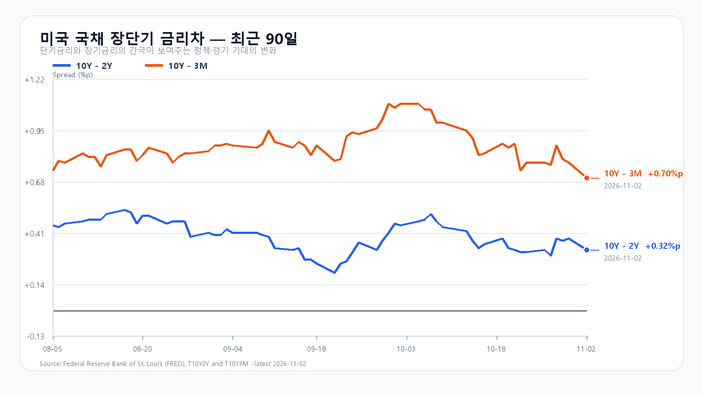
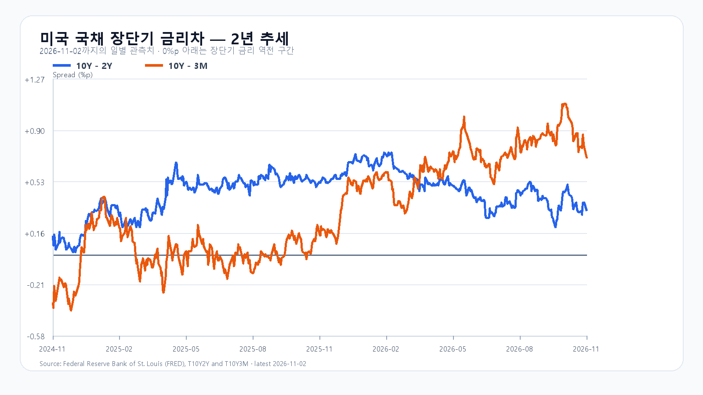

# 2026-11-03 KOSPI·KODEX 장전 리서치
작성 2026-11-03T08:03:54+09:00 / 데이터 최종 확인 2026-11-03T08:03:54+09:00 / 한국 장전

# 2026-11-03 취재 노트
실제 수집 시작 07:58 KST. 정규장 11/2 16:00 EST=11/3 06:00 KST. 시간외는 진행 중 최근 유효봉.
## 이슈 후보와 순위
1. 미국 반도체 추가 매도: 12점. SOXX-3.79%, AMD-7.52%, MU-5.78%. 한국 전일 반등 이후 미국 정규장 신규 약세. 다만 Intel 이전 충격 전체를 재합산하지 않음.
2. 유가 급락과 이란 협상: 11점. Reuters/Euronext 협상 보도, WTI 최근96.26달러. 협상 기대이며 평화·해협 개방 확정 아님. 5일 일봉 단순변화는 계약 롤오버 영향 가능하므로 공개 일간 변화율 제외.
3. Apple 실적: 10점. 회사 공식 매출1145억달러+12%, EPS2.10달러+14%, 관세환급 EPS0.05달러 포함. 국내 부품 수요와 AI 자금조달 우려 구분.
4. AMD 실적 예정: 9점. 공식11/3 14:00 PST=11/4 07:00 KST 콜.
5. 중간선거와 규제: 7점. 결과 미확정, 독립 수치 전망 제외.
6. 메모리 현물: 7점. TrendForce11/2 18:10 GMT+8 DDR5 61.50달러 보합, DDR4 82.719달러-0.09%. NAND 오래된10/26·계약가격은 오늘 값 제외. HBM·서버DRAM·eSSD 신규 계약단가 미확인.
7. 청산·증자·공급계약: 5점. OpenAI 조달·Anthropic 신용·Binance 보도 탐색, 최신 1차 확정 근거 부족으로 주도사건 제외. 펀드 청산으로 단정하지 않음.
8. 금리·고용: 8점. FRED11/2 스프레드10Y-2Y0.32%p·10Y-3M0.70%p. 개별금리 최신10/30 3M4.16·2Y4.56·10Y4.94%, 날짜 섞어 차감하지 않음. BLS JOLTS11/4 00:00 KST, 고용11/6 22:30.
## 전일과 검증 한계
KOSPI5859.08(+2.24%), OHLC5637.77/5910.83/5616.50/5859.08, KODEX75850(+4.56%) OHLC70395/77465/69410/75850·22138069주. 지수 fchart·price와 한국경제 종가 교차. 개별주 전일비/연속일봉 불일치로 삼성·SK 등락 재계산 제외. 투자자별 합계 불일치와 원천 간 차이로 금액 확정 묶음 보류, 0 아님.
직전 기본5550~5750 실패, 강세5750~5900 범위에 종가 포함. 장중5616.50~5910.83은 직전90%포락5150~6100 안. 정확15:20 수급·분봉 경로 부재로 조건/발행후 경로 평가 유보. candidate 가설 미사용.
## 중심 명제·이미지
새 반도체 매도는 부담, 유가 하락·Apple 실적은 완충. 전일 국내 기관 반등의 지속성이 핵심. 신규 밝은 아이보리 균형대·칩·기름방울, 경계와 여유, 이전 이미지 참조 없음.

## 미국 11월 2일 정규장
|종목|종가 USD|등락|
|---|---:|---:|
|QQQ|681.09|-1.36%|
|TQQQ|59.46|-4.11%|
|SOXX|453.65|-3.79%|
|SMH|508.31|-2.71%|
|NVDA|202.06|-1.26%|
|AMD|466.84|-7.52%|
|MU|833.59|-5.78%|
|AVGO|322.23|-1.18%|
## 미국 시간외 진행 중
|종목|USD|종가 대비|원천 시각|
|---|---:|---:|---|
|NVDA|202.96|+0.45%|2026-11-03T07:59:22+09:00|
|AMD|470.41|+0.76%|2026-11-03T07:59:00+09:00|
|MU|841.85|+0.99%|2026-11-03T07:59:19+09:00|
|AVGO|322.76|+0.16%|2026-11-03T07:59:09+09:00|

## 최종 조회
|항목|최근값|원천 시각|
|---|---:|---|
|KOSPI 전일 종가|5,859.08 · 2.24%|2026-11-02T15:30:00+09:00|
|KODEX 레버리지 전일 종가|75,850원 · 4.56%|조회 2026-11-03T08:03:53+09:00|

|하나은행 USD/KRW 고시|1,346.00원|2026-11-03T06:58:36+09:00|
|NQF 최근 거래|28,223.75|2026-11-03T06:59:59+09:00|
|ESF 최근 거래|7,587.00|2026-11-03T06:59:59+09:00|
|CLF 최근 거래|96.26|2026-11-03T06:59:57+09:00|
|BZF 최근 거래|104.23|2026-11-03T06:59:30+09:00|
## 조건부 전망
기본5700~5900(50%), 강세5900초과~6050(20%), 약세5450~5700미만(30%). 공격10 관망45 방어45. 90%장중포락5250~6250. 강세 지수>5900 AND 외국인>0 AND 프로그램>0, 약세 지수<5700 AND 외국인<0 AND 프로그램<0. 기본5700<=지수<=5900. 관측15:20, 범위 역진입시 무효. KODEX72000/75850/77465원.
- [Apple 실적](https://www.apple.com/newsroom/2026/11/apple-reports-fourth-quarter-results/)
- [AMD 일정](https://ir.amd.com/news-events)
- [BLS 일정](https://www.bls.gov/schedule/2026/11_sched.htm)
- [DRAM 현물](https://www.trendforce.com/price/dram/dram_spot)
- [미국 시세](https://finance.yahoo.com/quote/SOXX/)
- [유가·협상](https://live.euronext.com/en/financial-news/oil-drops-6-iran-signals-openness-peace-talks)
- [국내 종가](https://markets.hankyung.com/indices/kospi)
- [금리차](https://fred.stlouisfed.org/series/T10Y2Y)

