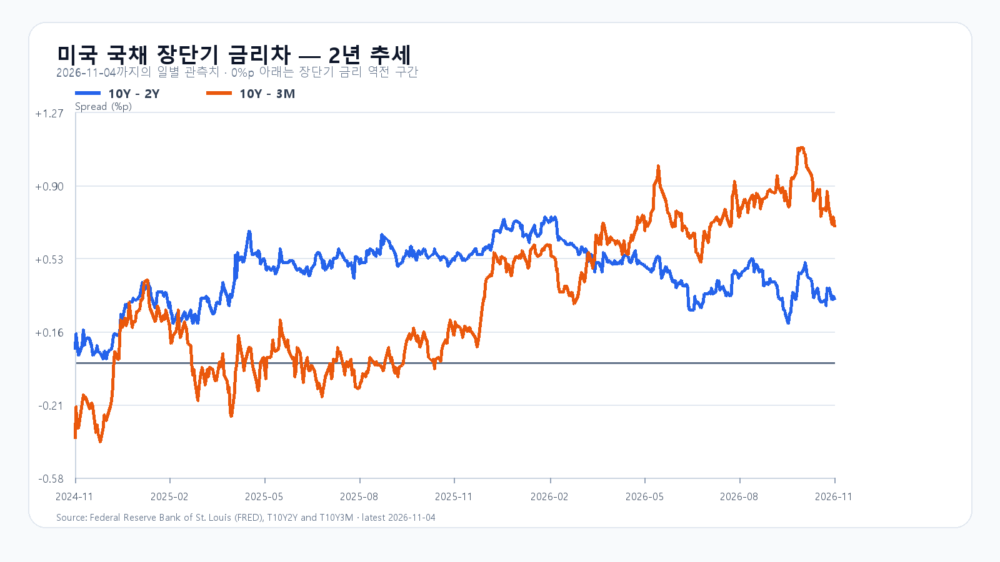
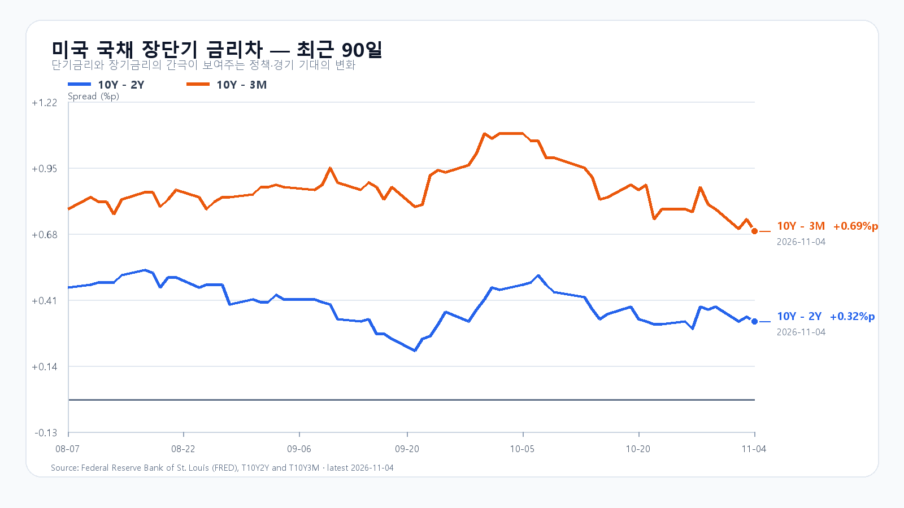

# 2026-11-05 KOSPI·KODEX 일일 리서치
작성 2026-11-05T09:00:50.433116+09:00 / 최종 데이터 확인 2026-11-05T09:00:50.371302+09:00 / 한국 장중
미국 정규장 11/4 종가, 시간외 원천별 시각을 분리. 선물은 지연 최근거래이며 환율은 하나은행 고시.

## 핵심 결론
미국 대형기술주 상승과 반도체 약세 분리. Micron -7%와 DDR5/DDR4 현물 하락이 국내 메모리주에 직접 하방. 유가/달러약세는 완충. 공격5 관망40 방어55.

## 밤사이 시장을 지배한 이슈
선거결과확인→정책불확실성완화와 데이터센터규제우려의 상반경로. 새법률확정아님. AI설비투자속도우려와 웨이퍼실수요구분. 상세후보·반론은 research/notes/2026-11-05.md.

## 전일 대비 바뀐 변수와 유지 변수
새재료는 전일한국장후 미국반도체분리약세·11/4 DRAM현물하락·미국유가급락. 어제국내장반영 AMD Q3실적을 오늘새호재로 중복가산하지 않음. HBM/서버수요확정급감주장안함.

## 한국시장·KODEX 대시보드
전일 KOSPI5786.13/5828.13/5421.72/5683.80(+0.62%), KODEX73605/75205/64115/70500(+0.58%)·35301275주. 실제값은 오늘새로조회한전일일봉원천.
|항목|값|원천 기준 시각|
|---|---:|---|
|KOSPI 장중|5,683.80|2026-11-05T09:00:00+09:00|
|KODEX 장중|70,500원|2026-11-05T09:00:50.371302+09:00|
|USD/KRW 하나은행 고시|1,340.50원|2026-11-05T08:51:29+09:00|
|NQF 최근 거래|28,558.25|2026-11-05T08:50:48+09:00|
|ESF 최근 거래|7,728.25|2026-11-05T08:50:44+09:00|
|BZF 최근 거래|94.83|2026-11-05T08:49:51+09:00|
|CLF 최근 거래|88.26|2026-11-05T08:50:45+09:00|

## 메모리 반도체 수급
11/4 18:10GMT+8 DDR5 16Gb61.333(-0.27%),DDR4 16Gb81.926(-0.96%). HBM/RDIMM/서버DDR5/eSSD 신규계약가격 미확인. NAND 공개표는10/26·PC-SSD8/5 기준으로오늘가격에대입하지않음. Siltronic웨이퍼실수요와주식리스크프리미엄분리.

## 미국 반도체·AI
11/4 미국정규장 USD OHLC. 가격/고가반납을표에서대조.
|종목|시가 USD|고가|저가|종가|등락|
|---|---:|---:|---:|---:|---:|
|QQQ|688.43|701.45|687.90|691.95|+0.97%|
|TQQQ|61.33|64.75|61.15|62.24|+2.79%|
|SOXX|458.28|469.22|441.68|450.41|-3.14%|
|SMH|511.17|522.18|497.33|504.27|-2.75%|
|NVDA|203.50|206.79|199.68|200.13|-3.17%|
|AMD|485.25|514.61|476.50|488.78|+1.01%|
|MU|822.99|853.34|791.00|795.23|-7.00%|
|AVGO|326.86|334.12|321.74|325.48|-2.00%|

## 미국 시간외
정규장종가대비이며정규장등락과합산안함.
|종목|시간외 USD|정규장 대비|원천 시각 KST|
|---|---:|---:|---|
|NVDA|201.23|+0.55%|2026-11-05T08:51:35+09:00|
|AMD|487.54|-0.25%|2026-11-05T08:50:56+09:00|
|MU|792.08|-0.40%|2026-11-05T08:51:33+09:00|
|AVGO|325.76|+0.09%|2026-11-05T08:51:10+09:00|

## 달러/원·국내 수급·시장 구조
환율고시/선물/NXT기준시각은위표. 외국인현물/선물·기관세부·프로그램·시장폭은거래일/종료상태가맞는최종묶음미확보로미확인.0대입하지않음. 반도체지수영향과유가하락수혜업종확산을별도관찰. 발생확인없는사이드카·청산은사건으로쓰지않음.

## 경제 캘린더
11/5 08:30ET=22:30KST 생산성/단위노동비용잠정.11/6 08:30ET=22:30KST10월고용.11/18 14:00ET=11/19 04:00KST10/27~28FOMC의사록.실제발표전수치없음. BLS/Fed공식달력확인.

## 미 국채와 장단기 금리차
FRED11/4 10Y-2Y0.32%p,10Y-3M0.69%p.개별금리최근공개11/3 3M4.21%,2Y4.61%,10Y4.95%. Reuters11/4시장10Y4.88%와종가/표시시각다름.개별금리기준일을섞어스프레드를재계산하지않음.

## 오늘 KOSPI·KODEX 시나리오
기본5500~5750 50%:범위유지조건·환율급등억제/메모리저점안정관찰. 경계이탈무효.
강세5750초과~5900 15%:5750초과 AND외국인현물>0 AND전체프로그램>0.5750재이탈무효.
약세5250~5500미만35%:5500미만 AND외국인현물<0 AND전체프로그램<0.5500회복무효.
가격경계는기본구간우선.15:20관측,다음점검09:30/10:00/14:00.90%잔여장중포락5200~6000. 공격5 관망40 방어55. KODEX64115지지/70500반등/73605저항.

## 전일 전망 평가
기본5700~5900실패,5683.80약세종가범위.일별저가5421.72의발행후시각은자료미확보. 수급조건과발행후경로는미검증.단일표본으로가설승격안함.

## 장중 체크리스트
반도체저점·수급동행·5500/5750·USD/KRW·유가하락업종확산.한축만개선되면공격판단유보. 대응점수는확률이아님.

## 출처와 확인 시각
- [미국 정규장·시간외](https://finance.yahoo.com/quote/SOXX/)
- [미국 선거 이후 시장](https://live.euronext.com/en/financial-news/world-shares-advance-democrats-victory-eases-political-uncertainty)
- [DRAM 현물](https://www.trendforce.com/price/dram/dram_spot)
- [Siltronic 실적](https://www.siltronic.com/en/press/press-releases/siltronic-slightly-raises-sales-guidance-for-2026-higher-demand-drives-volume-development-in-q3-2026.html)
- [Qualcomm·Starlink 공급 발표](https://www.qualcomm.com/news/releases/2026/11/spacex-selects-qualcomm-to-accelerate-starlink-mobile-s-nationwi)
- [BLS 공식 일정](https://www.bls.gov/schedule/2026/11_sched.htm)
- [FRED 금리차](https://fred.stlouisfed.org/series/T10Y2Y)
취재원문조회08:51KST전후,최종국내조회는첫부분시각. BLS/Qualcomm직접403은web공식원문열람으로확인.자세한원천·해시는research/evidence/2026-11-05에보존.
