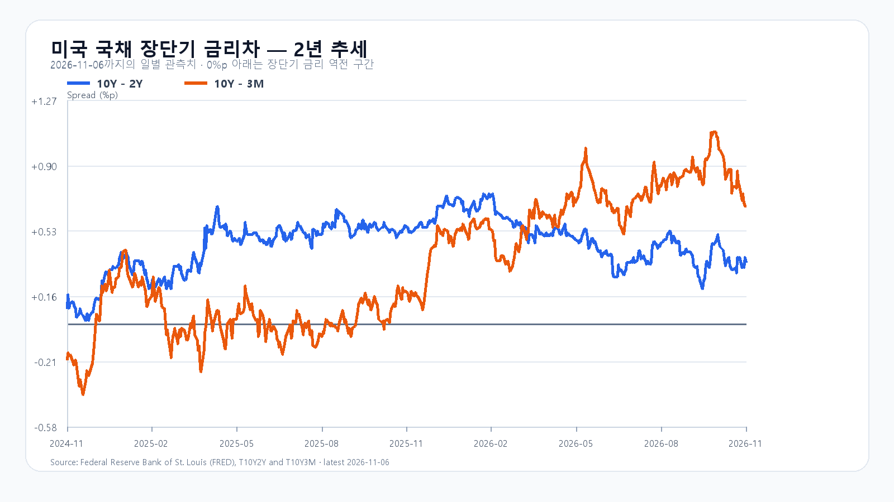
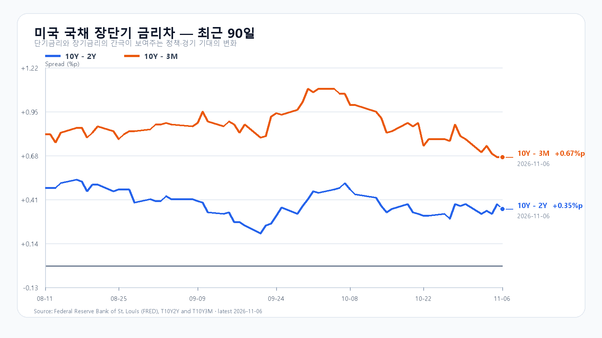

# 2026-11-09 KOSPI·KODEX 일일 리서치
작성 2026-11-09T08:08:52.882988+09:00 / 최종 데이터 2026-11-09T08:08:52.726261+09:00 / 한국 장전

미국 반도체주가 금요일 반등하면서 코스피도 급락 뒤 회복을 시도할 여건이 생겼습니다. 다만 원화는 약해졌고 메모리 현물가격도 내렸습니다. 오늘은 상승 출발 자체보다 삼성전자·SK하이닉스의 반등에 외국인과 프로그램 매수가 동참하는지가 중요합니다.

## 미국 반도체 반등은 새로운 재료다
6일 미국 정규장에서 AMD는 11.04%, Micron은 5.12%, Nvidia는 2.78%, Broadcom은 0.74% 올랐습니다. SOXX는 3.51%, SMH는 3.63%, QQQ는 1.40%, TQQQ는 3.54% 상승했습니다. 한국장이 끝난 뒤 나온 반등이므로 오늘 국내 메모리주에는 새로운 지지 재료입니다. 목요일 미국 급락은 금요일 국내장에 이미 반영됐습니다. 같은 하락을 오늘 한 번 더 차감할 이유는 없습니다.

반등의 크기와 추세 회복은 구분해야 합니다. Nvidia와 Micron은 미국 정규장 고가 아래에서 마감했습니다. 급락 이전 가격까지 되돌린 것도 아닙니다. 미국 반도체의 회복이 국내 반등으로 이어질 수 있지만, 외국인 매도가 계속되면 개장 직후 상승분을 지키기 어려울 수 있습니다.

## 고용은 경기 우려를 덜었지만 금리 부담을 남겼다
미 노동통계국이 6일 발표한 10월 비농업 고용은 16만5,000명 증가했고 실업률은 4.1%였습니다. 시간당 평균임금은 전월보다 0.4% 올랐습니다. 고용 증가는 경기 둔화 우려를 덜어 주지만 임금 상승은 물가와 금리 부담을 남깁니다. 반도체 반등만으로 금융 여건이 완화됐다고 보기 어려운 이유입니다.

## 원화 약세가 국내 반등의 제약이다
9일 07:48:18 KST 하나은행 달러/원 고시환율은 1,363.50원으로 전회 대비 6.50원 높았습니다. 서울 현물환 개장 체결가는 아닙니다. 원화 약세가 이어지면 외국인이 국내 주식을 적극적으로 늘리기 어렵고, 수출주의 환산이익 기대보다 시장의 위험 축소가 먼저 나타날 수 있습니다. 환율 상승이 진정되는지와 외국인 현물·선물의 방향을 함께 봅니다.

## 메모리 현물은 주가와 다른 방향이다
TrendForce의 6일 18:10 대만시간 DRAM 현물가격은 DDR5 16Gb 평균 60.167달러로 0.82%, DDR4 16Gb 평균 80.815달러로 1.06% 내렸습니다. 미국 메모리주 반등이 당장 범용 메모리 가격 회복을 뜻하지는 않습니다. HBM과 서버용 장기계약의 수요도 이 현물 지표 하나로 판단할 수 없습니다. NAND와 RDIMM 공개 표는 10월 자료여서 이번 거래일 가격 변화의 근거로 삼기 어렵습니다.

AI 투자에서는 이미 발표한 설비투자 계획보다 실제 집행과 현금흐름이 주가의 다음 시험대입니다. 반등이 지속되려면 투자 취소 우려가 줄고 주문과 매출 전환을 뒷받침하는 공시가 따라와야 합니다. 오늘 반등만으로 신규 공급계약이나 투자 확대가 확정됐다고 해석하지 않습니다.

## 전일 저점을 지키고 5,200을 회복하는가
금요일 코스피는 5,263.26에 출발해 고가 5,269.10, 저가 4,911.28을 기록한 뒤 5,059.69로 마감했습니다. 하루 하락률은 6.02%입니다. KODEX 레버리지는 12.86% 내린 54,460원으로 끝났고 장중 범위는 51,065~58,585원이었습니다. 코스피가 전일 저가 위에서 저점을 높이고 5,200을 되찾는다면 단기 회복의 근거가 강해집니다. 반대로 4,950을 지키지 못하면 전일 저점 재시험을 경계합니다.

직전 전망의 기본 종가 범위 5,050~5,350에는 들어왔지만 장중에는 하단을 크게 밑돌았습니다. 종가 범위에 들었다는 사실만으로 하루의 위험을 잘 포착했다고 평가하기 어렵습니다. 오늘도 종가 전망과 장중 손실 위험을 따로 봅니다.

## 오늘의 세 시나리오와 KODEX 기준선
기본 종가 범위는 4,950~5,200으로 확률 50%입니다. 4,950 이상 유지, 5,200 이하의 매물 소화, 외국인 현물 매도 진정을 함께 확인하는 경우입니다. 외국인 매도 진정의 관측 기준은 순매수액 0 이상으로 둡니다. 5,200을 넘고 외국인·프로그램이 함께 순매수하면 강세 범위 5,200 초과~5,400(25%)을 봅니다. 4,950 아래에서 외국인·프로그램 순매도가 겹치면 약세 범위 4,700~4,950 미만(25%)입니다. 각 종가 범위를 벗어나면 해당 시나리오는 무효이며 경계값은 기본 범위에 배정합니다. 세 시나리오의 장중 예상 저가·고가 포락은 4,600~5,500으로 둡니다.

공격 15·관망 50·방어 35로 관망에 무게를 둡니다. KODEX는 전일 저가 51,065원, 종가 54,460원, 고가 58,585원을 기준선으로 봅니다. 갭 상승 때는 54,460원 위 안착과 거래량을 확인하고 58,585원 부근에서는 매물 소화 여부를 봅니다. 51,065원을 이탈하면 반등 가정이 약해집니다. 외국인 매수가 없는 급등을 추격할 근거는 부족합니다.

## 내일 CPI 전까지 수급을 확인한다
미국 10월 CPI는 10일 22:30 KST에 발표됩니다. 오늘 한국장 종가 뒤의 일정이며 아직 결과는 나오지 않았습니다. 오늘은 09:30 외국인·프로그램 방향, 10:30 삼성전자·SK하이닉스 저점 유지, 14:00 이후 매수 지속 여부를 차례로 확인합니다. 시나리오 조건은 15:20까지 관측합니다.

## 미 국채 금리차
FRED의 6일 기준 10년-2년 금리차는 0.35%포인트, 10년-3개월은 0.67%포인트입니다. 개별 만기 금리의 최신 관측일은 5일이며 3개월 4.17%, 2년 4.46%, 10년 4.84%입니다. 서로 다른 관측일의 수준을 한 시점의 곡선으로 혼동하지 않아야 합니다. 장단기 금리차가 양수라는 사실만으로 반도체주의 밸류에이션 부담이 사라지는 것은 아닙니다.

## 한국시장
|항목|값|원천 기준 시각|
|---|---:|---|
|KOSPI 전일 종가|5,059.69|2026-11-06T15:30:00+09:00|
|KODEX 전일 종가|54,460원|2026-11-06T15:30:00+09:00|
|USD/KRW 하나은행 고시|1,363.50원|2026-11-09T07:48:18+09:00|
|NQF 최근 거래|27,085.25|2026-11-07T06:59:59+09:00|
|ESF 최근 거래|7,402.00|2026-11-07T06:59:59+09:00|
|BZF 최근 거래|98.32|2026-11-07T06:59:44+09:00|
|CLF 최근 거래|90.83|2026-11-07T06:59:58+09:00|

## 미국 정규장
|종목|시가 USD|고가|저가|종가|등락|
|---|---|---|---|---|---|
|QQQ|658.35|664.52|653.99|656.10|+1.40%|
|TQQQ|52.72|54.17|51.71|52.25|+3.54%|
|SOXX|139.56|140.21|133.80|136.53|+3.51%|
|SMH|473.41|476.25|456.44|463.96|+3.62%|
|NVDA|191.10|194.90|185.22|186.64|+2.77%|
|AMD|444.43|459.80|433.30|449.04|+11.04%|
|MU|708.35|724.80|676.00|690.00|+5.12%|
|AVGO|311.13|311.52|289.77|293.69|+0.74%|

## 시간외
|종목|시간외 USD|정규장 대비|시각 KST|
|---|---|---|---|
|NVDA|188.70|+1.10%|2026-11-07T09:59:59+09:00|
|AMD|448.14|-0.20%|2026-11-07T09:59:49+09:00|
|MU|694.79|+0.69%|2026-11-07T09:59:59+09:00|
|AVGO|295.27|+0.54%|2026-11-07T09:59:43+09:00|

## 출처와 확인 시각
취재·집필 입력 2026-11-09T08:08:29.057951+09:00
- [미국 정규장·시간외](https://finance.yahoo.com/quote/SMH/)
- [미국 고용 원문](https://www.bls.gov/news.release/empsit.nr0.htm)
- [미국 경제 일정](https://www.bls.gov/schedule/2026/11_sched.htm)
- [DRAM 현물](https://www.trendforce.com/price/dram/dram_spot)
- [NAND 공개 가격](https://www.trendforce.com/price/flash/flash_spot)
- [국내 일봉](https://api.stock.naver.com/chart/domestic/index/KOSPI?periodType=dayCandle)
- [하나은행 고시](https://m.stock.naver.com/marketindex/exchange/FX_USDKRW)
- [미국 금리차](https://fred.stlouisfed.org/series/T10Y2Y)