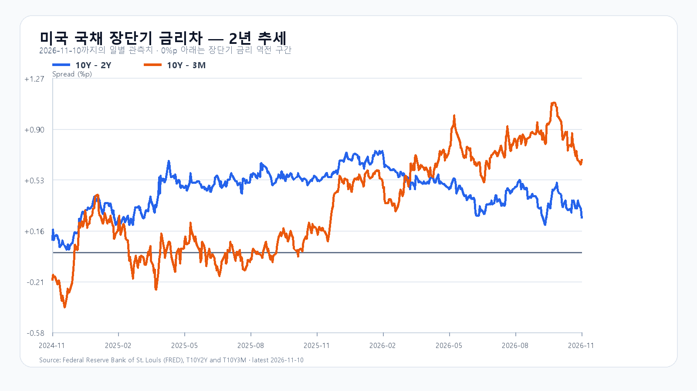
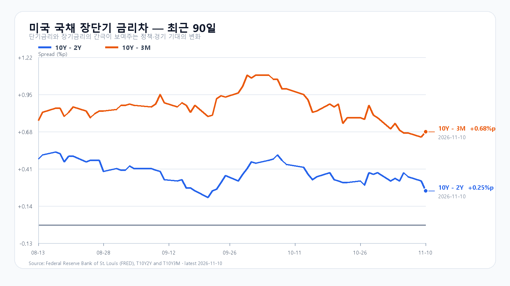

# 2026-11-12 KOSPI·KODEX 리서치
작성 2026-11-12T08:05:07.078849+09:00 / 최종 데이터 2026-11-12T08:05:06.856225+09:00 / 한국 장전

미국 반도체주가 함께 반등하면서 코스피의 추가 상승 여건이 좋아졌습니다. Micron과 AMD의 상승 폭이 컸고 원화도 강해졌습니다. 다만 코스피는 이미 이틀 연속 올랐습니다. 오늘은 갭 상승의 크기보다 5,400 위에서 외국인·프로그램 매수가 이어지는지가 중요합니다.

## Nvidia를 넘어 메모리와 경쟁사로 번진 반등
11일 미국 정규장에서 SOXX는 6.01%, SMH는 4.82% 올랐습니다. Micron은 11.89%, AMD는 7.32%, Broadcom은 3.99%, Nvidia는 2.92% 상승했습니다. QQQ와 TQQQ도 각각 2.32%, 6.86% 올랐습니다. 전날 업종 내 혼조에서 동반 반등으로 바뀐 점이 국내 반도체주에 유리합니다. 이 가격 변화는 수요일 한국장 마감 뒤의 새 신호입니다. 미국 시세

## AI 인프라 수요와 금융비용은 함께 커진다
CoreWeave의 3분기 매출은 36억6,100만달러, 영업이익은 2억700만달러였습니다. 반면 순이자비용은 8억4,600만달러, 순손실은 7억900만달러였습니다. 회사는 향후 3개월 고객 선급금·예치금 약 90억달러를 예상했습니다. 수요 확대를 뒷받침하는 실적이지만 자금 조달 부담도 큽니다. 회사 발표

이 실적은 10일 미국장 마감 후 나와 전날 한국장에서도 접할 수 있었습니다. 오늘 새로 더해진 것은 그 뒤 미국 정규장에서 나타난 반도체 매수의 폭입니다. 같은 실적을 이틀의 독립 호재로 더하기보다 미국 매수세가 삼성전자·SK하이닉스로 이어지는지를 봐야 합니다.

## 투자 승인과 실제 주문을 구분해야 한다
TSMC 이사회는 10일 Anthropic 보통주와 OpenAI 우선주에 각각 최대 5억달러를 투자하는 안을 승인했습니다. Anthropic 주식의 인수가격은 기업공개 가격에 따릅니다. 승인 한도가 실제 투자 완료나 메모리 주문액을 뜻하지는 않습니다. AI 고객과 공급자의 자본 연결은 수요 기반을 넓힐 수 있지만 현금 회수와 설비 집행을 함께 봐야 합니다. TSMC

## 메모리 현물은 품목마다 다르다
TrendForce의 11일 18:10 대만시간 DRAM 현물표에서 DDR5 16Gb 평균은 60.233달러로 0.11% 올랐고 DDR4 16Gb는 79.867달러로 0.15% 내렸습니다. Micron 주가 급등을 범용 메모리 전 품목의 가격 상승으로 읽을 수는 없습니다. HBM·서버 DRAM의 장기 주문과 범용 DDR4 재고 흐름은 별도로 판단해야 합니다. DRAM

공개 NAND 웨이퍼 현물표의 기준일은 11월 2일이며 512Gb TLC 평균은 16.152달러입니다. SLC·MLC·TLC는 수요처와 공급 여건이 다릅니다. 이 가격을 오늘의 eSSD 계약가격이나 국내 업체의 수율 변화로 바꿔 읽기에는 시차와 품목 차이가 큽니다. NAND

## 전일 고가를 넘은 뒤 지킬 수 있는가
11일 코스피는 5,209.71에 출발해 5,207.44~5,377.99 사이에서 움직인 뒤 5,375.36으로 2.60% 상승 마감했습니다. KODEX 레버리지는 58,175원에 출발해 57,660~62,150원을 오간 뒤 61,995원으로 6.09% 올랐습니다. 코스피가 고가 부근에 마감한 만큼 오늘은 5,377.99 돌파 뒤 지지가 첫 관문입니다. 국내 일봉

직전 기본 전망 5,100~5,300은 상단을 넘어섰습니다. 미국 물가 부담보다 국내 반등의 힘이 강했던 결과입니다. 오늘은 그 상승을 되돌리는 위험과 미국 반도체 강세의 추가 전달을 함께 반영합니다. 외국인 현물과 KOSPI200 선물의 방향, 프로그램 비차익 매수, 반도체 밖으로의 상승 확산을 확인할 필요가 있습니다.

## 환율은 완충, 유가는 보합권
12일 07:04:04 KST 하나은행 달러/원 고시환율은 1,337.50원으로 전회보다 7원 낮았습니다. 서울 현물환 개장 체결가와는 다릅니다. 브렌트 선물은 06:58:42 KST 92.63달러(-0.14%), WTI는 06:59:55 KST 86.42달러(-0.13%)였습니다. 원화 강세는 외국인 매수 여건을 돕지만 주식 매수 지속까지 보장하지는 않습니다. 환율 · 유가

## 세 종가 시나리오와 KODEX 기준선
기본 종가 범위는 5,300~5,500(50%)입니다. 지수가 이 범위에 머물고 외국인 현물이 순매도하지 않는 경우를 가정합니다. 5,500 초과와 외국인·프로그램 동반 순매수가 겹치면 강세 5,500 초과~5,700(30%), 5,300 미만과 두 수급의 동반 순매도가 겹치면 약세 5,050~5,300 미만(20%)입니다. 경계값은 기본 범위에 배정합니다. 범위 이탈이나 해당 수급의 반전은 각 시나리오의 무효화 기준입니다. 별도의 장중 저가·고가 포락은 4,950~5,800입니다.

대응 점수는 공격 25·관망 50·방어 25입니다. KODEX의 1차 지지는 전일 저가 57,660원, 반등 기준은 전일 종가 61,995원, 저항은 전일 고가 62,150원입니다. 종가와 고가의 간격이 좁아 62,150원 돌파 자체보다 돌파 후 매수 지속이 중요합니다. 61,995원 아래로 되밀리면서 외국인·프로그램 매도가 커지면 추격 근거가 약해집니다.

## 다음 확인 시점
09:30 외국인·프로그램 첫 수급, 10:30 삼성전자·SK하이닉스 저점 유지, 14:00 이후 수급 지속을 봅니다. 시나리오 조건 관측 시한은 15:20입니다. 미국 10월 PPI는 13일 08:30 ET, 한국시간 22:30 발표 예정입니다. 오늘의 반도체 반등이 물가·금리 부담을 없앴다는 뜻은 아닙니다. BLS 일정

## 한국시장
|항목|값|원천 기준 시각|
|---|---:|---|
|KOSPI 전일 종가|5,375.36|2026-11-11T15:30:00+09:00|
|KODEX 전일 종가|61,995원|2026-11-11T15:30:00+09:00|
|USD/KRW 하나은행 고시|1,337.50원|2026-11-12T07:04:04+09:00|
|NQF 최근 거래|28,444.25|2026-11-12T06:59:59+09:00|
|ESF 최근 거래|7,642.25|2026-11-12T06:59:59+09:00|
|BZF 최근 거래|92.63|2026-11-12T06:58:42+09:00|
|CLF 최근 거래|86.42|2026-11-12T06:59:55+09:00|

## 미국 정규장
|종목|시가 USD|고가|저가|종가|등락|
|---|---|---|---|---|---|
|QQQ|687.28|695.57|683.60|690.38|+2.31%|
|TQQQ|59.69|61.77|58.75|60.44|+6.86%|
|SOXX|153.69|158.57|150.88|155.40|+6.01%|
|SMH|505.00|516.65|496.01|506.96|+4.82%|
|NVDA|172.72|177.54|170.77|173.73|+2.92%|
|AMD|543.06|567.65|522.65|552.90|+7.32%|
|MU|777.28|827.58|763.05|811.30|+11.89%|
|AVGO|350.22|356.85|344.32|345.22|+3.99%|

## 미국 시간외
|종목|시간외 USD|정규장 대비|시각 KST|
|---|---|---|---|
|NVDA|159.36|-8.27%|2026-11-12T07:59:30+09:00|
|AMD|572.00|+3.45%|2026-11-12T07:59:31+09:00|
|MU|793.00|-2.26%|2026-11-12T07:59:31+09:00|
|AVGO|354.28|+2.62%|2026-11-12T07:59:31+09:00|

## 출처
- [미국 정규장·시간외](https://finance.yahoo.com/quote/SMH/)
- [CoreWeave 실적](https://investors.coreweave.com/news/news-details/2026/CoreWeave-Reports-Strong-Third-Quarter-2026-Results/default.aspx)
- [TSMC 이사회 결의](https://pr.tsmc.com/chinese/news/3352)
- [BLS 일정](https://www.bls.gov/schedule/2026/11_sched.htm)
- [DRAM](https://www.trendforce.com/price/dram/dram_spot)
- [NAND](https://www.trendforce.com/price/flash/flash_spot)
- [국내 일봉](https://api.stock.naver.com/chart/domestic/index/KOSPI?periodType=dayCandle)
- [달러/원 고시](https://m.stock.naver.com/marketindex/exchange/FX_USDKRW)
- [FRED](https://fred.stlouisfed.org/series/T10Y2Y)

취재·집필 입력 2026-11-12T08:03:38.045122+09:00
## 미 국채와 금리차
FRED 최신 공개 관측에서 10년-2년 금리차는 11월 10일 0.25%포인트, 10년-3개월은 0.68%포인트입니다. 개별 만기는 11월 9일 기준 3개월 4.24%, 2년 4.56%, 10년 4.88%입니다. 관측일이 달라 같은 날의 곡선으로 합칠 수는 없습니다. 장기금리의 높은 절대 수준은 반도체 가치평가의 부담으로 남습니다. [FRED](https://fred.stlouisfed.org/series/DGS10)
