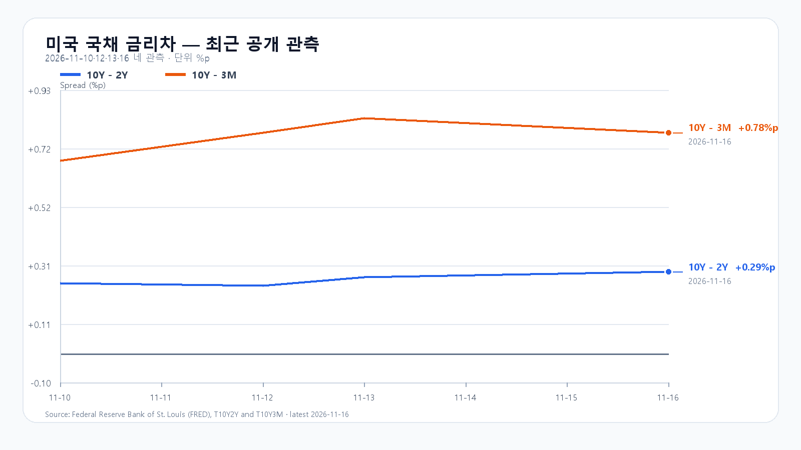

# 2026-11-17 KOSPI·KODEX 리서치
작성 2026-11-17T08:10:33.197962+09:00 / 최종 데이터 2026-11-17T08:10:32.984103+09:00 / 한국 장전

AI 반도체를 둘러싼 규제가 칩 수출에서 해외 데이터센터의 원격접근으로 넓어졌습니다. 미국 반도체주도 다시 큰 폭으로 내렸습니다. 전날 5,100선까지 밀린 코스피는 오늘 5,000 방어와 외국인·프로그램 매수 회복을 먼저 시험하게 됐습니다.

## 해외 서버를 빌리는 경로에도 규제가 붙었다
미국 상무부 BIS는 16일 첨단 AI칩과 서버의 원격접근에 관한 잠정 최종규칙을 발표했습니다. 제3국 데이터센터의 원격연산을 이용해 기존 제한을 우회하는 경로를 막겠다는 취지입니다. 국내 HBM 업체에는 최종 고객과 데이터센터 위치에 따른 주문 집행 지연이나 재배치가 위험 경로입니다. 이를 전 세계 AI 수요의 소멸이나 이미 체결된 메모리 주문의 일괄 취소로 해석할 근거는 아닙니다. BIS 발표

## Micron과 경쟁사까지 매도가 번졌다
16일 미국 정규장에서 Micron은 7.62%, AMD는 5.58%, Broadcom은 3.92%, Nvidia는 4.12% 하락했습니다. SOXX는 5.41%, SMH는 5.11% 내렸고 QQQ와 TQQQ도 각각 2.67%, 8.06% 하락했습니다. Nvidia 경영진 문제를 넘어 AI 투자와 반도체 업종의 위험을 함께 줄이는 움직임으로 읽힙니다. 이 미국장 하락은 월요일 한국장 마감 뒤 형성된 추가 가격 변화입니다. 미국 시세

## 내일 아침 실적은 주문과 현금의 시험대다
Nvidia의 실적 발표는 한국시간 18일 06:20경, 콘퍼런스콜은 07:00 예정입니다. 매출과 다음 분기 전망뿐 아니라 중국 관련 규제 대응, 고객의 투자 집행, 현금흐름과 금융지원 부담이 관건입니다. 대규모 CAPEX 계획이 공급사의 실제 매출로 이어지려면 고객의 자금 조달과 데이터센터 가동이 따라야 합니다. 경영진 교체 자체는 지난주 국내장에 알려졌던 재료입니다. 회사 일정

## 연준은 AI 투자 실망의 경로도 살핀다
워시 연준 의장은 16일 연설에서 AI가 생산성을 높이는 경우와 일자리 대체를 늘리는 경우, 투자 수익이 기대에 못 미쳐 주가와 경기가 둔화하는 경우를 제시했습니다. 이는 연준의 침체 예측이 아니라 대비를 위한 예시 시나리오입니다. 투자 규모가 큰 만큼 이익과 현금 회수가 늦어질 때 가치평가 조정도 커질 수 있다는 점이 반도체 주가에 중요합니다. 연준 연설

FRED의 16일 관측에서 미국 10년-2년 금리차는 0.29%포인트, 10년-3개월은 0.78%포인트입니다. 개별 만기의 최신 관측은 13일이며 10년 5.15%, 2년 4.88%, 3개월 4.32%입니다. 두 금리차의 방향도 서로 달랐습니다. 금리차 확대만으로 성장주 부담 완화를 단정하기보다 장기금리 수준과 실적 전망을 함께 봐야 합니다. 10년-2년 · 10년-3개월

## DDR5 가격 상승과 주가 급락은 서로 다른 신호다
TrendForce의 16일 18:10 대만시간 현물표에서 DDR5 16Gb 평균은 60.333달러로 0.11% 올랐고 DDR4 16Gb는 79.375달러로 0.16% 내렸습니다. DDR5 현물의 소폭 상승은 범용 메모리까지 수요가 일제히 무너졌다는 해석과 거리가 있습니다. 반면 HBM·서버 DRAM·기업용 SSD는 제품별 장기 주문, 고객 재고와 출하를 따로 봐야 합니다. DRAM 현물

NAND 웨이퍼 현물의 512Gb TLC 평균은 11월 2일 기준 16.152달러입니다. 이 수치는 오늘의 서버 SSD 계약가격을 대신하지 않습니다. 메모리 공급 제약이 남아 있어도 고객의 투자 집행이 늦어지면 주가에는 먼저 부담이 생길 수 있습니다. NAND 현물

## 월요일 저점과 5,000선이 가까워졌다
16일 코스피는 5,305.40에 출발해 5,327.99까지 올랐지만 5,100.50으로 3.59% 하락 마감했습니다. 저가는 5,069.83입니다. KODEX 레버리지는 60,205원에 출발해 54,440~60,795원을 오간 뒤 55,035원으로 8.16% 내렸습니다. 반등 출발 뒤 매도가 커진 만큼 개장 직후 상승만으로 수급 회복을 판단하기 어렵습니다. 국내 일봉

직전 기본 종가 범위 5,100~5,300에는 들어왔지만 종가는 하단에 붙었고 장중에는 하단 아래로 내려갔습니다. 오늘은 5,069.83과 5,000 지지를 살피며 삼성전자·SK하이닉스의 저점 유지, 외국인 현물과 KOSPI200 선물, 프로그램 비차익 매수와 상승 종목 확산이 함께 회복되는지 봅니다.

## 세 종가 시나리오와 KODEX 기준선
기본 종가 범위는 4,950~5,150(45%)입니다. 이 범위에서 외국인 현물이 순매도하지 않는 경우를 가정합니다. 5,150 초과와 외국인·프로그램 동반 순매수가 겹치면 강세 5,150 초과~5,300(15%), 4,950 미만과 두 수급의 동반 순매도가 겹치면 약세 4,700~4,950 미만(40%)입니다. 경계값은 기본 범위에 배정합니다. 범위 이탈이나 수급 반전은 무효화 기준이며 장중 저가·고가 포락은 별도로 4,600~5,400을 둡니다.

대응 점수는 공격 5·관망 40·방어 55입니다. KODEX의 1차 지지는 전일 저가 54,440원, 반등 기준은 전일 종가 55,035원, 저항은 전일 고가 60,795원입니다. 55,035원 회복 뒤 매수가 유지되는지 먼저 보고, 54,440원 이탈과 외국인·프로그램 매도가 겹치면 하방 위험을 경계합니다.

## 유가와 환율 완화가 매수로 이어지는지 본다
17일 07:26:18 KST 하나은행 달러/원 고시는 1,336.50원으로 전회보다 1.50원 낮았습니다. 서울 현물환 체결가와는 다릅니다. 미국 유가선물의 17일 06:59경 전자거래 가격은 WTI 85.06달러, 브렌트 91.84달러입니다. 원화 강세와 유가 하락은 비용 부담을 덜어주는 방향이지만 AI 규제와 실적 위험을 곧바로 상쇄하지는 못합니다. 환율 · 유가

오늘 09:30 첫 수급과 10:30 반도체 저점 유지, 14:00 이후 매도 가속 여부를 확인합니다. 내일 아침 Nvidia 실적을 앞둔 포지션 조정과 신규 매수를 구별해야 합니다. FOMC 의사록은 한국시간 19일 04:00 예정입니다. 연준 일정

## 한국시장
|항목|값|원천 기준 시각|
|---|---:|---|
|KOSPI 전일 종가|5,100.50|2026-11-16T15:30:00+09:00|
|KODEX 전일 종가|55,035원|2026-11-16T15:30:00+09:00|
|USD/KRW 하나은행 고시|1,336.50원|2026-11-17T07:26:18+09:00|
|NQF 최근 거래|27,336.50|2026-11-17T08:00:29+09:00|
|ESF 최근 거래|7,446.75|2026-11-17T08:00:30+09:00|
|BZF 최근 거래|91.84|2026-11-17T06:59:30+09:00|
|CLF 최근 거래|85.30|2026-11-17T08:00:31+09:00|

## 미국 정규장
|종목|시가 USD|고가|저가|종가|등락|
|---|---|---|---|---|---|
|QQQ|671.05|672.14|660.48|661.75|-2.67%|
|TQQQ|55.38|55.67|52.72|53.03|-8.06%|
|SOXX|142.98|144.50|140.88|141.22|-5.41%|
|SMH|468.72|473.32|460.66|461.90|-5.11%|
|NVDA|159.00|163.00|155.01|156.14|-4.12%|
|AMD|503.45|526.20|501.30|504.28|-5.58%|
|MU|735.06|739.12|716.38|719.02|-7.62%|
|AVGO|332.70|337.74|327.80|333.40|-3.92%|

## 미국 시간외
|종목|시간외 USD|정규장 대비|시각 KST|
|---|---|---|---|
|NVDA|155.66|-0.30%|2026-11-17T08:06:54+09:00|
|AMD|503.01|-0.25%|2026-11-17T08:06:48+09:00|
|MU|717.00|-0.28%|2026-11-17T08:06:55+09:00|
|AVGO|331.60|-0.54%|2026-11-17T08:04:47+09:00|

## 출처
- [미국 시세](https://finance.yahoo.com/quote/SMH/)
- [BIS 원격접근 규칙](https://www.bis.gov/press-release/bis-issues-rule-addressing-remote-access-american-super-intelligence-technology)
- [Warsh 연설](https://www.federalreserve.gov/newsevents/speech/warsh20261116a.htm)
- [Nvidia 실적 일정](https://investor.nvidia.com/news/press-release-details/2026/NVIDIA-Sets-Conference-Call-for-Third-Quarter-Financial-Results/default.aspx)
- [DRAM](https://www.trendforce.com/price/dram/dram_spot)
- [NAND](https://www.trendforce.com/price/flash/flash_spot)
- [국내 일봉](https://api.stock.naver.com/chart/domestic/index/KOSPI?periodType=dayCandle)
- [환율](https://m.stock.naver.com/marketindex/exchange/FX_USDKRW)
- [FRED 10년-2년](https://fred.stlouisfed.org/series/T10Y2Y)
- [FRED 10년-3개월](https://fred.stlouisfed.org/series/T10Y3M)
- [연준 일정](https://www.federalreserve.gov/newsevents/calendar.htm)

취재·집필 입력 2026-11-17T08:09:17.368787+09:00