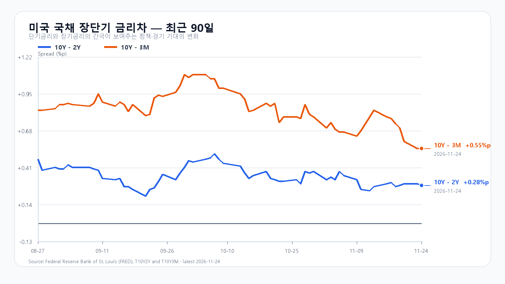
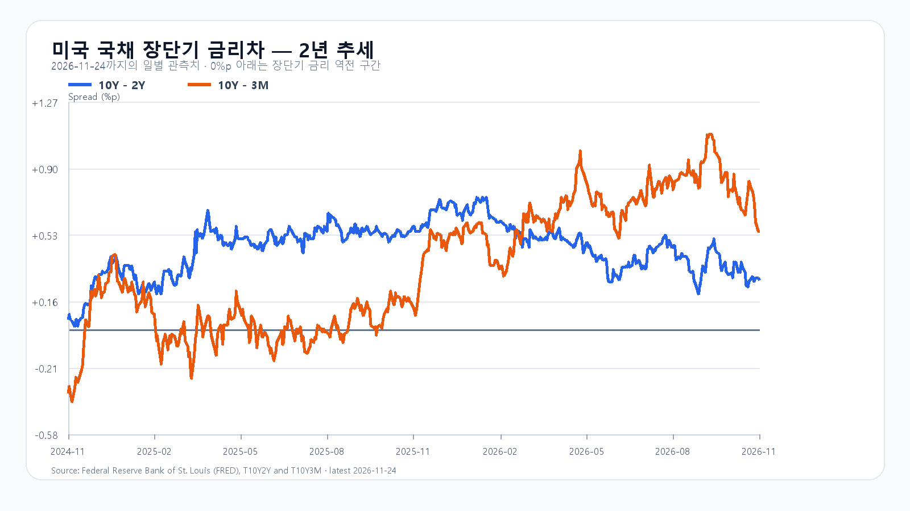
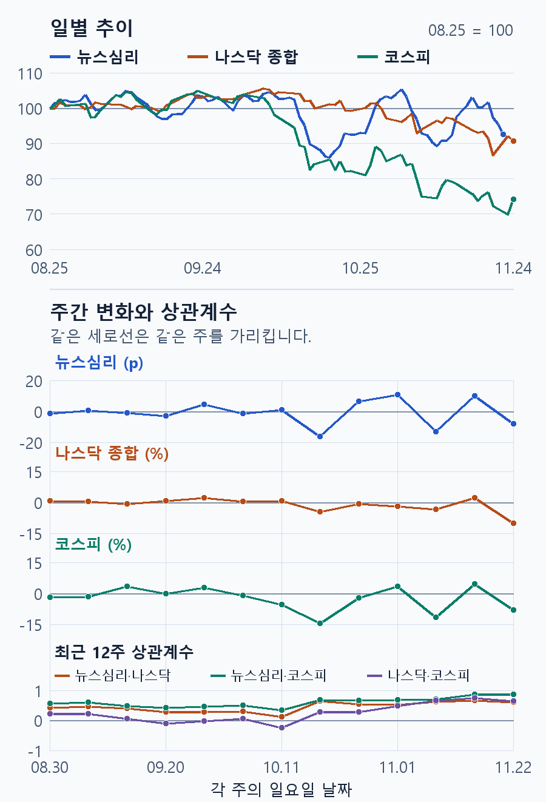

# 2026-11-25 KOSPI·KODEX 레버리지 리서치

작성 2026-11-25T08:08:25.595021+09:00 · 최종 데이터 2026-11-25T08:08:25.434073+09:00 · 한국 장전.

## 핵심 판단

코스피가 6.32% 반등한 뒤 미국 반도체주가 다시 큰 폭으로 밀렸다. 서울이 전날 상승분을 얼마나 지킬지는 4,880.16과 외국인 현물·비차익 프로그램 수급에서 확인한다. 기본 종가 4,850~5,020, 대응 점수 공격 10·관망 50·방어 40.

## 밤사이 시장을 움직인 이슈

1. **미국 반도체 급반락.** SOXX −8.27%, SMH −7.26%, 마이크론 −11.01%, 엔비디아 −5.86%. 나스닥종합 −1.48%, 다우 +0.85%. 월요일 뉴욕 급등은 화요일 서울 시장에 반영됐고, 화요일 미국 정규장 하락은 서울 마감 이후 발생했다. 개장 갭에 이어 국내 반도체 두 종목의 첫 저점과 매도 업종의 확산을 살핀다. [AP 마감](https://apnews.com/article/6cc4e580290aadf304ee316d6d46dd81) · [SOXX 일봉](https://finance.yahoo.com/quote/SOXX/history/)
2. **서울 5,000선 회복과 수급의 연속성.** 전날 외국인이 코스피 순매수로 돌아섰고, 삼성전자와 SK하이닉스의 외국인 수급은 엇갈렸다. 5,006.03 회복 여부와 함께 전날 저가 4,880.16을 살핀다. [연합뉴스](https://en.yna.co.kr/view/AEN20261124006752320) · [삼성증권](https://www.samsungpop.com/common.do?cmd=down&contentType=application%2Fpdf&fileName=4020%2F2026112416144493K_02_02.pdf&inlineYn=Y&saveKey=research.pdf)
3. **델 AI 서버 매출 전망 상향.** FY2027 3분기 AI 서버 매출 220억 달러(+291% YoY), 전체 매출 549.37억 달러(+103%), 영업현금흐름 44.59억 달러(+280%). 연간 AI 서버 매출 전망은 740억→780억 달러. 08:01:36 KST 시간외 +4.27%. 서버 매출은 수요를 보여 주지만 개별 메모리 공급사 주문이나 HBM 가격은 따로 봐야 한다. [델 실적](https://investors.delltechnologies.com/news-events/press-releases/detail/1665/dell-technologies-delivers-third-quarter-fiscal-2027-financial-results)

## 한국 시세와 수급

|항목|값|원천 기준 시각|
|---|---:|---|
|KOSPI 전일 종가|5,006.03|2026-11-24T15:30:00+09:00|
|KODEX 전일 종가|52,935원|2026-11-24T15:30:00+09:00|
|USD/KRW 하나은행 고시|1,342.50원|2026-11-25T06:34:50+09:00|
|NQF 최근 거래|26,266.00|2026-11-25T06:59:59+09:00|
|ESF 최근 거래|7,210.75|2026-11-25T06:59:59+09:00|
|BZF 최근 거래|88.50|2026-11-25T06:59:17+09:00|
|CLF 최근 거래|81.69|2026-11-25T06:59:55+09:00|

11/24 코스피 시가 4,880.16·고가 5,065.74·저가 4,880.16·종가 5,006.03(+6.32%). 코스닥 665.88(+4.79%). 삼성전자 189,400원(+6.70%), SK하이닉스 1,158,000원(+6.73%, KRX 정규장). KODEX 시가 52,965원·고가 54,360원·저가 51,585원·종가 52,935원(+13.63%), 26,832,640주.

11/24 네이버 20:15 장후 지수 표시와 같은 거래일 수급은 외국인 +8,130억원, 기관 +8,734억원, 개인 −21,350억원. 프로그램 차익 +519억원, 비차익 +3,360억원, 합계 +3,879억원. 상승 799·보합 19·하락 94종목. 삼성증권의 KRX 15:40 집계에서 외국인 코스피200 선물은 +14,984억원이었다. [코스피 일봉](https://m.stock.naver.com/api/index/KOSPI/price?pageSize=50&page=1) · [코스피 수급](https://m.stock.naver.com/api/index/KOSPI/integration) · [KODEX 일봉](https://m.stock.naver.com/api/stock/122630/price?pageSize=10&page=1) · [삼성증권](https://www.samsungpop.com/common.do?cmd=down&contentType=application%2Fpdf&fileName=4020%2F2026112416144493K_02_02.pdf&inlineYn=Y&saveKey=research.pdf)

## 미국 정규장과 시간외

| 11/24 정규장 | 시가 | 고가 | 저가 | 종가 | 등락률 | 시간외 변화 |
|---|---:|---:|---:|---:|---:|---:|
| QQQ | 640.02 | 643.47 | 631.15 | 638.10 | −1.99% | +0.18% |
| TQQQ | 46.60 | 47.41 | 44.61 | 46.19 | −5.93% | +0.53% |
| SOXX | 133.79 | 134.39 | 126.00 | 128.62 | −8.27% | +0.76% |
| SMH | 441.05 | 442.97 | 418.44 | 426.75 | −7.26% | +0.53% |
| 엔비디아 | 159.06 | 159.92 | 150.50 | 155.38 | −5.86% | −0.24% |
| AMD | 425.13 | 428.87 | 396.03 | 413.27 | −8.86% | +0.96% |
| 마이크론 | 669.39 | 672.07 | 622.22 | 629.79 | −11.01% | +0.79% |
| 브로드컴 | 300.89 | 309.18 | 297.80 | 301.08 | −3.98% | +1.10% |

정규장 종가는 25일 06:00 KST. 시간외는 07:59:28~08:01:48 KST에 확인한 정규장 종가 대비 변화다. 브렌트 88.50달러, WTI 81.69달러는 25일 06:59 KST 무렵 선물 호가다. 선물과 은행 고시환율은 표에 표시한 각 원천 시각으로 읽는다. [미국 일봉](https://finance.yahoo.com/quote/SOXX/history/) · [브렌트](https://finance.yahoo.com/quote/BZ%3DF/) · [WTI](https://finance.yahoo.com/quote/CL%3DF/)

## 메모리 수급

11/24 19:10 KST DDR5 16Gb 현물 60.833달러(+0.22%), DDR4 16Gb 78.25달러(−0.32%), DDR4 8Gb 43.321달러(−0.49%). 트렌드포스의 11/19 낸드 계약가 전망은 4분기 전분기 대비 +8~13%, 2027년 1분기 −5~0%. 중국 클라우드 업체의 기업용 SSD 주문 감소가 북미 수요 증가를 상쇄한다는 판단이다. AI 서버 매출 확대와 범용 메모리 현물의 혼조가 함께 나타났다. 오늘 개별 HBM 계약가격과 납기는 미확인이다. [DRAM 현물](https://www.trendforce.com/price/dram/dram_spot) · [낸드 전망](https://www.trendforce.com/presscenter/news/20261119-13314.html)

## 종가 시나리오와 장중 확인

| 시나리오 | 코스피 종가 | 확률 | 관찰 조건 | 무효화 |
|---|---:|---:|---|---|
| 강세 | 5,020 초과~5,150 | 15% | 5,020 상회와 외국인·프로그램 동반 순매수 | 5,020 이하 또는 한쪽 순매수 종료 |
| 기본 | 4,850~5,020 | 55% | 범위 안에서 외국인 순매도 6,000억원 이내 | 범위 이탈 또는 순매도 6,000억원 초과 |
| 약세 | 4,690~4,850 미만 | 30% | 4,850 하회와 외국인·프로그램 동반 순매도 | 4,850 회복 또는 한쪽 순매도 종료 |

90% 장중 고가·저가 포락 4,650~5,200. 코스피 4,880.16 / 5,006.03 / 5,065.74. KODEX 51,585원 / 52,935원 / 54,360원. 09:30 외국인·비차익 프로그램, 10:30 두 반도체주의 첫 저점과 상승 종목 수, 14:00 이후 순매도 확대 여부를 본다. 조건 관측 마감 15:20 KST.

전일 전망은 종가 5,006.03으로 강세 구간에 들었다. 15:20 지수 5,000.08은 강세 조건의 가격 기준을 충족했다. 같은 시각 외국인과 프로그램 수급은 미확인이다.

## 일정과 금리차

- 11/25 00:00 KST 미국 11월 소비자신뢰 103.3, 10월 91.9. [Conference Board](https://www.conference-board.org/topics/consumer-confidence/)
- 11/25 22:30 KST 미국 10월 PCE와 개인소득·지출, 3분기 GDP 잠정치 및 기업이익. [BEA](https://www.bea.gov/index.php/news/schedule/full)
- 11/26 한국은행 금융통화위원회. 11/26 미국 현지 추수감사절 주식시장 휴장, 11/27 오후 1시 ET 조기 종료. [한국은행](https://www.bok.or.kr/portal/singl/crncyPolicyDrcMtg/listYear.do?menuNo=200755&mtgSe=A&syear=2026) · [NYSE](https://www.nyse.com/trade/hours-calendars)

11/24 미 재무부 3개월 4.36%(−1bp), 2년 4.63%(보합), 10년 4.91%(−1bp). 10년−2년 0.28%p, 10년−3개월 0.55%p. 장기금리 하락폭은 1bp에 그쳤다. [미 재무부](https://home.treasury.gov/resource-center/data-chart-center/interest-rates/TextView?type=daily_treasury_yield_curve&field_tdr_date_value_month=202611) · [FRED 10년−2년](https://fred.stlouisfed.org/series/T10Y2Y) · [FRED 10년−3개월](https://fred.stlouisfed.org/series/T10Y3M)

[취재 노트](../research/notes/2026-11-25.md)

## 국내 뉴스심리와 경기선행지수

- [한국은행 뉴스심리지수](https://snapshot.bok.or.kr/dashboard/C8) 91.07 · 2026-11-22 관측 · 주간 공표 · 7일 전보다 8.02포인트 하락
- [뉴스심리지수 3개월 평균](https://snapshot.bok.or.kr/dashboard/C8) 100.76 · 2026-10까지 3개월 · 일별 지수의 월평균 사용 · 한 달 전 3개월 평균보다 1.51포인트 하락
- [경기선행종합지수 순환변동치](https://kosis.kr/visual/economyBoard/economyJipyo.do?lang=ko&listId=130&unitySrvcId=641) 104.1 · 2026-09 기준 · 전월보다 0.1포인트 하락

