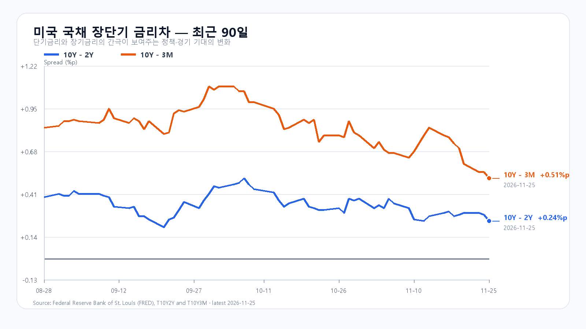
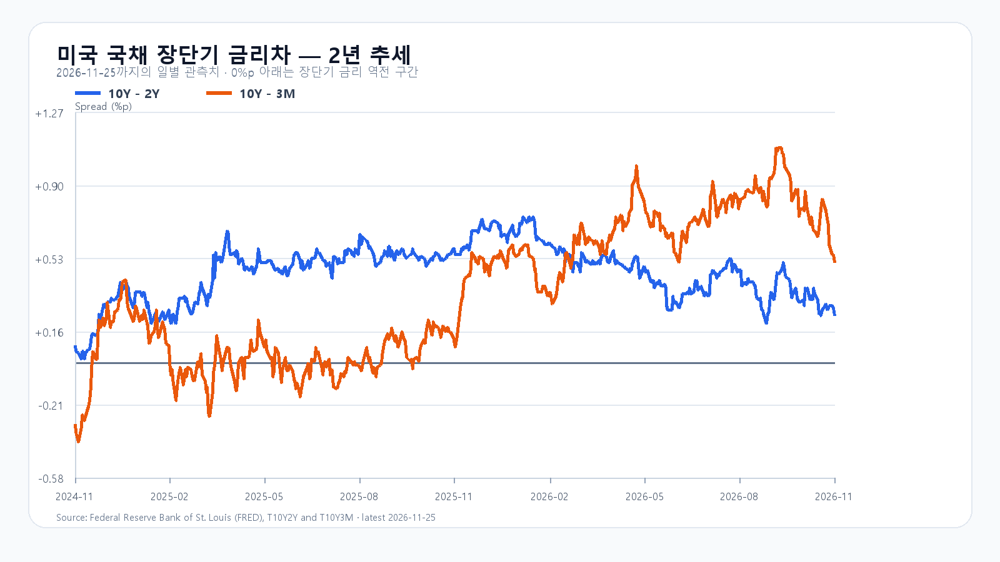
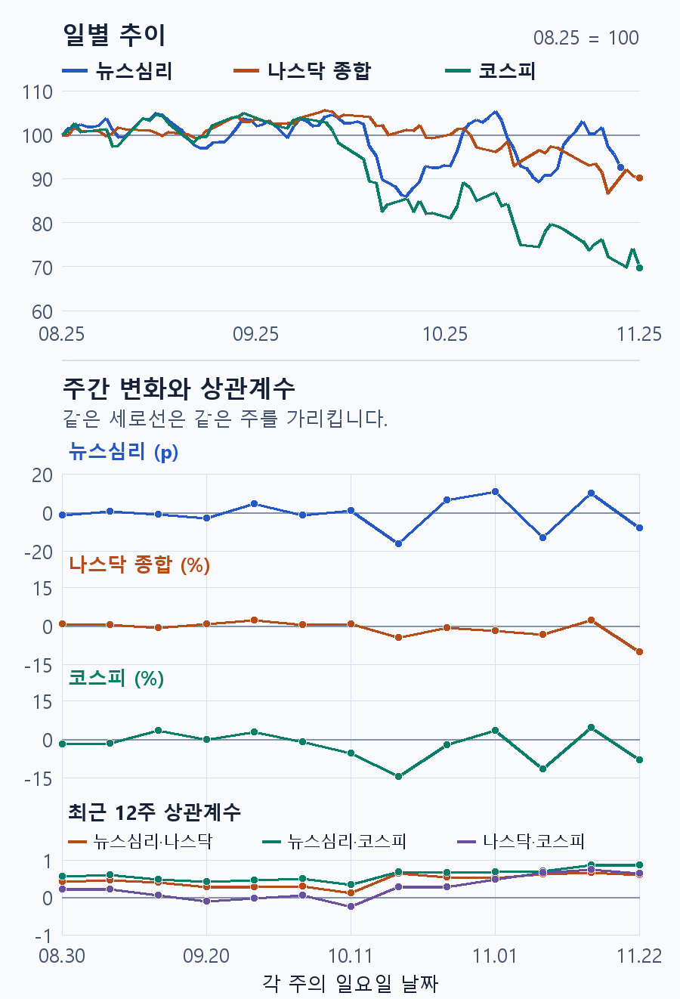

# 2026-11-26 KOSPI·KODEX 레버리지 리서치

작성 2026-11-26T08:11:45.390187+09:00 · 최종 데이터 2026-11-26T08:11:45.265809+09:00 · 한국 장전.

## 핵심 결론

코스피의 전일 저가 4,672.55와 금통위 발표 뒤 원화가 오늘의 첫 기준이다. 미국 반도체주는 저점에서 낙폭을 줄였다. 외국인 현물과 비차익 프로그램 매도까지 줄면 전날 급락 뒤 반등이 이어질 수 있다. 기본 종가 4,600~4,810, 대응은 공격 20·관망 55·방어 25.

## 밤사이 시장을 움직인 이슈

1. SOXX는 장중 −8.12%에서 −0.50%까지 낙폭을 줄였다. 마이크론 −4.53%, 엔비디아 −3.91%. 나스닥종합 −0.62%, S&P 500 −0.25%, 다우 +0.33%. 11/24 미국 반도체 급락은 11/25 서울 하락에 이미 반영 가능한 재료였다. [AP 마감](https://apnews.com/article/94fdb0ecb060ec65c0b02879ce0d2d09) · [SOXX 일봉](https://finance.yahoo.com/quote/SOXX/history/)
2. 미국 무역대표부가 기존 관세를 고려해 한국산 제품 최대 15%를 제안했다. 8542.32.00 메모리 집적회로는 예외 품목이다. 서울 마감 전 나온 조사 관련 보도와 이후 공개된 구체적인 안을 구분한다. [USTR](https://www.ustr.gov/about/policy-offices/press-office/press-releases/2026/november/ustr-makes-determinations-and-proposes-actions-14-section-301-investigations-relating-structural) · [한국 품목 별표](https://ustr.gov/sites/default/files/files/Press/Releases/2026/Korea%20FRN.pdf)
3. 오늘 한국은행 통화정책방향 결정회의가 열린다. 직전 3.00%. 11/25 22:30 KST 공개된 미국 10월 PCE 전년 +3.8%, 근원 +3.3%, 두 지표 모두 전월 +0.3%. 미국 3분기 GDP 잠정 연율 +4.3%(속보 +3.4%). [금통위](https://www.bok.or.kr/portal/singl/crncyPolicyDrcMtg/listYear.do?menuNo=200755&mtgSe=A&syear=2026) · [직전 결정](https://www.bok.or.kr/portal/bbs/P0000559/view.do?nttId=11065823&menuNo=200690) · [PCE](https://www.bea.gov/sites/default/files/2026-11/pi1026.pdf) · [GDP](https://www.bea.gov/sites/default/files/2026-11/gdp3q26-2nd.pdf)

## 한국 시장과 수급

|항목|값|원천 기준 시각|
|---|---:|---|
|KOSPI 전일 종가|4,697.51|2026-11-25T15:30:00+09:00|
|KODEX 전일 종가|45,430원|2026-11-25T15:30:00+09:00|
|USD/KRW 하나은행 고시|1,345.50원|2026-11-26T07:44:36+09:00|
|NQF 최근 거래|26,017.25|2026-11-26T08:01:42+09:00|
|ESF 최근 거래|7,187.50|2026-11-26T08:01:44+09:00|
|BZF 최근 거래|90.82|2026-11-26T06:59:56+09:00|
|CLF 최근 거래|84.07|2026-11-26T08:01:25+09:00|

25일 코스피 시가 4,809.00·고가 4,823.36·저가 4,672.55·종가 4,697.51(−6.16%), 코스닥 650.64(−2.29%). 삼성전자 170,700원(−9.87%), SK하이닉스 1,030,000원(−11.05%, 정규장). KODEX 레버리지 48,350 / 48,665 / 44,895 / 45,430원(−14.18%), 거래량 26,484,638주. [코스피 일봉](https://m.stock.naver.com/api/index/KOSPI/price?pageSize=50&page=1) · [연합뉴스](https://www.yna.co.kr/view/AKR20261125133251008) · [KODEX 일봉](https://m.stock.naver.com/api/stock/122630/price?pageSize=10&page=1)

삼성증권 15:40 KRX 집계에서 외국인 현물 −19,085억원, 개인 +14,223억원, 기관 0억원, 코스피200 선물 외국인 −487억원. 장마감 직후 보도에서 비차익 약 −1.15조원, 프로그램 합계 약 −1.00조원. 장 초반 매도 사이드카가 발동했고 전기전자주가 하락을 이끌었다. 서울 외환시장 15:30 원/달러 1,343.2원(+0.8원). 위 표의 하나은행 고시와는 시각·성격이 다르다. [삼성증권](https://www.samsungpop.com/common.do?cmd=down&contentType=application%2Fpdf&fileName=4020%2F2026112515475228K_02_01.pdf&inlineYn=Y&saveKey=research.pdf) · [연합뉴스](https://www.yna.co.kr/view/AKR20261125133251008) · [프로그램 잠정 집계](https://worldmoneyroadmap.com/ko/reports/2026-11-25-evening/)

## 미국 AI·반도체와 메모리

| 11/25 미국 정규장 | 시가 | 고가 | 저가 | 종가 | 등락률 | 시간외 |
|---|---:|---:|---:|---:|---:|---:|
| QQQ | 617.10 | 634.89 | 607.76 | 633.93 | −0.65% | −0.38% |
| TQQQ | 41.61 | 45.48 | 39.59 | 45.28 | −1.97% | −1.10% |
| SOXX | 121.21 | 128.09 | 118.18 | 127.98 | −0.50% | −0.26% |
| SMH | 402.83 | 422.94 | 393.88 | 422.46 | −1.01% | −0.29% |
| 엔비디아 | 144.02 | 150.37 | 141.17 | 149.30 | −3.91% | −0.11% |
| AMD | 382.85 | 407.77 | 370.40 | 406.03 | −1.75% | −0.25% |
| 마이크론 | 574.92 | 604.95 | 548.13 | 601.25 | −4.53% | −0.06% |
| 브로드컴 | 286.62 | 301.27 | 278.00 | 300.86 | −0.07% | −0.62% |

정규장 종가는 한국시간 06:00. 시간외는 08:06:17~08:06:56 KST, 당일 종가 대비. 브렌트 90.82달러, WTI 84.15달러는 06:59 KST 무렵 선물 호가. [미국 정규장 일봉](https://finance.yahoo.com/quote/SOXX/history/) · [네이버 미국 시간외](https://m.stock.naver.com/worldstock/home/USA) · [브렌트](https://finance.yahoo.com/quote/BZ%3DF/) · [WTI](https://finance.yahoo.com/quote/CL%3DF/)

11/25 19:10 KST DDR5 16Gb 60.767달러(−0.11%), DDR4 16Gb 77.75달러(−0.64%), DDR4 8Gb 43.214달러(−0.25%). 트렌드포스는 11/19 낸드 계약가를 4분기 +8~13%, 내년 1분기 −5~0%로 전망했다. 델의 AI 서버 매출 전망 780억 달러는 서버 수요의 배경이다. 오늘 공급사별 HBM 신규 계약이나 가격은 미확인이다. [DRAM 현물](https://www.trendforce.com/price/dram/dram_spot) · [낸드 전망](https://www.trendforce.com/presscenter/news/20261119-13314.html) · [델 실적](https://investors.delltechnologies.com/sec-filings/all-sec-filings/content/0001571996-26-000050/exhibit991earnings8kq3fy27.htm)

## 시나리오

| 시나리오 | 종가 범위 | 확률 | 15:20 관찰 조건 | 무효화 |
|---|---:|---:|---|---|
| 강세 | 4,810 초과~4,970 | 25% | 4,810 상회와 외국인·프로그램 동반 순매수 | 4,810 이하 또는 한쪽 순매수 종료 |
| 기본 | 4,600~4,810 | 55% | 범위 안에서 외국인 순매도 8,000억원 이내 | 범위 이탈 또는 순매도 8,000억원 초과 |
| 약세 | 4,440~4,600 미만 | 20% | 4,600 하회와 외국인·프로그램 동반 순매도 | 4,600 회복 또는 한쪽 순매도 종료 |

90% 장중 포락 4,400~5,030. 코스피 지지·기준·저항 4,672.55 / 4,697.51 / 4,823.36. KODEX 44,895 / 45,430 / 48,665원. 09:30 두 반도체주의 첫 저점과 외국인 수급, 금통위 발표 직후 원화, 14:00 이후 비차익 프로그램과 상승 종목 수를 확인한다.

전일 종가는 약세 범위였고 15:20 코스피 4,699.10은 약세 가격 조건을 만족했다. 당시 외국인과 프로그램 수급은 미확인이다.

## 일정과 금리차

오늘 한국은행 통화정책방향 결정회의. 뉴욕 주식시장은 11/26 현지 추수감사절 휴장. 11/27 13:00 ET(한국 11/28 03:00) 조기 종료. [한국은행](https://www.bok.or.kr/portal/singl/crncyPolicyDrcMtg/listYear.do?menuNo=200755&mtgSe=A&syear=2026) · [NYSE](https://www.nyse.com/trade/hours-calendars)

미 재무부의 11/25 3개월 4.34%(−2bp), 2년 4.61%(−2bp), 10년 4.85%(−6bp). 10년−2년 0.24%p, 10년−3개월 0.51%p. 장기물 금리가 더 낮아졌다. [미 재무부](https://home.treasury.gov/resource-center/data-chart-center/interest-rates/TextView?type=daily_treasury_yield_curve&field_tdr_date_value_month=202611) · [FRED 10년−2년](https://fred.stlouisfed.org/series/T10Y2Y) · [FRED 10년−3개월](https://fred.stlouisfed.org/series/T10Y3M)

[취재 노트](../research/notes/2026-11-26.md)

## 국내 뉴스심리와 경기선행지수

- [한국은행 뉴스심리지수](https://snapshot.bok.or.kr/dashboard/C8) 91.07 · 2026-11-22 관측 · 주간 공표 · 7일 전보다 8.02포인트 하락
- [뉴스심리지수 3개월 평균](https://snapshot.bok.or.kr/dashboard/C8) 100.76 · 2026-10까지 3개월 · 일별 지수의 월평균 사용 · 한 달 전 3개월 평균보다 1.51포인트 하락
- [경기선행종합지수 순환변동치](https://kosis.kr/visual/economyBoard/economyJipyo.do?lang=ko&listId=130&unitySrvcId=641) 104.1 · 2026-09 기준 · 전월보다 0.1포인트 하락

